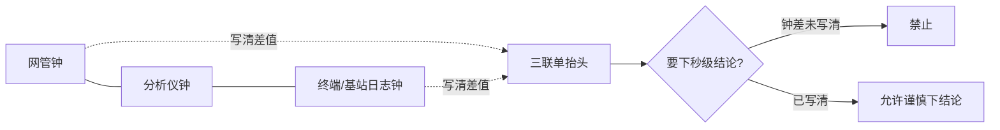

# 手册 15 · 运维制度：电源监控对时与告警风暴治理

> **手册模式 · 岗位深挖（运维 / 网管 / 电源监控治理）第 15 篇**（接第 40 课收官 · 手册 01–14 之后 · **不是第 41 课**）  
> 适合：手册 12 已经给你贴纸 K（市电、后备、倒换、告警、交维），可一到「网管铃狂响三分钟又全绿」「整流假绿其实采集断了」「分析仪时间比网管快 8 分钟导致因果颠倒」「交班把告警全部静音」「市电闪断被拆成二十条独立射频病」你就慌——有人说铃多说明网管灵敏，有人说静音完才好交班，有人要用加功率掩盖倒换窗假干扰——你想学会**先证明监控对象完整、时钟对齐、单条告警语义清楚，再谈风暴治理与结案**的人  
> 阅读量：约 **30–40 分钟** · **不重 dump CACH / EMB / Slot Type 全字段**（第 18–22 课已有）、**不重写手册12 电源全文 / 手册06 三联单全文 / 手册07–09 全文**（只给指针）、**不发明 ETSI 条款号**、**不写真实频点 / 站名 / 个号 / 密钥 / 真实单位名**（全部教学虚构、脱敏到 L3） · **不教告警绕过 / 监控攻击步骤**——只讲制度治理 · 要把「**先证监控与对时；时钟漂移未写清禁下秒级因果；禁静音全部当交班常态；禁加功率掩盖假绿/假干扰；风暴先找根因事件；假绿拒签；倒换窗主贴 N 可挂 K；公开包脱敏 L3**」钉成肌肉记忆  
> **频谱 / 调制提醒（弱项短补）**：一条 DMR 信道占 **12.5 kHz**；**4FSK** 装货；**2-slot TDMA** 把时间切成 **30 ms** 一格、两格一轮 **60 ms**。电源监控与对时 **不改变**这些物理台阶——它只是把「机房心跳与墙上钟」对齐到同一本账。若有人把「告警风暴」当覆盖/干扰/话务病的补丁，或用加功率叙事「铃响时先抬功率压掉话」，先回 `学习推送/加餐_频率带宽与调制解调.md`，再挂本篇贴纸 **N**，并指针手册07/09/12，而不是先开射频工单或静音全屏。

---

## 1. 为什么要写这篇手册（动机 + 现场对话）

前十四篇手册教你认病、交维、写频与空投边界：贴纸 A–E 协议层，F 射频，G 实验室，H 话务，I 室分，J 写频，K 电源物理层，L 井库，M 批量/OTAP。可现场还有一类「病」——**不是今晚空口才坏，而是监控铃把真火淹没，或各楼层钟没对时把因果写反**：

- 夜班：「铃响了半屏，先全部静音，明早再看。」——静音当交班常态；真火被盖住。  
- 新人：「网管全绿，肯定没事。」——采集断了也会假绿；假绿 = 拒签。  
- 射频同事：「凌晨两点 BER 跳，肯定是同频。」——没先对分析仪/网管/终端三钟；时钟漂移把因果颠倒。  
- 班长：「风暴来了，逐条认领成独立射频/话务工单。」——市电闪断被拆成二十条假病。  
- 领导：「铃多说明网管灵敏，别关。」——没有关联与抑制；海量铃掩盖真火。  
- 电源同事：「手册12 交维过了，监控还要管？」——K 管物理倒换；本篇管监控链、对时与风暴治理。  
- 手册06 学过的人：「三联单要对时——风暴时来不及写？」——越风暴越要写清时钟差与根因事件，否则秒级结论作废。  
- 有人：「加功率压一下，铃就少了。」——加功率是手册07/09/12 禁区；本篇也禁。

这几句背后是同一件事：

> **「电源监控 / 对时 / 告警」这个词在现场至少有五个坑**：  
> **① N-监**：监控对象与采集链——电源/整流/电池/油机/环境/网管链路是否完整、是否假绿  
> **② N-时**：对时——NTP/PTP/本机漂移、时区、夏令、分析仪/网管/终端三钟；漂移会把因果颠倒  
> **③ N-告**：单条告警语义与级别——欠压、整流故障、电池低、油机未起、链路中断、温度…  
> **④ N-风**：告警风暴 / 抖动 / 闪断风暴 / 静音过度 / 关联缺失——海量铃掩盖真火  
> **⑤ N-治**：治理——关联规则、抑制/静音窗口、升级路径、结案、脱敏公开包  
> 把 ①–⑤ 当成「网管厂商自动搞定」或「出了事用手册07/09 先开射频/话务单」，会把时钟债与监控债留给下一班。

本篇目标：能背出**电源监控对时与告警风暴治理工作流**；会用新贴纸 **N（监控/对时/风暴）** 与五个子类；会填 **插页 N（R1–R8）** 和《本网电源监控对时与告警风暴治理卡》；能用「**消防中控室火警面板 + 各楼层钟没对时**」故事讲清假绿与因果颠倒；能拒绝「全静音交班、假绿放行、漂移下秒级结论、风暴逐条拆成射频病、加功率压铃」；自测过关后，回库把本网最近一次监控风暴事件（脱敏到 L3）按本篇重对一遍。

**本篇硬禁令（写进脑子）**：不发明 ETSI 条款号；**不写真实批复频点、真实站号、真实个号、真实密钥、真实单位名进公开仓库**；**不教告警绕过、监控链路攻击、静音后门**——只讲制度治理；不重写手册12 / 06 / 07–09 全文（只给指针）；**手册12 的 K 规则物理倒换仍生效，本篇加深监控侧**；**不把加功率/加信道当假绿或风暴的止痛药**；监控/对时/风暴问题**主贴 N**，倒换窗可挂 K，假 F/H 可次挂，禁止把「铃多」写成「用户捣蛋」；结案词用贴纸 N + 本网证据；公开 ISA-18.2 / EEMUA 191 精神、NTP BCP、电信直流监控资料只借**精神与顺序**——**不背条款号当 ETSI**。

---

## 2. 总图 / 故事：监控像「消防中控室火警面板 + 各楼层钟没对时」

### 2.1 一句话：必须先证明探头在线、钟对齐、单铃语义清楚，再谈抑制风暴——否则假绿放行、真火被淹没、因果写反

```text
   ┌──────────────────────────────────────────────────────────────┐
   │  消防中控室（本网网管 / NOC 告警墙）                            │
   │                                                              │
   │   各楼层探头 = 市电/整流/电池/油机/环境/链路传感器（N-监）       │
   │   各楼层挂钟 = 基站钟、分析仪钟、网管钟、终端日志钟（N-时）       │
   │   单条火警灯 = 一条可行动告警：欠压/整流故障/电池低…（N-告）     │
   │   火警风暴   = 一分钟刷屏铃；闪断抖动；关联缺失（N-风）         │
   │   治理台账   = 关联规则、抑制窗、升级路径、结案、脱敏（N-治）     │
   │                                                              │
   │   ┌─────────┐   ┌─────────┐   ┌─────────┐   ┌─────────┐     │
   │   │ 探头在线 │──▶│ 三钟对齐 │──▶│ 单铃语义 │──▶│ 风暴分诊 │     │
   │   │ (N-监)  │   │ (N-时)  │   │ (N-告)  │   │ (N-风)  │     │
   │   └────┬────┘   └────┬────┘   └────▲────┘   └────┬────┘     │
   │        │             │             │              │           │
   │        │采集断假绿    │漂移颠倒因果  │级别乱/无动作 │全静音/逐条拆│
   │        ▼             ▼             │              ▼           │
   │   ┌─────────┐   ┌─────────┐       │         ┌─────────┐     │
   │   │ 拒签放行│   │ 禁秒级  │───────┘         │ 真火淹没│     │
   │   │ (N-监)  │   │ 结论    │                 │ (N-风)  │     │
   │   └─────────┘   └─────────┘                 └────┬────┘     │
   │        ▲                                          │           │
   │   关联找到根因事件 → 抑制抖动窗 → 升级路径 → 结案（N-治）◀─┘   │
   │   禁：静音全部当交班；加功率压铃；风暴拆成独立射频病            │
   └──────────────────────────────────────────────────────────────┘
```

口诀：

> **先探头，再对钟，后认铃，末治风暴。**  
> 探头断了却全绿 = 中控室假装没事——**假绿拒签。**  
> 各楼层钟差八分钟还写「谁先谁后」= 把纵火写成灭火。

### 2.2 「中控室」五段直觉（弱项短补，钉死）

| 段 | 像什么 | 运维直觉 | 本篇贴纸 |
|----|--------|----------|----------|
| **监控对象** | 各楼层烟感/温感探头 | 市电、整流、电池、油机、环境、网管链路是否在采；假绿=探头掉线仍显示正常 | N-监 |
| **对时** | 各楼层挂钟与中控母钟 | NTP/PTP、时区、漂移；分析仪/网管/终端三钟差必须写进三联单 | N-时 |
| **单条告警** | 一盏可行动火警灯 | 语义、级别、建议动作；「铃响但无人该做什么」= 坏铃 | N-告 |
| **风暴** | 整面墙同时闪 | 闪断抖动、链路抖、NTP 跳变引发刷屏；海量铃掩盖真火 | N-风 |
| **治理** | 中控规程：关联、抑制、升级、结案 | 根因事件优先；禁止全静音交班；公开包脱敏 L3 | N-治 |

> 公开 NTP 最佳实践（多源、监控偏移/抖动）、告警管理精神（可行动才叫告警、风暴要关联与合理化）、电信直流电源监控资料（整流/电池/市电最小采集集）——本篇只借**顺序直觉**：探头完整 → 钟对齐 → 单铃语义 → 根因关联 → 抑制窗 → 升级结案。**不背厂商菜单步骤 / 不背标准条款号当 ETSI / 不教绕过告警。**

### 2.3 和手册12 / 06 / 07 / 09 的咬合（指针，不重写）

- **手册12 贴纸 K**：市电/后备/倒换/告警/交维的**物理层**——**本篇是 K-告 与监控侧的加深册**。倒换演练窗可挂 K，但**监控风暴与对时主贴 N**。  
- **手册06**：三联单五要素与对时——时钟漂移未写清 → **禁下秒级因果结论**（本篇规则硬钉）。  
- **手册07 贴纸 F**：覆盖/干扰；倒换窗或欠压窗 BER 跳 → 先问 N/K，**禁加功率叙事**。  
- **手册09 贴纸 H**：话务；多站间歇掉电被当成容量病 → 先 N/K，禁加信道掩盖。  
- **手册08 贴纸 G**：实验室闭环；台架验证「假绿」时可用 G 气质，不重写六闭环。  
- **手册10 / 13**：室分/井库；远端有源掉电引发铃风暴 → 主贴常仍是 N（监控链）或 K（物理），次挂 I/L。  
- **手册11 / 14**：写频/OTAP；管理台掉电或时钟乱导致完成账错位 → 可挂 N-时，回 J/M 结案。  
- **手册01–05**：风暴后登记/Grant 异常——可次挂，**先冻结射频玄学，先证监控与对时**。

### 2.4 新贴纸 N：监控 / 对时 / 告警风暴（五个子类）

```text
                    ┌──────── 贴纸 N · 监控/对时/风暴 ────────┐
                    │  N-监  监控对象与采集链：电源·整流·电池·油机·环境·链路；假绿拒签 │
                    │  N-时  对时：NTP/PTP·漂移·时区·分析仪/网管/终端三钟              │
                    │  N-告  单条告警语义与级别：欠压·整流故障·电池低·油机·链路·温度   │
                    │  N-风  风暴/抖动/闪断/静音过度/关联缺失：海量铃掩盖真火           │
                    │  N-治  治理：关联规则·抑制窗·升级路径·结案·脱敏 L3               │
                    └──────────────────────────────────────────────────────────────┘
```

| 子类 | 一句话 | 典型拒签 / 拒静音触发 |
|------|--------|----------------------|
| **N-监** | 采集链完整且非假绿才谈放行 | 探头离线仍显示正常；关键对象未进网管 |
| **N-时** | 三钟差写清才允许秒级因果 | 漂移未记录仍写「谁先谁后」 |
| **N-告** | 每条铃要有语义、级别、建议动作 | 「未知告警」刷屏无人认领 |
| **N-风** | 风暴先找根因事件，禁逐条拆射频病 | 市电闪断被拆成二十条 F/H 工单 |
| **N-治** | 关联+抑制窗+升级+结案；禁全静音交班 | 交班把告警墙一键静音当常态 |

### 2.5 监控 / 对时 / 风暴最小工作流（背下来）

```text
1. N-监：列出本站最小监控对象 → 抽查采集是否在线 → 假绿？→ 拒签
2. N-时：读网管钟 / 分析仪钟 / 终端或基站日志钟 → 写清差值与时区
3. N-告：挑最高级别未结案铃 → 语义/级别/建议动作是否清楚
4. N-风：是否风暴？（短时海量 / 抖动重复 / 静音过度）→ 先找根因事件
5. N-治：关联抑制 → 升级路径 → 三联单结案（脱敏 L3）→ 可挂 K/F/H 但主贴 N
```

---

## 3. 核心交付：插页 N + 拒签/拒静音卡 + 与总三联单怎么写

### 3.1 什么时候贴 N（而不是先贴 K / F / H）

| 现象 | 优先贴纸 | 说明 |
|------|----------|------|
| 交维要证市电→后备→回切物理动作 | **K**（手册12） | 本篇不替代倒换验收 |
| 网管铃风暴、假绿、时钟乱、静音过度 | **N** | 本篇主场 |
| 倒换窗 BER 跳、欠压远端掉 | **N 主，可挂 K/F** | 先监控/电源，后射频 |
| 多站间歇「忙」其实掉电 | **N 主，可挂 H** | 禁加信道 |
| 写频完成账时间对不上 | **N-时 可挂，主常仍 J/M** | 指针手册11/14 |

口诀：**物理倒换看 K；监控铃与钟看 N；射频/话务是次挂，不是先开枪。**

**和贴纸 F / H 的「咬一口」提醒（不重写 07/09）**：

- 倒换窗或欠压窗出现「同步差 / BER 跳 / 数字悬崖」——先问是否 N/K 事件窗，再考虑 F。  
- 多站同期「信道忙 / 排队长」——先问是否电源相关铃族，再考虑 H。  
- 两本账（控制∥业务）若时间戳互相打架，先 N-时，再谈话务分诊。

### 3.2 插页 N · 监控 / 对时 / 风暴（挂在总三联单或网管交班首页后）

| 行 | 检查项 | 过/否 | 证据位 |
|----|--------|-------|--------|
| **R1** | 最小监控对象清单存在（市电/整流/电池/油机/环境/链路） |  | 清单编号·脱敏站类 |
| **R2** | 采集链抽查：关键点非假绿（断采能报红或离线） |  | 截图·探测时间 |
| **R3** | 三钟差值已记录（网管 / 分析仪 / 终端或基站日志） |  | 差值·时区·来源 |
| **R4** | NTP/PTP 或本机对时状态可读（偏移/是否同步） |  | 状态摘要·非密钥 |
| **R5** | 最高级别未结案告警有语义+级别+建议动作 |  | 告警名·动作栏 |
| **R6** | 若风暴：已标根因事件（市电闪断/链路抖/NTP跳变/…） |  | 根因一句话 |
| **R7** | 抑制/静音仅限声明窗口；非「全静音交班」 |  | 窗起止·审批 |
| **R8** | 结案：升级路径走完或书面挂起；公开包脱敏 L3 |  | 结案号·脱敏勾 |

> R1–R2 不过 → **拒签 / 拒放行**。R3–R4 不过 → **禁下秒级因果**。R7 若「全静音」→ **拒静音卡**。

### 3.3 「假绿拒签 / 禁全静音交班」卡（贴网管 / NOC）

```text
┌────────────────────────────────────────────┐
│  假绿拒签 / 禁全静音交班卡（贴纸 N）          │
│                                            │
│  □ 采集链未证非假绿 → 禁止签字放行          │
│  □ 三钟差未写清 → 禁止写秒级谁先谁后        │
│  □ 「一键静音全部」不得作为交班常态          │
│  □ 风暴未标根因事件 → 禁止逐条拆射频/话务单 │
│  □ 禁加功率 / 加信道掩盖假绿或倒换窗假干扰  │
│                                            │
│  例外静音必须：起止时间 · 原因 · 审批人 ·   │
│  到期自动恢复提醒                            │
└────────────────────────────────────────────┘
```

### 3.4 和总三联单怎么写（接手册06）

| 三联单栏 | 本篇要多写的 |
|----------|-------------|
| 时间 | **三钟差**、时区、是否夏令；写「网管快 +Xm / 分析仪慢 −Ys」 |
| 现象 | 铃密度（约 X 条/10 分钟）、是否抖动重复、是否假绿 |
| 证据 | 根因事件、采集在线证明、对时状态摘要（无密钥/无真实站名） |
| 处置 | 关联/抑制窗/升级；**未**全静音 |
| 结案 | 主贴 N-?；可挂 K/F/H；脱敏 L3 |

### 3.5 《本网电源监控对时与告警风暴治理卡》预告

第七章给可复印模板：封面拒签门槛、主表对齐插页 R1–R8、根因事件页、抑制窗与升级页、夜班速填五行。

---

## 4. 深潜：八条硬规则 + 对时/风暴直觉 + 假病禁令

### 4.1 八条硬规则（本篇钉子）

1. **先证监控与对时，再写空口/干扰玄学**——探头与钟没过关，射频单先冻结。  
2. **时钟漂移未写清 → 禁下秒级因果结论**——呼应手册06；差几分钟就把灭火写成纵火。  
3. **禁「静音全部告警」当交班常态**——例外必须有窗、原因、审批、到期恢复。  
4. **禁「加功率/加信道」掩盖电源监控假绿或倒换窗假干扰**——呼应手册07/09/12。  
5. **风暴时先找根因事件（市电闪断/链路抖/NTP跳变），禁逐条认领成独立射频病**——一因多铃是常态。  
6. **监控假绿（采集断了显示正常）= 拒签 / 拒放行**——中控室假装没事比铃响更危险。  
7. **倒换/油机演练窗可挂 K，但监控侧风暴与对时主贴 N**——物理与监控分工，不互相顶替。  
8. **公开材料脱敏 L3；不写真实站名/频点/个号/密钥**——教学与公开仓双禁。

### 4.2 对时 / 风暴直觉（不背厂商菜单）

```text
  铃墙亮了 / 有人要下秒级结论
        │
        ▼
  采集链非假绿？──否──▶ 拒签（N-监 / 规则6）
        │是
        ▼
  三钟差已写清？──否──▶ 禁秒级因果（N-时 / 规则2）
        │是
        ▼
  单铃语义/级别/动作清楚？──否──▶ 先 N-告 合理化，不盲目升级射频
        │是
        ▼
  是否短时海量/抖动重复？──是──▶ 标根因事件（N-风）→ 关联抑制（N-治）
        │否（单条可行动）
        ▼
  升级路径 / 倒换窗？──物理倒换──▶ 可挂 K；监控主贴仍可能是 N
        │
        ▼
  结案 + 脱敏 L3；禁全静音交班；禁加功率压铃
```

现场口诀：

> **先假绿，再漂移，后根因，末结案。**  
> 跳过根因的逐条认领 = 把一场市电闪断写成二十个同频事故。

**最小监控对象清单（教学默认，按本网裁剪）**：

| 对象 | 为什么必须进墙 | 假绿典型样子 |
|------|----------------|--------------|
| 市电状态 | 闪断是风暴第一大根因 | 市电断了墙仍「市电正常」 |
| 整流模块/系统 | 模块挂了靠电池偷时间 | 模块离线仍显示输出正常 |
| 电池组电压/低电压告警 | 后备是否真有油 | 电压采死、告警永不亮 |
| 油机/ATS 状态 | 演练与真启动要可区分 | 油机未起却无铃 |
| 机房环境（温湿度等） | 高温先杀电源后杀射频 | 温感掉线墙仍舒适 |
| 网管/采集链路本身 | 链路断=整面假绿风险 | 链路断了业务墙仍绿 |

> 清单不是为了「铃越多越好」，而是为了**断采可被看见**。看不见的探头 = 中控室的盲区。

### 4.3 三钟差：多少算「必须写」

| 场景 | 教学阈值直觉（非厂商指标） | 动作 |
|------|---------------------------|------|
| 排障写「谁先谁后」 | 差 **≥ 数秒** 且结论依赖顺序 | 必须写清差值；差大则只写「先后不明」 |
| 日常交班 | 差 **≥ 约 1 分钟** | 记入交班；安排对时 |
| 风暴关联 | 差 **≥ 约数分钟** | **禁止**用未校正时间线做根因排序 |
| 批量/OTAP 完成账（指针 M） | 管理台钟 vs 终端日志钟差大 | 完成窗时间线作废重对；可挂 N-时 |
| 实验室对照（指针 G） | 台架钟 vs 网管钟未对齐 | 证据包时间戳无效；先对时 |
| NTP 明显未同步 | 状态显示未锁定/偏移异常 | 主贴 N-时；先修钟再写因果 |



> 本篇**不规定**你网必须用 NTP 还是 PTP，只要求：**凡写秒级因果，必须先暴露时钟差。**  
> 夏令时/时区只写「显示层」也算坑：同一瞬间 UTC 一致，面板却差一小时——三联单要写**时区标签**，不要只抄面板数字。

### 4.4 「假绿 / 假干扰 / 假容量 / 假协议」怎么认

| 假病外表 | 常见监控真因 | 错误处置 | 正确主贴 |
|----------|--------------|----------|----------|
| 假绿 | 采集断、代理僵死、链路断仍显示正常 | 签字放行 | N-监 拒签 |
| 假干扰 | 倒换窗/欠压窗 BER 跳 | 开同频工单、加功率 | N/K（次挂 F） |
| 假容量 | 多站间歇掉电像「忙」 | 加信道 | N/K（次挂 H） |
| 假协议 | 时钟乱导致日志「登记失败在前」 | 改鉴权参数 | N-时（次挂 A） |
| 假灵敏 | 铃多=网管好 | 拒绝合理化 | N-风/N-治 |
| 假消缺 | 全静音后墙面干净 | 交班走人 | N-治 拒静音 |

**三问快判（背）**：

1. **假绿？** 断采能不能报红/离线？（R2）  
2. **钟差？** 三钟差值写了没有？（R3）  
3. **根因？** 风暴有没有一句话根因事件？（R6）  

三问里有「否」，就**先写 N**；三问全「是」且仍有持续空口病，再进手册01–05/07/09。切记：风暴夜优先关联与对时，不是先开同频或加信道。

### 4.5 假病禁令墙（与加功率叙事）

1. 禁止用「全静音」代替消缺与结案。  
2. 禁止用加功率压掉倒换窗/欠压窗的「假干扰」观感。  
3. 禁止用加信道掩盖多站掉电造成的「假忙」。  
4. 禁止在时钟差未写清时做秒级根因排序。  
5. 禁止把监控假绿说成「网管显示正常就是正常」。

### 4.6 和弱项加餐的衔接

12.5 kHz / 4FSK / 30 ms 两槽背熟，你才说得清：**监控与对时管的是机房心跳与证据钟，不是调制台阶**。有人要用加功率/加信道治铃或多站掉话时，回加餐 + 手册07/09/12 + 本篇八条硬规则。

---
