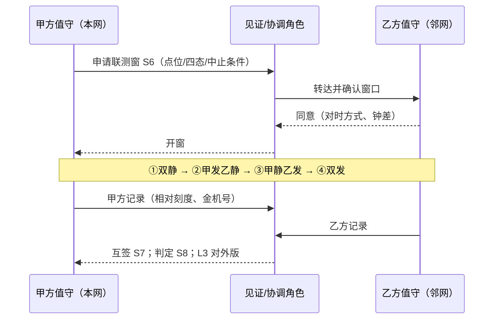

## 4. 深潜：八条硬规则 + 隔墙算术（弱项补）+ 联测四态

### 4.1 八条硬规则（本篇钉子）

1. **先证邻居台账与频率关系，再谈「邻网干扰我」与加站加功率**——说不清隔壁是谁、在哪一道，射频单先冻结。  
2. **禁用加功率 / 抬增益 / 私自挪频借频去压过邻网**——功率战双输；功率、频率、台址、天线都是许可事项，变更要走变更手续（《无线电管理条例》第三十八条：变更许可事项应办理变更手续）。  
3. **无书面协调记录（邻居台账 + 边界条件 + 变更通知机制）→ 禁签开通 / 扩容 / 改参**——电话里说好的不算协调。  
4. **边界联测须双方同窗、对时、见证、四态对照、证据互签；单方自测 → 禁签边界验收**——墙那边听到什么，只有一起听才算数。  
5. **共址 / 近址 / 第一邻道 / 混栅格新增信道，未核算 ACP、ACS、阻塞、互调候选 → 禁签**——「邻频又不是同频」是本篇头号错觉。  
6. **本网口部走 P、现场诊断走 F、自家隔离走 O；跨网 / 跨单位 / 跨制式 / 跨行政区的协调与联测主贴 S**——可叠挂，不可偷换。  
7. **任一方边界侧变更（功率、天线高度 / 方向 / 下倾、台址、信道、制式或信道间隔迁移）→ 先通知、后复测；未复测禁宣称「边界无影响」**。  
8. **争议不私了、不报复：协调不成按规定报无线电管理机构；公开材料脱敏 L3（禁真实频点 / 站名 / 单位名 / 联系人 / 坐标）**。

> 法规锚点（已核原文，教学转述）：《无线电管理条例》**第六条**不得造成有害干扰；**第三十九条**定期维护、避免干扰；**第五十二条**边境遵守协调协议；**第六十五条**受扰可投诉，处理遵循「频带外让频带内、次要业务让主要业务、后用让先用、无规划让有规划」；**第六十六条**管理机构可要求维修、校准或降功率。**国无办〔2025〕1号 第八条**：省级规划须考虑同邻频兼容、地理隔离，与相邻省协调；**第十五条**：边境按协议协调。**这些是主管部门的处理规则，不是你方单方「判对方让频」的依据。**

### 4.2 弱项补 ①：车道、裙边与「dBc」（频率与带宽）

把 12.5 kHz 信道想成一条车道。国无办〔2025〕1号附件1 对专用对讲机写得很具体（已核原文）：**12.5 kHz 信道间隔时占用带宽不大于 8.5 kHz**，数字体制采用 **4FSK** 等调制。也就是说，车（信号主体）只占车道中间约三分之二，两边留了「路肩」。

```text
   功率
    ▲           本道 F0（12.5 kHz 车道）
    │          ┌──────────────┐
    │         ╱│  信号主体    │╲            ← 主体 ≤ 8.5 kHz 宽
    │        ╱ │  （4FSK）    │ ╲
    │  裙边 ╱  │              │  ╲ 裙边     ← 裙边溢进隔壁 = 邻道功率
    │ ─────────┼──────────────┼─────────
    │ 第一邻道 │              │ 第一邻道
    │ F0−1道   │              │ F0+1道
    └──────────┴──────────────┴──────────▶ 频率
```

**dBc 是什么？**「比载波低多少 dB」。附件1 表 1-2（12.5 kHz 间隔）：**第一邻道（偏移 12.5 kHz）调制邻道功率 −60 dBc、瞬态切换邻道功率 −50 dBc；第二邻道（偏移 25 kHz）−70 dBc / −60 dBc**。ETSI EN 300 113 V3.1.1 §7.4.3 对 12.5 / 20 / 25 kHz 间隔的邻道与隔道功率也写为**比发射功率低 60.0 dB**（无需低于 −37 dBm）。

把 dB 翻成大白话（弱项钉子）：

| dB | 功率比 | 生活比喻 |
|----|--------|----------|
| −3 dB | 一半 | 音量拧小一半 |
| −10 dB | 十分之一 | 隔一道门 |
| −30 dB | 千分之一 | 隔一堵砖墙 |
| −60 dB | 百万分之一 | 隔一堵厚墙——但你若贴着墙放大音箱，隔壁仍听得见 |

**教学粗算（虚构数字）**：一台基站端口 30 W ≈ +44.8 dBm（国无办附件1 基站 / 转发台端口功率上限即 30 W）。−60 dBc 意味着第一邻道里还剩约 **−15 dBm**。−15 dBm 听起来很小，但对方接收机的灵敏度在 **−110 dBm 量级**——差了 95 dB。所以**邻道功率是否成问题，全看「两家隔多远、天线隔离多少」**。这就是为什么「共址 + 第一邻道」是本篇最高风险组合。

**还有一个时间维度**：表 1-2 的**瞬态切换邻道功率（−50 dBc）比调制邻道功率（−60 dBc）宽松 10 dB**——发射机「开口 / 收口」那一瞬裙边更宽。DMR 是 TDMA 突发发射（30 ms 一格），**联测要在真实话务 / 突发状态下看，不能只开一个连续载波就下结论**。

### 4.3 弱项补 ②：接收侧——耳朵能不能只听自己这一道（ACS / 阻塞 / 互调）

发射端「漏多少」只是一半；接收端「挡多少」是另一半。ETSI EN 300 113 V3.1.1 把接收机这几项分得很清楚（已核目录与原文）：

| 指标（EN 300 113 V3.1.1） | 一句话 | 原文要点（教学转述，以原文为准） |
|---------------------------|--------|----------------------------------|
| **§8.5 同频抑制** | 同一道上来了别人，能扛多少 | 12.5 kHz、按速率分档给限值 |
| **§8.6 邻道选择性 ACS** | 隔壁一道很强时，还能不能解对本道 | 表 12：12.5 kHz 正常条件下无用信号可到 **−47 dBm** 而不超过规定劣化（极端条件 −51 dBm）；旧版 EN 300 113-1 V1.5.1 以「不小于 60 dB」表述 |
| **§8.7 杂散响应抑制** | 其他某些频率「钻空子」进来 | 搜索法 + 限值 |
| **§8.8 互调响应抑制** | 两个强信号在接收机里混出本道 | 无用信号可到基站 **−37 dBm** / 移动与手持 **−42 dBm** |
| **§8.9 阻塞或减敏** | 远一点的超强信号把前端顶饱 | 阻塞电平不小于 **−23 dBm**（杂散响应频点除外） |

**发 + 收合起来看（工程常用近似）**：邻道干扰的总「隔离能力」由发射邻道泄漏比和接收邻道选择性共同决定，**谁差谁说了算**；两者一样好时，合起来还要再差约 3 dB（常用近似：1/总 = 1/发射泄漏比 + 1/接收选择性，线性值相加）。所以「我的发射机达标」不能证明「对方不受扰」，反之亦然——**这就是为什么必须双方联测**。

### 4.4 隔墙算术：ITU-R SM.337 的「频率-距离」思路（S-邻 / S-界）

ITU-R SM.337-6《频率与距离间隔》（已核原文）给出的思路非常朴素：

```text
   到达受扰接收机的干扰电平：
     Pi = Pt + Gr − Lp(d) − OCR(Δf)
       Pt   干扰发射机等效辐射功率（e.i.r.p.）
       Gr   受扰接收天线增益
       Lp   路径损耗（随距离 d 增大）
       OCR  频率偏移 Δf 下的「偏道抑制」（发射裙边 + 接收选择性的合效果）

   可容忍的条件：  Pd − Pi ≥ 保护比
       Pd   受扰接收机收到的有用信号电平
```

**直觉**：要让干扰「够小」，只有四个旋钮——**降低对方发射（Pt）、拉开距离（Lp）、拉开频率（OCR）、提高有用信号（Pd）**。SM.337 的目录里还专门有「陆地移动系统应用：基站对基站干扰」和「一条互调的频率-距离规则」，说明这是陆地移动的老问题。

**教学虚构例（共址 + 第一邻道）**：对方中继等效 +50 dBm；两副天线之间隔离（含路径与天线增益）只有 60 dB；第一邻道 OCR 取 60 dB → Pi ≈ 50 − 60 − 60 = **−70 dBm**。本网边界手台上行到达本站约 **−100 dBm**。Pd − Pi = −30 dB——**远低于任何保护比**，本站上行会被「隔壁车道」压住。四个旋钮怎么拧？**加隔离（天线垂直间距、滤波 / 空腔，走站务规程）、拉开频率（改到第二邻道以外，须主管部门批准）、或者双方协商**——唯独**不是**把本网手台功率开大（规则2）：Pd 抬几 dB，换来的是边界外溢和互调一起变大。

> **注意**：上面只用来练直觉，**不是**本网协议值；真实核算用本网批复参数、设备检测报告和主管部门认可的方法。

### 4.5 互调候选：相对偏移就能算（S-邻）

三阶互调最常见的产物在 **2f1 − f2** 和 **2f2 − f1**（手册07 §4.5 已讲指纹与 3:1 衰减器测试）。协调时**不需要写真实频点**，用「道号偏移」就能先筛：

```text
  设本道 F0，道宽 12.5 kHz，用整数 a、b 表示两部发射机相对 F0 的道号偏移
     发射机 1：F0 + a 道      发射机 2：F0 + b 道
     三阶产物：F0 + (2a − b) 道   与   F0 + (2b − a) 道

  例（教学虚构）：共址两家发射在 +3 道、+5 道
     产物 = +1 道、+7 道
     若本网某接收频点恰在 +1 道 → 互调候选命中 → S-邻 拒签，先改方案
```

两个提醒：

- **要算到接收频点上**：异频中继的接收频点 = 发射频点 ∓ 收发间隔。国无办〔2025〕1号附件1 写明专用对讲机异频单工收发间隔：**150 MHz 频段 5.7 MHz、400 MHz 频段 10 MHz**。共址多家时，把所有发射频点两两组合，再对照所有**接收**频点。  
- **无源互调**（生锈接头、松动金属结构）不在任何一家的设备检测报告里——共址联测时要专门安排「双发」态观察（§4.8）。

### 4.6 远近效应：为什么邻频有时比同频更凶（S-界）

```text
   本网站 A ●───────────────────────────── ✦ 本网手台（边界区）
                       远：有用信号弱 −105 dBm（教学虚构）
                                           ✦ ── 200 m ── ● 邻网站 B（第一邻道）
                                                 近：邻道信号强 −40 dBm（教学虚构）
   接收选择性 60 dB → 漏进本道约 −100 dBm ≈ 有用信号 → 边界区掉话 / BER 飘

   另一个同频站 C 在 50 km 外：到达 −120 dBm → 反而不是主要矛盾
```

**结论**：边界区的「远我近他」最危险——这正是**边界联测点位必须包括「对方站附近、本网覆盖边缘」**的原因（§4.8 点位清单）。这也解释了为什么加功率没用：你把 A 站开大，B 站附近手台的有用信号多几 dB，但 A 站在 B 网那边的外溢也一样多几 dB，对方必然跟着开大。

### 4.7 混栅格与跨制式邻居（S-协 / S-邻）

- **混栅格**：国无办〔2025〕1号允许专用对讲机使用 **12.5 kHz 或 6.25 kHz** 信道间隔。两种栅格的中心频点不一定对齐，**偏移可能小于一个 12.5 kHz 道**。只要台账里出现「对方 6.25 kHz」或「对方迁栅格」，就按**比第一邻道还近**处理，直到核算完成。  
- **跨制式**：邻居可能是模拟调频、其他 4FSK 数字制式、6.25 kHz 窄带数字制式或宽带系统。**制式不同，接收机对「隔壁那种波形」的抗性也不同**——这正是 S2 要写「制式 + 间隔」的原因。DMR 设计本身尽量「入乡随俗」：ETSI TR 102 398 V1.5.1 §5.1.4 说明编码增益用于**保证规划覆盖边缘的话音质量，而不是把覆盖推得更远**，边缘之外较快滚降，以免破坏原有频率复用与干扰规划假设；§5.2 说明 DMR 按 EN 300 113 / EN 300 390 的 12.5 kHz 信道栅格、依各国规定使用；TS 102 361-1 V2.7.1 §10.1.0 要求 DMR 设备满足 EN 300 113-2 或 EN 300 390-2 的基本要求。**换句话说：DMR 不比模拟更「霸道」——边界区出事，多半是配置、台址、功率、隔离或协调缺位，不是「数字信号天生干扰大」。**

### 4.8 边界联测四态（S-测）——本篇最重要的现场动作

**四态对照**（双方在同一书面窗内、对时后执行；状态切换由双方值守角色口令确认）：

| 态 | 甲（本网）边界侧 | 乙（邻网）边界侧 | 看什么 | 能回答的问题 |
|----|------------------|------------------|--------|--------------|
| **① 双静** | 停发 | 停发 | 双方接收噪底（相对刻度） | 背景噪声本来多高？有无第三方？ |
| **② 甲发乙静** | 发（真实突发） | 停发 | 乙接收点噪底 / BER、频谱偏侧能量 | 甲的裙边 / 外溢进乙多少？ |
| **③ 甲静乙发** | 停发 | 发（真实突发） | 甲接收点噪底 / BER | 乙的裙边 / 外溢进甲多少？ |
| **④ 双发** | 发 | 发 | 双方 BER、互调候选道有无能量 | 真实负载下是否可共存？互调是否命中？ |

**点位清单（教学模板）**：边界线两侧各若干点（脱敏编号）+ 「远我近他」点（对方站附近、本网覆盖边缘）+ 共址 / 近址机房接收口 + 历史投诉点 + 制高点。**每点双方各用一台在档金机**（手册18 Q），再加一台共同参考接收机或频谱仪（截图改相对刻度）。

**判定（教学写法）**：② / ③ 态下受扰侧噪底抬升与 BER 劣化不超过**协调书约定值**；④ 态互调候选道无命中；边界外溢不超过 **S5 上限**。任何一项不过 → S8 写「带条件 / 拒签」+ 整改项 + 复测日期。

**中止条件**：任何一方真实业务受影响超阈、出现紧急呼叫、见证方要求中止——立即回到正常发射态，记录原因。**联测窗只能停「边界侧约定信道」，禁止扩大范围**；停发安排必须经各自单位审批（这是业务中断，不是网优一个人的事）。



---

## 5. 现场映射：原话 → S 子类；对话脚本；联测节奏

### 5.1 原话速查表

| 现场原话 | 先贴 | 一句话动作 |
|----------|------|------------|
| 「隔壁单位新开了信道，我们边界变差了」 | S-协 / S-测 | 查台账有无变更通知；约四态联测 |
| 「铁塔上又挂了一家」 | S-邻 | 互调候选（算到接收频点）+ 隔离核算 |
| 「他们压我们，我们也开大」 | S-治 | 规则2；禁功率战 |
| 「对方从 12.5 迁到 6.25 了」 | S-邻 / S-协 | 按比第一邻道还近处理，先核算 |
| 「边界我们自己跑过了，签吧」 | S-测 | 单方自测禁签（规则4） |
| 「兄弟单位，打个电话就行」 | S-协 | 无书面协调禁签（规则3） |
| 「我们覆盖到哪算哪」 | S-界 | 补边界线与外溢上限 |
| 「洞口听到隔壁站」 | 先分：本网 → P；他网 → S | 看邻居台账 |
| 「挪到旁边那个空频点试试」 | S-治 | 频率是许可事项；禁私自挪频借频 |
| 「公开周报里写了对方站名和频点」 | S-治 | 撤回，L3 重写（规则8） |

### 5.2 对话脚本（四则）

**脚本 A · 边界变差**  
- 网优：「边界那片 BER 飘，肯定是隔壁单位。」  
- 你：「插页 S2 / S3 呢？对方在哪一道、什么制式、有没有变更通知？」  
- 网优：「听说他们上月加了信道，没正式通知。」  
- 你：「先 S-协：补变更通知记录；再约四态联测。没联测之前，结论只写『候选』。」

**脚本 B · 功率战**  
- 班长：「他们压我们，把我们中继功率开到顶。」  
- 你：「禁止，规则2。功率是许可事项，改要走变更；而且你开大，对方也开大，边界一起烂。」  
- 班长：「那怎么办？」  
- 你：「四个旋钮：拉距离、拉频率、加隔离、协商。频率要批复，隔离走站务规程，协商走 S-协，谈不拢报主管部门。」

**脚本 C · 单方自测**  
- 施工方：「边界我们跑了 20 个点，都正常，签验收吧。」  
- 你：「对方在场吗？做了『你发我静 / 我静你发』吗？双方钟差多少？」  
- 施工方：「就我们自己跑的。」  
- 你：「单方自测不算边界联测，规则4。排 S6 联测窗。」

**脚本 D · 共址新增**  
- 站务：「铁塔租给了另一家，下周装。」  
- 你：「他们的发射 / 接收道号偏移给我，S-邻 先算互调候选，要算到我们的接收频点。没算完不签我方同意书。」  
- 站务：「他们说设备都达标。」  
- 你：「单台达标 ≠ 共址可共存。规则5。」

### 5.3 夜班 15 分钟怎么用

1. **3 分钟**：边界区告警 / 噪底趋势（相对刻度）；有抬升记 S 候选，不写「干扰」。  
2. **4 分钟**：查邻居台账有无近期变更通知；无通知而有变化 → 交班写「S-协 待核」。  
3. **4 分钟**：本周有无联测窗 / 复测到期。  
4. **4 分钟**：三联单现象栏禁写「对方干扰」除非已联测；贴纸栏主 S 若适用。

### 5.4 单次边界联测 60 分钟标准节奏（可复印）

| 分钟 | 动作 |
|------|------|
| 0–8 | 开窗：双方 + 见证到位；对时、写钟差；复述点位、四态顺序、中止条件 |
| 8–18 | ① 双静：各点噪底（相对刻度） |
| 18–30 | ② 甲发乙静：乙侧各点噪底 / BER / 频谱偏侧能量 |
| 30–42 | ③ 甲静乙发：甲侧各点同上 |
| 42–52 | ④ 双发：双方 BER；互调候选道能量 |
| 52–60 | 恢复正常发射；双方互签 S7；判定 S8；对外版 L3 |

点位多时按点位分批开多个窗；**禁止与重大保障 / 真实事故窗重叠**。

### 5.5 「邻网三问」（贴网优班）

1. 边界区邻居是谁、在哪一道、什么制式、最近变过没有？（S-协 / S-邻）  
2. 边界线和外溢上限写在哪里？（S-界）  
3. 最近一次双方四态联测是什么时候、结果互签了吗？（S-测）  
三问不过，**禁止先开加功率 / 挪频工单**。

---
