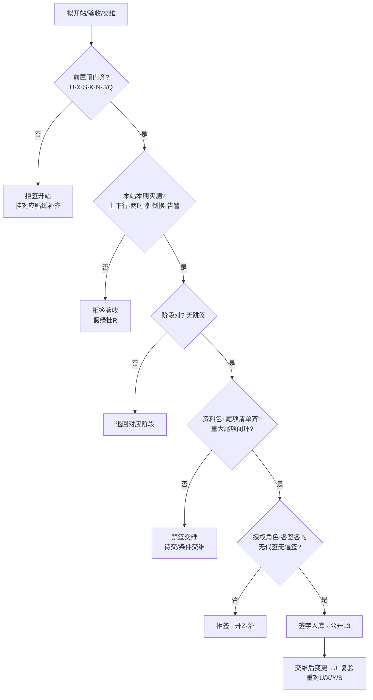

# 手册 27 · 运维制度：开站验收与交维签字边界

> **手册模式 · 岗位深挖（开站前置闸门 / 验收实测 / 交维资料与边界 / 分阶段签字边界 / 带病交维治理）第 27 篇**（接第 40 课收官 · 手册 01–26 之后 · **不是第 41 课**）  
> 适合：已有贴纸 I / K / J / Q / N / U / X / Y / R / S，可一到「执照没下来先试发射」「打通了就签验收」「只测下行就交维」「资料后补、尾项口头答应」「工期到了让运维先签」「交维后又改了功率」「屏绿就是验收通过」就慌——想学会**先证前置再开站、本站本期实测上下行再签验收、分阶段签禁跳签、资料与尾项齐才交维、禁代签逼签、交维后变更须复验、主贴 Z、假绿≠验收、跨网挂 S、脱敏 L3**的人  
> 阅读量：约 **30–40 分钟** · **不重写手册10 / 11 / 12 / 15 / 18 / 19 / 20 / 22 / 25 / 26 全文**（只给指针）、**不 dump 空口字段**、**不发明条款号**、**不写真实频点 / 站名 / 单位名 / 验收单全文号 / 合同号 / 联系人 / 坐标**（教学虚构、L3）· **不教无证开站、不教伪造或套用验收记录、不教用功率战掩盖覆盖与干扰问题过验收、不教规避监测**——只讲开站前置、验收实测、交维资料、签字边界与拒签 · 要把「**先证前置闸门再开站；验收看本站本期实测；分阶段签禁跳签；资料与尾项齐才交维；各签各的禁代签；变更须复验；主贴 Z；假绿≠验收；跨网挂 S；脱敏 L3**」钉成肌肉记忆  
> **频谱 / 调制提醒（弱项短补）**：一条 DMR 信道「车道宽」**12.5 kHz**，信号主体「车身」占用带宽通常更窄（国无办〔2025〕1号附件1：12.5 kHz 间隔时 ≤ 8.5 kHz），调制是 **4FSK**，时隙是 **2-slot TDMA**（30 ms / 格）。中继站**收发异频**：基站「说」用发射频率（**下行**，基站→手台），基站「听」用接收频率（**上行**，手台→基站）——手台功率小、天线短，**上行往往比下行先不够用**，所以「只测下行就签验收」是本篇头号坑。本篇主角是**整站「能不能开、验没验、交没交、谁签的」**——像新房交付验房 + 物业承接查验签字。概念生疏先回 `学习推送/加餐_频率带宽与调制解调.md`。

---

## 1. 为什么要写这篇手册（动机 + 现场对话）

前二十六篇手册从 A–E 协议一路写到 Y 重大活动设备准入：其中 **I 管室分隧道交维、K 管电源倒换交维、Q 管金机、N 管监控、U 管执照、X 管环境报告、Y 管活动设备**——每张贴纸都是一个分项闸门。可**谁来把这些拼成「这座站可以开、可以验、可以交给运维」并签下名字？** 这就是本篇的 Z——**开站验收与交维签字边界**。

- 项目经理：「执照批文下周就到，先开站试发射，验收那天再补。」——**前置闸门未齐先开站** = 本篇拒签（规则1，挂 U）。  
- 施工队：「开通当天手台打通了，调度台也听得见，签验收吧。」——**打通 ≠ 验收实测**；没有上下行双向、覆盖、倒换、告警记录 = 规则2。  
- 建设方：「开站、验收、交维一张单签完，省得来回跑。」——**跳签 / 开站即交维** = 规则3。  
- 运维新人：「竣工图下个月给，三个问题口头答应改。」——**资料缺项无期限、尾项无主人** = 禁签交维（规则4）。  
- 领导：「工期节点到了，运维先签交维，有问题再说。」——**被工期逼签** = 规则5 红线（类比《物业承接查验办法》第三十八条「不得以交付期限届满为由要求承接未经查验的物业」）。  
- 施工队：「交维之后我们回来把功率调大了一点、换了根跳线，没事。」——**交维后未走变更复验** = 规则5。  
- 协调岗：「新站跟邻网共址，我们先开，邻居投诉再说。」——**跨网开站须先通知或挂 S**（规则7）。  

这几句背后是同一件事：

> **「开站验收与交维签字」在现场至少有五个坑**：**① Z-开** 开站前置闸门（U 执照覆盖、X 环境报告、S 邻频通知、K 电源倒换、J/Q 写频与金机基线、N 监控接入；重大保障另加 V/Y）；**② Z-验** 验收实测（本站本期、上下行双向、覆盖 / 功能 / 倒换 / 告警联测、方法与仪器有效、记录可追溯）；**③ Z-交** 交维资料包与责任边界（竣工资料、配置与金机基线、备件、巡检周期、告警归属、尾项清单有主人有期限）；**④ Z-签** 分阶段签字边界（开站 / 初验 / 试运行 / 终验 / 交维各签各的；谁可签；禁代签、禁跳签、禁被工期逼签）；**⑤ Z-治** 治理（未验先开、带病交维、尾项无主、套他站记录、假绿顶替、交维后私改、功率战掩盖、公开泄密）。  
> 把 ①–⑤ 当成「打通就算验收」「签了就算交维」「资料以后补」「工期到了先签」，这座站以后每次故障都会先吵「当初到底交没交清楚」。

本篇目标：能背出**开站验收与交维签字工作流**与阶段梯；会用新贴纸 **Z（开 / 验 / 交 / 签 / 治）**；会填**插页 Z（Z1–Z8）**和《本网开站验收与交维签字台账卡》；能用「**新房交付验房 + 物业承接查验签字**」故事讲清前置、实测、分段签、资料尾项、变更复验；能拒绝未验先开、打通即验、只测下行、跳签、带病交维、逼签代签、假绿顶替、交维后私改；自测过关后，回库把本网最近一座新站或改造站的材料（L3）重对一遍。

**本篇硬禁令（写进脑子）**：凡引法规与标准只指向已公开发布的文书标题与官方链接（无线电管理条例、频率使用许可管理办法、地面无线电台（站）管理规定、无线电台执照管理规定、国无办〔2025〕1号；**只作故事类比**的建设工程质量管理条例、竣工验收规定、物业承接查验办法），**程序、期限、责任以原文与属地最新要求为准，本篇只作教学转述，不发明条款号与内部口径**；房建与物业文件**不是台站法定依据**；**现象与台账一律用相对道号、角色标签、脱敏编号，禁真实频点 / 站名 / 单位名 / 验收单全文号 / 合同号 / 联系人 / 坐标**；**不教无证开站、不教伪造或套用验收记录、不教功率战掩盖覆盖或干扰、不教规避监测**；I / K / Q / N / U / X / Y / J / M / R 各管各的分项——**开站验收与交维签字边界主贴 Z**；Tait 验收六阶段、FAT/SAT 教材、TSB-88 覆盖验证只借**方法级**表述，**签字与交维以国内法规、本网合同与书面判据为准**。

---

## 2. 总图 / 故事：开站交维像「新房交付验房 + 物业承接查验签字」

### 2.1 一句话：开站验收与交维像新房交付——开发商说「能住了」不算数；竣工验收合格、业主逐户验房、资料移交、问题清单有人有期限、物业承接查验签协议、双方签交接记录，才算交到「管家」手里；交付期限到了也不能逼物业接收未经查验的房子

```text
   ┌────────────────────────────────────────────────────────────┐
   │  新房交付验房 + 物业承接查验  =  本网开站验收 + 交维签字      │
   │                                                            │
   │  竣工验收 + 认可文件 + 水电通  ≈ Z-开  U·X·S·K·N·J/Q 前置     │
   │  逐户验房：开龙头试门窗看渗漏  ≈ Z-验  上下行·两时隙·倒换告警 │
   │  竣工图·清单·保修书·问题单     ≈ Z-交  资料包·基线·尾项清单   │
   │  竣工验收≠收房≠物业承接       ≈ Z-签  开站≠初验≠终验≠交维    │
   │  逼收房·带病交付·假验收        ≈ Z-治  逼签·带病交维·假绿·私改 │
   └────────────────────────────────────────────────────────────┘
```

口诀：

> **先证前置再开站，实测上下行再签验；分段签字不跳步，资料尾项齐才交。**  
> 打通就签验收 = 开发商说「灯能亮」就让你签收房——**拒签**。  
> 工期到了逼运维签 = 交付日到了逼物业接一栋没查验的楼——**拒签**。

### 2.2 「验房 + 物业承接」五段直觉（钉死）

| 段 | 像什么 | 运维直觉 | 本篇贴纸 |
|----|--------|----------|----------|
| **开站前置** | 竣工验收合格、拿到规划消防等认可文件、水电通了才能交付 | U 执照覆盖、X 环境报告、S 通知、K 电源、N 监控、J/Q 基线齐再开站发射入网 | Z-开 |
| **验收实测** | 业主逐户验房：开水龙头、关门窗、泼水看渗漏，写在验房单上 | 本站本期、上下行双向、覆盖 / 功能 / 倒换 / 告警联测，可追溯记录 | Z-验 |
| **交维资料** | 竣工图、设备清单、保修书、使用说明书移交物业；缺的列清单写补交期限 | 竣工资料、配置与金机基线、备件、巡检、告警归属、尾项清单 | Z-交 |
| **分阶段签字** | 竣工验收、业主收房、物业承接查验各签各的；谁参加谁签 | 开站 / 初验 / 试运行 / 终验 / 交维各签各的；授权角色签，禁代签 | Z-签 |
| **治理** | 开发商逼收房、假验收、串通弄虚作假 → 追责 | 逼签、跳签、带病交维、套记录、假绿顶替、私改 → 拒签 / 治理 | Z-治 |

> 公开文书告诉我们（**教学转述，以原文为准**）：房建领域「**验收合格方可交付使用**」、验收组**签署意见**、意见不一致**协商后重新验收**；物业领域承接查验按「方案→移交资料→现场查验→解决问题→确认结果→签协议→办交接」走，**未移交资料要列清单并书面承诺补交时限**，且**不得以交付期限届满为由逼物业承接未经查验的物业**（出处见 §10 第 12–14 条）。本篇只借这串顺序直觉——**台站开站的合法前提仍是无线电管理条例与台站、执照规定（走 U），房建文件不是台站法定依据**。

### 2.3 和手册10 / 11 / 12 / 15 / 18 / 19 / 22 / 25 / 26 的咬合（指针，不重写）

- **I（手册10）/ K（手册12）**：室分隧道、电源倒换是交维的**专业分项**；Z 是整站**签字总闸门**——分项实测包挂进 Z-验 / Z-交，不重写。  
- **J（手册11）/ Q（手册18）**：交维那一刻的配置与金机基线就是站的「出生证明」，入 Z-交 资料包；交维后变更走 J。  
- **N（手册15）**：没接网管、告警没归属、没对时，就不叫交维。  
- **R（手册19）**：屏上全绿 ≠ 验收通过（规则6）；挂 R 提醒，主贴 Z。  
- **U（手册22）/ X（手册25）**：无证不开站、无本站本期环境报告不开站——它们是 Z-开 的前置闸门，本身仍各走 U / X。  
- **V（手册23）/ Y（手册26）**：重大保障临时站开站加挂 V/Y；闭幕回收与 V 呼应。  
- **S（手册20）/ T（手册21）**：跨网共址新站先通知或挂 S；开站后投诉挂 T。

### 2.4 新贴纸 Z：开 / 验 / 交 / 签 / 治（五个子类）

> 小彩蛋：**Z** 是字母表最后一张贴纸，角色也正好是「收口」——**把前面各分项闸门收拢成一张签字总单**。以后新专题用双字母或分册编号续写，不改 A–Z 既有含义。

```text
                ┌──────────── 贴纸 Z · 开/验/交/签/治 ────────────┐
                │  Z-开  开站前置：U·X·S·K·N·J/Q（保障加 V/Y）齐   │
                │  Z-验  验收实测：本站本期·上下行·覆盖·倒换·告警  │
                │  Z-交  交维资料与边界：竣工资料·基线·备件·尾项   │
                │  Z-签  分阶段签字：开≠初验≠试运行≠终验≠交维     │
                │  Z-治  治理：逼签·跳签·带病交维·套记录·假绿·私改 │
                └──────────────────────────────────────────────────────┘
```

| 子类 | 一句话 | 典型拒签触发 |
|------|--------|----------------------|
| **Z-开** | 前置闸门缺一（无执照覆盖、无环境报告、邻居未通知、电源未演、未接监控）仍开站 → 拒签开站 | 「批文下周到，先试发射」 |
| **Z-验** | 无本站本期可追溯实测、只测下行、套他站记录 → 拒签验收 | 「开通当天打通了就签」 |
| **Z-交** | 资料包缺项无书面补交期限、尾项无主人无期限、责任边界不清 → 禁签交维 | 「竣工图下个月给」 |
| **Z-签** | 跳签、代签、无授权角色签、被工期逼签 → 拒签 | 「一张单把开站验收交维全签了」 |
| **Z-治** | 未验先开、带病交维、交维后私改、假绿顶替、功率战掩盖、公开泄密 → 治理 | 「交维后施工队自己又调了功率」 |

### 2.5 开站 → 验收 → 交维 阶段梯（背下来）

很多现场吵架，是因为大家嘴里的「验收」不是同一个东西。先把阶段梯钉死（**阶段名称以本网合同与制度为准，下面是教学通用梯**，方法级参考 Tait 公开文章的验收六阶段：出厂验收 FAT、客户验收/系统联调 CAT、站点验收 SAT、覆盖验证、系统终验、试运行 Burn-in + 尾项清单 punch list）：

```text
  ① 出厂/台架验收（FAT · 可挂 G 实验室）
        │  设备本身合格；不等于装到站上合格
        ▼
  ② 开站（前置闸门齐 → 允许发射入网）          ← Z-开 签字点
        │  上电、入网、能发能收；≠ 验收
        ▼
  ③ 初验 / 站点验收（SAT：本站实测）            ← Z-验 签字点
        │  上下行双向、两时隙、倒换、告警、室分分项（I）、电源分项（K）
        ▼
  ④ 覆盖验证（按设计承诺区抽样实测，TSB-88 思路可借）
        │  不是「领导车里听得见」
        ▼
  ⑤ 试运行 / 观察期（Burn-in：真实业务跑一段）
        │  尾项清单记录；重大尾项可重启观察期
        ▼
  ⑥ 终验（全部分项 + 观察期无重大尾项）          ← Z-签 终验签字点
        │
        ▼
  ⑦ 交维（资料包 + 责任边界 + 尾项移交 + 告警归属）← Z-交 交维签字点
        │  从此运维方「全面履行维护义务」，建设方保修与尾项责任仍在
        ▼
  ⑧ 运维期变更（改频/改功率角色/换天线/改写频基线）
        └─▶ 走 J 变更 + 局部复验；触发 U/X/Y/S 重对（规则5）
```

> **一句话分辨**：**开站**回答「能不能发射」；**初验**回答「这一座站做得对不对」；**覆盖验证**回答「承诺的地方有没有信号」；**试运行**回答「真实业务下稳不稳」；**终验**回答「合同交付齐没齐」；**交维**回答「从今天起谁负责、拿什么负责」。**六个问题，六个签字点，不能一笔带过。**

### 2.6 开站验收与交维最小工作流（背下来）

每次准备签字前，按下图从上往下走；任何一个「否」都停在那一格，先补齐再往下（交维后变更回到 J + 复验）。



现场口诀：

> **先证前置再开站，实测上下行再签验；分段签字不跳步，资料尾项齐才交。**  
> 跳过实测的「验收合格」= 没开过水龙头就签了验房单。

---

## 3. 核心交付：插页 Z + 拒签卡 + 与总三联单怎么写

### 3.1 什么时候贴 Z（而不是先贴 I / K / U / X / Y / R）

| 现场信号 | 主贴 | 可次挂 |
|----------|------|--------|
| 新站 / 改造站要开站发射、签初验、终验、交维 | **Z** | I / K / Q / N / U / X |
| 室分 / 隧道那一段管子测没测、签没签 | **I**（分项） | 整站签字仍 Z |
| 电源倒换剧本演没演 | **K**（分项） | 整站签字仍 Z |
| 执照 / 环境报告是否覆盖本站 | **U / X** | 缺则拒签开站（Z-开） |
| 交维后改频、改功率角色、换天线、改写频基线 | **J / M** + 挂 **Z**（复验） | U / X / S |
| 屏绿 / 假绿 / 打通想顶替验收实测 | **Z-治** + 挂 **R** | — |
| 新站跨网 / 共址开站 | **Z** + 挂 **S** | T（开站后投诉） |

> **口诀**：分项管子 → **I**；电源倒换 → **K**；证照 → **U**；环境报告 → **X**；活动设备 → **Y**；临时窗 → **V**；写频/OTAP → **J/M**；假绿 → **R**；邻居 → **S**；**整站「能不能开、验没验、交没交、谁签的」→ Z**。可叠挂，**该类签字主贴 Z**。

### 3.2 插页 Z · 开 / 验 / 交 / 签 / 治（挂在总三联单或交维单后）

| 行 | 名称 | 填写示例（教学虚构，L3） |
|----|------|--------------------------|
| **Z1** | 站点角色与当前阶段 | 「站点角色甲·新建/改造·当前拟签：□开站 □初验 □覆盖验证 □试运行 □终验 □交维 □交维后变更复验」 |
| **Z2** | 开站前置闸门 | 「□U 执照覆盖本站本参数 □X 环境报告本站本期 □S 已通知/已协调 □K 倒换剧本已演 □N 已接入对时 □J/Q 配置与金机基线已备份 □（保障站）V/Y」——缺一拒签开站 |
| **Z3** | 验收实测包 | 「□下行 □上行 □两时隙 □主要业务（组呼/个呼/短信/紧急） □倒换 □告警联测 □室分隧道挂 I □方法角色 □仪器有效期」——缺项拒签验收 |
| **Z4** | 覆盖验证与试运行 | 「覆盖抽样角色·承诺区角色·通过□/未过□；观察期起止角色·重大尾项触发重启□」 |
| **Z5** | 交维资料包 | 「□竣工资料（图纸角色） □设备清单角色 □配置备份 + 金机基线 □备件 □巡检周期 □告警归属 □保修与联系角色 □验收记录原件受控」——缺项须附清单 + 书面补交期限 |
| **Z6** | 尾项清单（punch list） | 「每条：编号脱敏·等级（重大/一般）·主人角色·期限·复验方式·状态」——重大尾项未闭环禁签交维 |
| **Z7** | 签字角色 | 「建设方角色 / 施工方角色 / 运维方角色 / 授权会签角色；本人签□ 无代签□ 无工期逼签□」 |
| **Z8** | 拒签门槛 + 变更复验触发 | 「缺任一正式项 → 拒签；交维后变更触发：□改频 □改功率角色 □换天线/馈线 □改写频基线 □搬迁 □其他____ → 走 J + 局部复验 + 重对 U/X/Y/S」 |

> 插页每一行都对应一条硬规则：Z2→规则1，Z3→规则2，Z1→规则3，Z5/Z6→规则4，Z7/Z8→规则5，公开包→规则8。**任何一行缺项，就停在那一行。**

### 3.3 和总三联单怎么写（接手册06）

- **现象**：「拟签阶段 + Z 子类」；未过闸门前**不写**「已验收」「已交维」「运行正常」。  
- **证据**：Z2–Z7 勾选与指针；互挂 I/K/U/X/Y/J 编号（脱敏）。  
- **结论**：Z 子类 + 阶段 + 待验 / 待交 / 条件交维 / 已交维 / 拒签；次挂时写明主贴仍 Z。  
- **动作**：补前置、补测、补资料、派尾项、复验、挂 S、拒签——**禁写**「打通即验」「先签后补」「交维后小改不用报」。

### 3.4 《本网开站验收与交维签字台账卡》预告

§7 给出可复印模板：封面拒签门槛（兼作拒签卡，贴项目办 / 交维会议室 / 值班台）、资料包与尾项页、分阶段签字页与交维后变更复验页。本插页 Z1–Z8 是「贴在三联单后的短页」；台账卡是「本网每座站维护一辈子的厚页」——**站在，卡在；站搬，卡跟着搬**。
