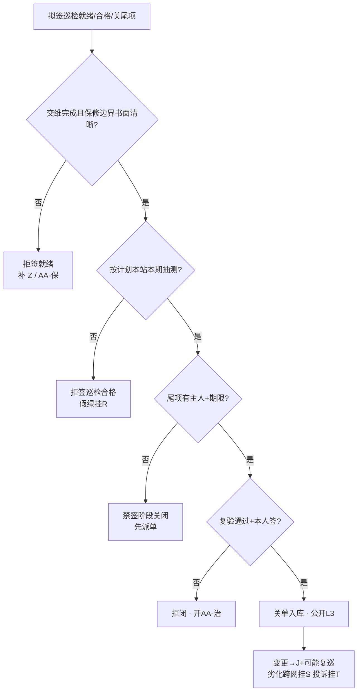

# 手册 28 · 运维制度：交维后首年巡检与保修期尾项闭环

> **手册模式 · 岗位深挖（首年巡检计划与实测 / 保修质保边界 / 交维尾项与新发现 / 尾项闭环与签字 / 过保甩锅与假闭环治理）第 28 篇**（接第 40 课收官 · 手册 01–27 之后 · **不是第 41 课**）  
> 适合：已有贴纸 Z / Q / N / K / I / R / J / S / T，可一到「交维签了就万事大吉」「还在保口头说说就行」「巡检套旧记录」「尾项过期自动关」「屏绿就当巡检合格」「跳一次巡检没事」「过保了就甩给运维」「功率大一点覆盖就回来了」就慌——想学会**先证交维完成且保修边界书面清晰再签首年巡检就绪、本站本期实测抽测、按计划巡禁跳巡、尾项有主有期、闭环须复验、主贴 AA、假绿≠巡检、跨网挂 S、脱敏 L3**的人  
> 阅读量：约 **30–40 分钟** · **不重写手册10 / 11 / 12 / 15 / 18 / 19 / 20 / 21 / 22 / 25 / 27 全文**（只给指针）、**不 dump 空口字段**、**不发明条款号**、**不写真实频点 / 站名 / 单位名 / 保修单全文号 / 合同号 / 联系人 / 坐标**（教学虚构、L3）· **不教伪造巡检记录、不教功率战掩盖劣化、不教规避监测、不教口头关尾项**——只讲首年巡检、保修边界、尾项清单、闭环签字与拒闭 · 要把「**先证交维与保修书面边界再签巡检就绪；本站本期实测抽测；按计划巡；尾项有主有期；复验才闭；主贴 AA；假绿≠巡检；跨网挂 S；脱敏 L3**」钉成肌肉记忆  
> **频谱 / 调制提醒（弱项短补）**：一条 DMR 信道「车道宽」**12.5 kHz**，信号主体「车身」占用带宽通常更窄（国无办〔2025〕1号附件1：12.5 kHz 间隔时 ≤ 8.5 kHz），调制是 **4FSK**，时隙是 **2-slot TDMA**（30 ms / 格）。中继站**收发异频**：基站「说」用发射频率（**下行**，基站→手台），基站「听」用接收频率（**上行**，手台→基站）——手台功率小、天线短，**上行往往比下行先不够用**。交维签字（Z）只证明「交那天」站是好的；**首年巡检**要回答的是：过了几个月、换了季节、邻居加了设备、馈线接头松了半圈之后，**上下行、覆盖抽测、电源倒换、网管心跳还在不在判据里**。劣化常先从上行边缘、室分口部、蓄电池倒换、告警漏报露出来——**屏上还绿，现场已经漂了**。概念生疏先回 `学习推送/加餐_频率带宽与调制解调.md`；开站验收与交维签字回手册27（贴纸 Z）。

---

## 1. 为什么要写这篇手册（动机 + 现场对话）

前二十七篇手册从 A–E 协议一路写到 Z 开站交维签字：其中 **Z 回答「交没交清楚」**，**Q 金机、N 监控、K 电源、I 室分**各管分项。可交维签字那天并不是故事的结局——**首年往往还在保修期内**，建设方 / 厂商仍有保修义务，运维方已开始「全面履行维护义务」。谁来把「首年该怎么巡、保什么不保什么、交维尾项和新发现怎么关」钉成一张可执行的台账？这就是本篇的 **AA**——**交维后首年巡检与保修期尾项闭环**。

- 项目经理：「交维签了，巡检你们自己看着办，保修我口头说还在保。」——**无书面保修边界仍签「首年巡检就绪」** = 本篇拒签（规则1）。  
- 巡检员：「上季度那份记录拿来改个日期就行，站又没动。」——**套他期记录** = 规则2。  
- 班长：「这个月忙保障，首年第二巡跳过，下季度补。」——**跳巡 / 超期未补巡仍签合格** = 规则3。  
- 施工队：「交维尾项三个问题我们口头答应改；新发现的也先记着。」——**尾项无主人无期限** = 规则4。  
- 协调岗：「厂商说修好了，电话里关单吧；过期了系统自动关。」——**口头关 / 过期自动关** = 规则5。  
- 网管：「屏全绿，巡检打勾就行。」——**假绿顶替巡检** = 规则6。  
- 施工队：「边缘差一点，我们把功率抬一点就回来了。」——**功率战掩盖劣化** = 规则7。  
- 宣传岗：「把保修单全文号、站坐标发群里表扬闭环率。」——**L3 违规** = 规则8。  

这几句背后是同一件事：

> **「交维后首年巡检与保修期尾项闭环」在现场至少有五个坑**：**① AA-巡** 首年巡检计划与实测（按周期走点：覆盖抽测、电源倒换抽测、网管心跳、室分口部等——指针到 I/K/N/Q，不重写）；**② AA-保** 保修 / 质保边界（谁修、保什么、不保什么、响应时限、书面依据；禁口头「还在保」）；**③ AA-尾** 交维尾项 + 首年新发现尾项清单（有主人、有期限、重大 / 一般分级）；**④ AA-闭** 尾项闭环与签字（复验通过才关单；禁口头关闭、禁过期自动关）；**⑤ AA-治** 治理（过保甩锅、假闭环、跳巡、用功率战掩盖劣化、假绿顶替巡检、公开泄密）。  
> 把 ①–⑤ 当成「交维签了就万事大吉」「口头还在保」「套旧记录」「过期自动关」，这座站首年每一次故障都会先吵「到底还在不在保、当初尾项关没关、巡检到底做没做」。

本篇目标：能背出**首年巡检与保修尾项闭环工作流**；会用新贴纸 **AA（巡 / 保 / 尾 / 闭 / 治）**；会填**插页 AA（AA1–AA8）**和《本网交维后首年巡检与保修期尾项闭环台账卡》；能用「**新车首年保养 + 质保期内故障保修单闭环**」故事讲清计划巡检、书面保修边界、尾项有主有期、复验才闭；能拒绝无书面保修边界、套记录、跳巡、口头关单、假绿顶替、功率战掩盖、过保甩锅；自测过关后，回库把本网最近一座交维未满一年的站（L3）重对一遍。

**本篇硬禁令（写进脑子）**：凡引法规与标准只指向已公开发布的文书标题与官方链接（无线电管理条例、频率使用许可管理办法、地面无线电台（站）管理规定、无线电台执照管理规定、国无办〔2025〕1号；**只作故事类比**的《家用汽车产品修理更换退货责任规定》、《房屋建筑工程质量保修办法》、《建设工程质量管理条例》质量保修章），**程序、期限、责任以原文与属地最新要求及本网合同为准，本篇只作教学转述，不发明条款号与内部口径**；汽车三包与房建保修文件**不是台站法定依据**；**现象与台账一律用相对道号、角色标签、脱敏编号，禁真实频点 / 站名 / 单位名 / 保修单全文号 / 合同号 / 联系人 / 坐标**；**不教伪造巡检记录、不教功率战掩盖劣化、不教规避监测、不教口头关尾项**；I / K / Q / N / Z / J / R / S / T 各管各的——**交维后首年巡检与保修期尾项闭环主贴 AA**；Tait 验收后 burn-in / punch list、P25 Best Practice 现场验收与 burn-in 约定只借**方法级**表述，**首年巡检周期、保修边界与闭环签字以本网合同、书面保修书与制度为准**。

---

## 2. 总图 / 故事：交维后首年像「新车首年保养 + 质保期内故障保修单闭环」

### 2.1 一句话：交维签字像新车交车——钥匙交到你手里不算故事结束；首年要按保养手册按时到店做保养（巡检），质保期内坏了要开保修单、写清保什么不保什么、修好后车主到场确认才关单（尾项闭环）；口头说「还在保」「修好了」都不算数

```text
   ┌────────────────────────────────────────────────────────────┐
   │  新车首年保养 + 质保保修单闭环  =  本网首年巡检 + 保修尾项闭环 │
   │                                                            │
   │  保养手册周期 + 到店实测项目   ≈ AA-巡  计划·走点·本站本期抽测 │
   │  三包凭证 / 保修书书面边界     ≈ AA-保  谁修·保什么·不保什么   │
   │  交车问题单 + 使用中新发现     ≈ AA-尾  交维尾项 + 巡检新发现  │
   │  修好后车主确认关单            ≈ AA-闭  复验通过 + 签字才关    │
   │  过保甩锅·假关单·跳保养·抬功率  ≈ AA-治  过保甩锅·假闭环·跳巡  │
   └────────────────────────────────────────────────────────────┘
```

口诀：

> **交维不是终点，首年还在保；计划巡检有实测，尾项复验才关单。**  
> 交维签了就不巡 = 新车交车后从不做首保——**拒签「巡检合格」**。  
> 口头「还在保」就派修 = 没有三包凭证就让 4S 店白修——**拒签保修派工**（先补书面边界）。

### 2.2 「新车保养 + 质保保修单」五段直觉（钉死）

| 段 | 像什么 | 运维直觉 | 本篇贴纸 |
|----|--------|----------|----------|
| **首年巡检** | 保养手册写明 5000 / 10000 公里首保、项目清单、到店实测（机油、制动、轮胎） | 首年巡检周期书面钉死；覆盖抽测、倒换抽测、网管心跳、室分口部按计划走点，本站本期记录 | AA-巡 |
| **保修边界** | 三包凭证写明包修期、保什么、易损件不保什么、修理者网点 | 书面保修书：责任方、范围、期限起算、响应时限、不保清单；禁口头「还在保」 | AA-保 |
| **尾项清单** | 交车时问题单 + 使用中新开保修单，每条有单号、等级、处理人、期限 | 交维未闭环尾项 + 巡检 / 告警新发现；重大 / 一般；主人 + 期限 + 复验方式 | AA-尾 |
| **闭环签字** | 修好后车主到场确认、签字关单；过期不自动关；不能代签 | 复验通过 + 授权角色签字才关；禁口头关、禁过期自动关、禁代签逼关 | AA-闭 |
| **治理** | 过保甩锅、假关单、跳保养、改装后仍要免费保、隐瞒里程 | 过保甩锅、假闭环、跳巡、功率战掩盖、假绿顶替、公开泄密 → 拒签 / 治理 | AA-治 |

> 公开文书告诉我们（**教学转述，以原文为准**）：汽车三包领域有**包修期 / 三包有效期书面凭证**、修理记录存档、易损件单独质保期、**使用不当 / 改装造成的损坏可免责**等直觉；房建保修领域有**质量保修书明确范围、期限、责任**、保修完成后组织验收、使用不当与不可抗力不属保修范围等直觉（出处见 §10）。本篇只借这串顺序直觉——**台站首年巡检与保修边界以本网合同、书面保修书与制度为准，汽车三包与房建保修不是台站法定依据**。

### 2.3 和手册10 / 11 / 12 / 15 / 18 / 19 / 27 等的咬合（指针，不重写）

- **Z（手册27）**：交维签字是 AA 的**前置闸门**——没交维完成（或条件交维书面列明）就谈不上「首年巡检就绪」；Z 交维资料包里的「巡检周期」「保修与联系角色」「尾项清单」正是 AA 要接着跑的那几页。  
- **I（手册10）/ K（手册12）**：室分口部、电源倒换是首年巡检的**专业抽测点**；AA-巡 挂分项指针，不重写 R1–R8 / 倒换剧本。  
- **Q（手册18）/ J（手册11）**：金机基线是「交维那天的出生证明」；巡检发现漂移要对照 Q，变更走 J，可能触发复巡。  
- **N（手册15）**：网管心跳、告警归属是 AA-巡 必勾项；告警漏报常比射频劣化更早暴露。  
- **R（手册19）**：屏上全绿 ≠ 已巡检合格（规则6）；挂 R 提醒，主贴 AA。  
- **S（手册20）/ T（手册21）**：巡检发现跨网劣化 / 干扰挂 S；用户投诉挂 T；禁功率战。  
- **U（手册22）/ X（手册25）**：巡检若发现参数与执照 / 环境报告不符，回挂 U/X，不是 AA 单独能「调回去」的。

### 2.4 新贴纸 AA：巡 / 保 / 尾 / 闭 / 治（五个子类）

> 小彩蛋：字母表在 Z 收口之后，本篇起用**双字母贴纸**——**AA** 是「交维之后的第一张续写贴纸」，角色正好是「首年还在保、巡检与尾项要闭环」。A–Z 既有含义不改；新专题用 AA、AB… 续写。

```text
                ┌──────────── 贴纸 AA · 巡/保/尾/闭/治 ────────────┐
                │  AA-巡  首年巡检：计划周期·走点·本站本期抽测      │
                │  AA-保  保修边界：谁修·保什么·不保·响应·书面依据 │
                │  AA-尾  尾项清单：交维尾项+新发现·主人·期限·分级 │
                │  AA-闭  闭环签字：复验通过才关·禁口头/过期自动关 │
                │  AA-治  治理：过保甩锅·假闭环·跳巡·功率战·假绿  │
                └──────────────────────────────────────────────────────┘
```

| 子类 | 一句话 | 典型拒签 / 拒闭触发 |
|------|--------|----------------------|
| **AA-巡** | 无书面计划、跳巡、无本站本期抽测记录仍签「巡检合格」→ 拒签 | 「上季度记录改个日期」 |
| **AA-保** | 无书面保修边界（范围 / 期限 / 责任方 / 响应）仍签「首年巡检就绪」或派保修 → 拒签 | 「口头说还在保」 |
| **AA-尾** | 交维尾项或新发现无主人无期限、重大未分级 → 禁签阶段关闭 | 「先记着，有空再派」 |
| **AA-闭** | 口头说修好、过期自动关、未复验、代签逼关 → 拒闭 | 「电话里关单吧」 |
| **AA-治** | 过保甩锅、假闭环、跳巡、功率战掩盖、假绿顶替、公开泄密 → 治理 | 「过保了就甩给运维」 |

### 2.5 交维 → 首年巡检 → 保修尾项闭环 阶段梯（背下来）

```text
  ① 交维完成（Z：资料包 + 责任边界 + 尾项移交）     ← Z 前置；AA 起点
        │  条件交维须书面列明一般尾项；重大尾项应为 0
        ▼
  ② 保修边界书面钉死（AA-保）                        ← 拒「口头还在保」
        │  责任方 / 范围 / 起算日 / 期限 / 响应 / 不保清单
        ▼
  ③ 首年巡检计划书面钉死（AA-巡）                    ← 周期 + 走点清单
        │  例如教学：季巡 / 半年覆盖抽测 / 年终总巡（以本网为准）
        ▼
  ④ 按计划执行抽测（本站本期 · 上下行 · 倒换 · 心跳）← AA-巡 实测
        │  发现异常 → 开尾项（AA-尾）或挂 S/T/J
        ▼
  ⑤ 尾项派主人 + 期限 + 复验方式（重大 / 一般）      ← AA-尾
        │  保修范围内 → 走 AA-保 派工；范围外 → 另开变更 / 采购路径
        ▼
  ⑥ 整改完成 → 复验通过 → 签字关单（AA-闭）
        │  禁口头关、禁过期自动关、禁代签逼关
        ▼
  ⑦ 保修期末尾项清零检查 + 过保交接备忘（仍 L3）
        └─▶ 变更（改频/改功率角色/换天馈）→ J + 可能触发复巡（规则7）
```

> **一句话分辨**：**交维（Z）**回答「从今天起谁负责、拿什么负责」；**保修边界（AA-保）**回答「还在保的范围内谁修、修到什么时候」；**首年巡检（AA-巡）**回答「计划点有没有按时走到、本站本期还达标吗」；**尾项（AA-尾）**回答「未了事项谁管、何时了」；**闭环（AA-闭）**回答「修好了没有、谁亲眼确认关的单」。**五个问题，五张子贴纸，不能一笔带过。**

### 2.6 首年巡检与保修尾项最小工作流（背下来）

每次准备签「巡检合格 / 尾项关闭 / 首年巡检就绪」前，按下图从上往下走；任何一个「否」都停在那一格。



现场口诀：

> **先证交维与保修，计划巡检有实测；尾项有主有期限，复验签字才关单。**  
> 跳过实测的「巡检合格」= 4S 店没抬车就在保养单上打勾。

---

## 3. 核心交付：插页 AA + 拒签/拒闭卡 + 与总三联单怎么写

### 3.1 什么时候贴 AA（而不是先贴 Z / I / K / Q / N / R）

| 现场信号 | 主贴 | 可次挂 |
|----------|------|--------|
| 交维后首年要定巡检计划、做季巡 / 年巡、关保修尾项 | **AA** | Z / Q / N / K / I |
| 整站还没交维清楚、还在争签字 | **Z** | 交维完成后再开 AA |
| 室分口部 / 电源倒换那一段抽测 | **I / K**（分项） | 整站巡检台账仍 AA |
| 发现配置 / 金机漂移、要改参 | **J / Q** + 挂 **AA**（复巡） | U / X / S |
| 屏绿 / 假绿想顶替巡检实测 | **AA-治** + 挂 **R** | — |
| 巡检发现跨网劣化 / 干扰 | **AA** + 挂 **S** | T（投诉） |
| 保修期将满、尾项未清零 | **AA-保 / AA-闭** | Z（回看交维边界） |

> **口诀**：整站交维签字 → **Z**；室分管子 → **I**；电源倒换 → **K**；金机 / 写频 → **Q/J**；监控心跳 → **N**；假绿 → **R**；邻居 → **S**；投诉 → **T**；**交维后「首年怎么巡、保什么、尾项怎么关」→ AA**。可叠挂，**该类台账主贴 AA**。

### 3.2 插页 AA · 巡 / 保 / 尾 / 闭 / 治（挂在总三联单或巡检单后）

| 行 | 名称 | 填写示例（教学虚构，L3） |
|----|------|--------------------------|
| **AA1** | 站点角色与保修窗口 | 「站点角色甲·交维日角色·保修起算日角色·保修届满日角色·当前拟签：□首年巡检就绪 □季巡合格 □尾项关闭 □保修末清零」 |
| **AA2** | 保修 / 质保边界（书面） | 「□责任方角色 □范围角色 □不保清单角色 □响应时限角色 □书面保修书 / 合同条款指针（脱敏）□联系角色」——缺一拒签「巡检就绪」与保修派工 |
| **AA3** | 首年巡检计划 | 「周期：□季 □半年覆盖抽测 □年终；走点清单指针；下次应巡日角色」——无书面计划拒签 |
| **AA4** | 本期抽测包 | 「□下行抽测 □上行边缘抽测 □两时隙抽测 □倒换抽测（K）□网管心跳 / 告警抽测（N）□室分口部（I）□对照金机（Q）□方法角色 · 仪器有效期」——缺项拒签合格 |
| **AA5** | 交维尾项结转 | 「交维未闭环：重大__ / 一般__；每条主人·期限·状态」——重大应为 0 才签「巡检就绪」（条件交维例外须书面） |
| **AA6** | 本期新发现尾项 | 「编号脱敏·等级·主人·期限·复验方式·是否走保修（AA-保）」 |
| **AA7** | 闭环签字 | 「复验人角色 · 结果 · 关闭人角色 · 本人签□ · 无代签□ · 无过期自动关□」 |
| **AA8** | 拒签 / 拒闭门槛 + 变更复巡触发 | 「缺任一正式项 → 拒签 / 拒闭；触发复巡：□改频 □改功率角色 □换天馈 □重大覆盖劣化 □过保交接 □其他____ → 挂 J / 复巡 / 重对 U/X/S」 |

> 插页每一行都对应一条硬规则：AA2→规则1，AA4→规则2，AA3→规则3，AA5/AA6→规则4，AA7→规则5，公开包→规则8。**任何一行缺项，就停在那一行。**

### 3.3 和总三联单怎么写（接手册06）

- **现象**：「拟签类型 + AA 子类」；未过闸门前**不写**「巡检合格」「尾项已关闭」「保修期内运行正常」。  
- **证据**：AA2–AA7 勾选与指针；互挂 Z/I/K/Q/N/J 编号（脱敏）。  
- **结论**：AA 子类 + 待巡 / 待修 / 待复验 / 已关闭 / 拒签 / 拒闭；次挂时写明主贴仍 AA。  
- **动作**：补保修书面边界、补巡、派尾项、复验、挂 S、拒闭——**禁写**「套旧记录」「口头关单」「过期自动关」「抬功率先顶着」。

### 3.4 《本网交维后首年巡检与保修期尾项闭环台账卡》预告

§7 给出可复印模板：封面拒签 / 拒闭门槛（兼作拒签卡，贴值班台 / 运维会议室）、保修边界页、巡检计划与抽测页、尾项与闭环页。本插页 AA1–AA8 是「贴在三联单后的短页」；台账卡是「本网每座站首年（及保修期）维护的厚页」——**站在，卡在；保修届满，卡归档并开过保备忘**。 若一座站交维时是「条件交维」，台账卡封面须**红字提示**「一般尾项结转中，重大须为 0」——避免新人只看绿灯就签就绪。

---

