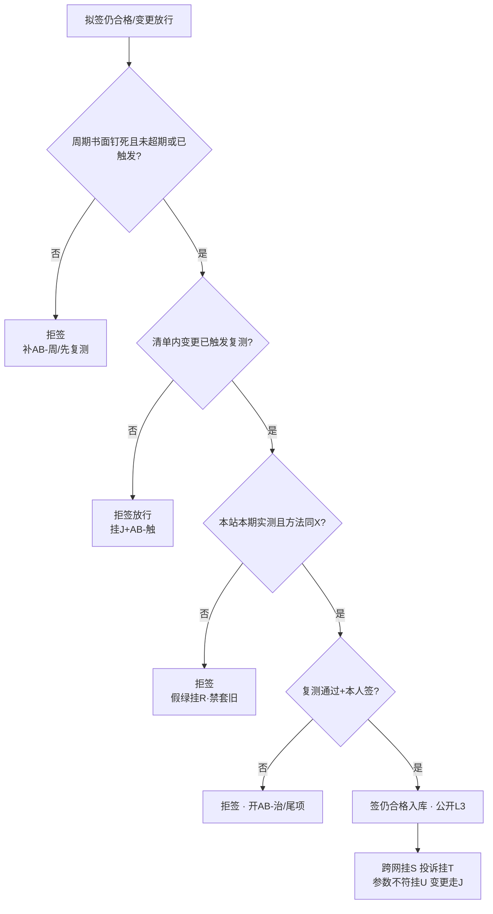

# 手册 29 · 运维制度：室分电磁环境复测周期与变更触发

> **手册模式 · 岗位深挖（复测周期书面钉死 / 变更触发清单 / 本期本站实测最小集 / 复测通过才签仍合格 / 跳复测套旧报告与功率战治理）第 29 篇**（接第 40 课收官 · 手册 01–28 之后 · **不是第 41 课**）  
> 适合：已有贴纸 I / X / Z / AA / J / S / T / R / U / O，可一到「交维那年测过就永远合格」「改了馈线合路还套旧报告」「首年巡检走过等于室分电磁环境复测了」「楼层装修完功率抬一点就行」「屏绿就当噪底没漂」「季测跳过下半年补」「公开仓贴报告全文号与楼层坐标」就慌——想学会**先证复测周期书面钉死且与 X 报告方法一致再签「室分电磁环境仍合格」、变更触发必复测、本站本期实测（上下行·口部·噪底）、禁套旧报告、主贴 AB、假绿≠复测、跨网挂 S、脱敏 L3**的人  
> 阅读量：约 **30–40 分钟** · **不重写手册10 / 11 / 16 / 19 / 20 / 21 / 22 / 25 / 27 / 28 全文**（只给指针）、**不 dump 空口字段**、**不发明条款号**、**不写真实频点 / 站名 / 单位名 / 报告全文号 / 楼层坐标 / 联系人**（教学虚构、L3）· **不教伪造复测记录、不教功率战掩盖噪底漂、不教规避监测、不教套旧报告顶替**——只讲室分 / 隧道电磁环境**复测周期、变更触发、实测最小集、签字边界与治理** · 要把「**周期书面钉死；变更必触发；本期本站实测；复测通过才签仍合格；禁套旧报告；主贴 AB；假绿≠复测；跨网挂 S；脱敏 L3**」钉成肌肉记忆  
> **频谱 / 调制提醒（弱项短补）**：一条 DMR 信道「车道宽」**12.5 kHz**，信号主体「车身」占用带宽通常更窄（国无办〔2025〕1号附件1：12.5 kHz 间隔时 ≤ 8.5 kHz），调制是 **4FSK**，时隙是 **2-slot TDMA**（30 ms / 格）。中继站**收发异频**：基站「说」用发射频率（**下行**，基站→手台），基站「听」用接收频率（**上行**，手台→基站）——手台功率小、天线短，**上行往往比下行先不够用**。室分 / 隧道里更明显：口部、拐弯、合路器之后、楼层装修改管之后，**噪底一抬、上行先塌**。交维那天的 X 报告只证明「交那天」环境与方法；**复测**要回答的是：过了几个月、改了馈线 / 合路 / 增益 / 楼层 / 共址邻居之后，**上下行、口部、噪底是否仍在判据里、方法是否仍与 X 一致**。概念生疏先回 `学习推送/加餐_频率带宽与调制解调.md`；室分交付回手册10（贴纸 I）；电磁环境验收报告台账回手册25（贴纸 X）；开站交维回手册27（贴纸 Z）；首年巡检回手册28（贴纸 AA）。

---

## 1. 为什么要写这篇手册（动机 + 现场对话）

前二十八篇手册从 A–E 协议一路写到 AA 首年巡检：其中 **I 回答「室分管子交没交清楚」**，**X 回答「开站 / 交维那天电磁环境报告齐不齐」**，**Z 回答「交没交清楚」**，**AA 回答「首年怎么巡、保什么、尾项怎么关」**。可交维与首年巡检都还没有单独钉死一件事——**室分 / 隧道的电磁环境，多久必须再测一次？改了什么东西必须立刻复测？和 AA 季巡怎么分工，才不会「巡检走过就算复测了」或「三年前 X 报告永远顶着」？** 这就是本篇的 **AB**——**室分电磁环境复测周期与变更触发**。

- 项目经理：「交维那年测过了，报告还在文件夹，室分电磁环境永远合格。」——**无书面复测周期仍签「仍合格」** = 本篇拒签（规则1）。  
- 施工队：「改了两根馈线、合路增益拧半圈，旧报告方法一样，套用就行。」——**变更后套旧报告** = 规则2 / 规则4。  
- 巡检员：「AA 季巡我走过口部了，等于 AB 复测做完了。」——**用首年巡检抽测顶替电磁环境复测** = 规则3 / 与 AA 分工不清。  
- 班长：「这个季度忙保障，室分复测跳过，年终并一次。」——**跳复测 / 超期未补** = 规则1。  
- 网管：「屏全绿、噪底曲线去年的还能看，打勾。」——**假绿 / 旧曲线顶替本期实测** = 规则6。  
- 施工队：「楼层装修完边缘差一点，功率抬一点就回来了。」——**功率战掩盖** = 规则7。  
- 协调岗：「邻居共址加装后口部变差，我们先顶着，别惹事。」——**跨网不挂 S、私了** = 规则7。  
- 宣传岗：「把复测报告全文号、楼层坐标发群里表扬闭环率。」——**L3 违规** = 规则8。  

这几句背后是同一件事：

> **「室分电磁环境复测周期与变更触发」在现场至少有五个坑**：**① AB-周** 复测周期书面钉死（季 / 半年 / 年；与 AA 首年巡检分工——巡检抽测 ≠ 电磁环境复测）；**② AB-触** 变更触发清单（改馈线 / 合路 / 增益 / 楼层拓扑 / 共址邻居 / 功率角色 / 载频角色等）；**③ AB-测** 本期本站实测方法最小集（上下行、口部、噪底、与 X 报告方法一致）；**④ AB-签** 复测通过才签「室分电磁环境仍合格」；禁套旧报告；**⑤ AB-治** 治理（跳复测、套旧报告、功率战掩盖、假绿顶替、公开泄密）。  
> 把 ①–⑤ 当成「交维那年测过就永远合格」「改管子还套旧报告」「巡检走过等于复测」，这座楼每一次装修、每一次合路拧半圈，都会先吵「到底还合不合格、旧报告还能不能用、谁该掏复测钱」。

本篇目标：能背出**室分电磁环境复测工作流**；会用新贴纸 **AB（周 / 触 / 测 / 签 / 治）**；会填**插页 AB（AB1–AB8）**和《本网室分电磁环境复测周期与变更触发台账卡》；能用「**大楼消防 / 防排烟系统定期检测 + 装修改管必复检**」故事讲清周期钉死、改管触发、方法一致、复测才签、禁套旧证；能拒绝无周期、套旧报告、跳复测、假绿顶替、功率战掩盖；自测过关后，回库把本网最近一座带室分 / 隧道的站（L3）重对一遍：周期、触发清单、最近一次复测与 X 方法对照。

**本篇硬禁令（写进脑子）**：凡引法规与标准只指向已公开发布的文书标题与官方链接（无线电管理条例、频率使用许可管理办法、地面无线电台（站）管理规定、国无办〔2025〕1号、GB 8702 电磁环境控制限值；**只作故事类比**的建筑消防设施检测 / 维护保养公开标准与消防安全责任制相关公开文件），**程序、期限、责任以原文与属地最新要求及本网制度 / 合同为准，本篇只作教学转述，不发明条款号与内部口径**；消防设施定期检测文件**不是台站法定依据**；**现象与台账一律用相对道号、角色标签、脱敏编号，禁真实频点 / 站名 / 单位名 / 报告全文号 / 楼层坐标 / 联系人**；**不教伪造复测记录、不教功率战掩盖、不教规避监测、不教套旧报告**；I / X / Z / AA / J / S / T / R / U / O 各管各的——**室分电磁环境复测周期与变更触发主贴 AB**；ITU 室内传播、DAS 公开科普、TSB-88 覆盖抽样只借**方法级**表述，**复测周期、触发清单与签字以本网制度与 X 报告方法为准**。

---

## 2. 总图 / 故事：室分复测像「大楼消防 / 防排烟定期检测 + 装修改管必复检」

### 2.1 一句话：交维那天的 X 报告像消防验收合格证——发证那天算数，不等于永远不用再检；平时要按周期做消防设施检测（复测），装修改了烟管 / 防火门必须复检（变更触发）；去年的检测报告在改管之后不能直接套用

```text
   ┌──────────────────────────────────────────────────────────────┐
   │  消防/防排烟定期检测+改管复检  =  本网室分电磁环境复测+变更触发 │
   │                                                              │
   │  检测周期书面钉死（年检/季检） ≈ AB-周  季/半年/年·与AA分工    │
   │  装修改烟管/合路/阀门必复检   ≈ AB-触  馈线·合路·增益·楼层·邻居 │
   │  按规程实测·仪器在检·记录完整 ≈ AB-测  上下行·口部·噪底·方法同X │
   │  检测合格才签「设施仍完好」   ≈ AB-签  复测通过才签「仍合格」  │
   │  跳检·套旧证·私改顶着·假绿   ≈ AB-治  跳复测·套旧报告·功率战  │
   └──────────────────────────────────────────────────────────────┘
```

口诀：

> **交维报告管「那天」，复测管「还在不在」；改了管子必触发，套旧报告直接拒。**  
> 交维测过就不复测 = 消防验收后从不年检——**拒签「室分电磁环境仍合格」**。  
> 改完馈线还拿三年前报告交差 = 改完防排烟管道还拿去年检测证——**拒签**。

### 2.2 「消防定期检测 + 装修改管复检」五段直觉（钉死）

| 段 | 像什么 | 运维直觉 | 本篇贴纸 |
|----|--------|----------|----------|
| **复测周期** | 消防设施维护保养 / 检测规程写明周期、项目、记录存档 | 季 / 半年 / 年复测书面钉死；与 AA 首年巡检走点分工，不互相顶替 | AB-周 |
| **变更触发** | 装修改管、改防火门、改风机阀门 → 必须复检，不能「先用着」 | 改馈线 / 合路 / 增益 / 楼层拓扑 / 共址邻居 / 功率 / 载频角色 → 触发复测 | AB-触 |
| **实测方法** | 按检测技术规范：内容、仪器、方法、原始记录 | 本站本期：上下行、口部、噪底；方法与仪器有效期与 X 报告一致可追溯 | AB-测 |
| **签字边界** | 检测合格 / 问题整改复检通过才签「设施完好」；禁套旧证 | 复测通过才签「室分电磁环境仍合格」；禁套他期他站旧报告 | AB-签 |
| **治理** | 跳检、套旧证、私改后不报、用临时措施顶着 | 跳复测、套旧报告、功率战、假绿顶替、公开泄密 → 拒签 / 治理 | AB-治 |

> 公开文书告诉我们（**教学转述，以原文为准**）：建筑消防设施检测 / 维护保养领域有**周期、检测内容、仪器、记录与结论、问题整改**等直觉；消防安全责任制强调设施完好有效、不能长期失管（出处见 §10）。本篇只借这串顺序直觉——**台站室分复测周期与触发以本网制度、合同与 X 报告方法为准，消防检测标准不是台站法定依据**。

### 2.3 和手册10 / 16 / 25 / 27 / 28 等的咬合（指针，不重写）

- **I（手册10）**：室分交付、口部、合路、层级是 AB 复测的**对象与分项指针**；AB 不重写 R1–R8，但复测走点必须能挂回 I 的口部 / 层级角色。  
- **X（手册25）**：交维 / 开站电磁环境报告与台账是 AB 的**方法锚**——复测方法须与 X 报告方法一致（或书面说明差异并获批）；X 管「首次正式验收证据」，AB 管「之后还合不合格」。  
- **Z（手册27）**：交维完成是 AB 周期起算的常见锚点之一（以本网为准）；未交维清楚先回 Z，不急着开「仍合格」。  
- **AA（手册28）**：首年巡检抽测（含室分口部抽测指针）**不等于** AB 电磁环境复测；AA-巡 可发现「口部变差」并开尾项 / 触发 AB，但**不能用季巡记录改日期顶 AB 复测报告**。  
- **O（手册16）**：覆盖与抽样方法可借；复测抽样密度以本网与 X 方案为准。  
- **J（手册11）**：改馈线 / 合路 / 增益 / 功率 / 载频走变更；变更单上应勾选「是否触发 AB 复测」。  
- **S（手册20）/ T（手册21）**：复测发现跨网噪底抬升 / 干扰挂 S；用户投诉挂 T；禁功率战。  
- **R（手册19）**：屏绿 ≠ 已复测合格；挂 R 提醒，主贴 AB。  
- **U（手册22）**：复测若发现与执照参数不符，回挂 U，不是 AB 单独能「调回去」的。

### 2.4 新贴纸 AB：周 / 触 / 测 / 签 / 治（五个子类）

> 小彩蛋：双字母贴纸续写——**AA** 管「交维后首年还在保的巡检与尾项」；**AB** 管「室分 / 隧道电磁环境还合不合格、改了什么必须再测」。A–Z 既有含义不改；新专题用 AA、AB、AC… 续写。

```text
                ┌──────────── 贴纸 AB · 周/触/测/签/治 ────────────┐
                │  AB-周  复测周期：季/半年/年书面钉死·与AA分工     │
                │  AB-触  变更触发：馈线·合路·增益·楼层·邻居·功率  │
                │  AB-测  本期实测：上下行·口部·噪底·方法同X       │
                │  AB-签  复测通过才签「仍合格」·禁套旧报告         │
                │  AB-治  治理：跳复测·套旧·功率战·假绿·泄密       │
                └──────────────────────────────────────────────────────┘
```

| 子类 | 一句话 | 典型拒签 / 拒闭触发 |
|------|--------|----------------------|
| **AB-周** | 无书面周期、跳复测、超期未补仍签「仍合格」→ 拒签 | 「年终合并一次就算了」 |
| **AB-触** | 清单内变更未触发复测、先用着再说 → 拒签放行 / 拒签仍合格 | 「改两根馈线没事」 |
| **AB-测** | 无本站本期实测、方法与 X 不一致且无书面说明、仪器过期 → 拒签 | 「把去年曲线改个日期」 |
| **AB-签** | 套旧报告、只有结论没有指针、未过闸门 → 拒签「仍合格」 | 「文件夹里有 PDF」 |
| **AB-治** | 跳复测、套旧、功率战、假绿顶替、公开泄密 → 治理 | 「功率抬一点顶着」 |

### 2.5 交维报告 → 周期钉死 → 变更触发 → 复测签字 阶段梯（背下来）

```text
  ① 交维/开站 X 报告入库（方法·仪器·测点角色·结论）  ← X 前置；AB 方法锚
        │  Z 交维完成常见为周期起算锚（以本网为准）
        ▼
  ② 复测周期书面钉死（AB-周）                          ← 拒「测过就永远合格」
        │  例如教学：半年口部+噪底 / 年全面复测；与 AA 季巡分工表书面列明
        ▼
  ③ 变更触发清单书面钉死（AB-触）                      ← 改何物必须复测
        │  馈线/合路/增益/楼层拓扑/共址邻居/功率/载频…
        ▼
  ④ 到期或触发 → 本期本站实测（AB-测）                 ← 上下行·口部·噪底·方法同X
        │  发现跨网噪底/干扰 → 挂 S；投诉 → 挂 T；参数不符 → 挂 U
        ▼
  ⑤ 复测通过 + 授权签字（AB-签）→ 签「室分电磁环境仍合格」
        │  禁套旧报告、禁假绿、禁只有结论
        ▼
  ⑥ 未通过 → 开尾项/冻结放行/挂 AA 或 I 分项整改 → 整改后再次复测
        └─▶ 任何清单内变更未勾选触发 → 拒签放行（规则2）
```

> **一句话分辨**：**X** 回答「交维 / 开站那天报告齐不齐」；**AA** 回答「首年整站巡检走点有没有做到」；**I** 回答「室分管子分项交没交清」；**AB** 回答「室分 / 隧道电磁环境按周期或变更后**还合不合格**」。**四个问题，四张贴纸，不能一笔带过。**

### 2.6 室分复测最小工作流（背下来）

每次准备签「室分电磁环境仍合格 / 变更后放行」前，按下图从上往下走；任何一个「否」都停在那一格。



现场口诀：

> **周期钉死看日历，改管触发先复测；本期实测方法同，套旧报告直接拒。**  
> 跳过实测的「仍合格」= 物业拿着去年消防检测证，说「今年也一样」。

---

## 3. 核心交付：插页 AB + 拒签卡 + 与总三联单怎么写

### 3.1 什么时候贴 AB（而不是先贴 I / X / Z / AA / J）

| 现场信号 | 主贴 | 可次挂 |
|----------|------|--------|
| 室分/隧道要定复测周期、到期复测、变更后复测、签「仍合格」 | **AB** | I / X / AA / J |
| 整站还没交维清楚、还在争 X 报告齐不齐 | **Z / X** | 齐了再开 AB 周期 |
| 室分管子分项交付、口部清单本身不清 | **I** | 交付清后再跑 AB |
| 首年整站季巡 / 保修尾项 | **AA** | 发现口部劣化可触发 AB |
| 改馈线/合路/增益/功率/载频 | **J** + 勾选是否触发 **AB** | U / X |
| 屏绿 / 假绿想顶替复测实测 | **AB-治** + 挂 **R** | — |
| 复测发现跨网噪底抬升 / 干扰 | **AB** + 挂 **S** | T（投诉） |
| 复测与执照参数不符 | **AB** + 挂 **U** | J |

> **口诀**：室分管子 → **I**；交维/开站环境报告 → **X**；整站交维签字 → **Z**；首年巡检保修 → **AA**；变更单 → **J**；假绿 → **R**；邻居 → **S**；投诉 → **T**；执照参数 → **U**；**「室分电磁环境多久再测、改何物必测、还合不合格」→ AB**。可叠挂，**该类台账主贴 AB**。

### 3.2 插页 AB · 周 / 触 / 测 / 签 / 治（挂在总三联单或复测单后）

| 行 | 名称 | 填写示例（教学虚构，L3） |
|----|------|--------------------------|
| **AB1** | 站点/室分角色与周期窗口 | 「站点角色甲·室分层级角色·交维/起算日角色·周期：□季 □半年 □年 ·下次应复测日角色·当前拟签：□周期复测合格 □变更后复测合格 □仍合格」 |
| **AB2** | 与 AA / X / I 分工 | 「□AA 季巡抽测指针（不顶替 AB）□X 报告方法锚（脱敏编号）□I 口部/合路清单指针」——三者缺说明拒签「分工清晰」类就绪 |
| **AB3** | 变更触发清单（勾选） | 「□改馈线/接头 □改合路/分路 □改增益/衰减 □改楼层/隧道拓扑 □共址邻居变更 □改功率角色 □改载频角色 □有源器件更换 □其他____」——清单内变更未勾选触发→拒签放行 |
| **AB4** | 本期实测包（最小集） | 「□下行抽测 □上行边缘/口部抽测 □两时隙抽测 □口部/关键点角色 □噪底/底噪抽样 □对照 X 方法一致□或书面差异说明 □仪器有效期 □测人/复核人角色」——缺项拒签 |
| **AB5** | 与 X 报告对照 | 「X 报告脱敏指针·方法要点一致□·测点角色可追溯□·有效期内作方法锚□（过期作历史，不作「仍合格」依据）」 |
| **AB6** | 触发后状态 | 「□未触发 □待复测（冻结放行）□复测中 □已复测入库 □未通过待整改」 |
| **AB7** | 签字边界 | 「复测人角色 · 结果 · 签字人角色 · 本人签□ · 未套旧报告□ · 未假绿顶替□ · 未功率战□」 |
| **AB8** | 拒签门槛 + 互挂 | 「缺任一正式项 → 拒签；互挂：I/X/Z/AA/J/S/T/R/U（脱敏）；公开包 L3」 |

> 插页每一行都对应一条硬规则：AB1/AB2→规则1与分工，AB3→规则2，AB4/AB5→规则3，AB7→规则4，公开包→规则8。**任何一行缺项，就停在那一行。**

### 3.3 和总三联单怎么写（接手册06）

- **现象**：「拟签类型 + AB 子类」；未过闸门前**不写**「室分电磁环境仍合格」「变更后已放行」「周期复测正常」。  
- **证据**：AB2–AB7 勾选与指针；互挂 I/X/AA/J 编号（脱敏）。  
- **结论**：AB 子类 + 待复测 / 待整改 / 已合格 / 拒签；次挂时写明主贴仍 AB。  
- **动作**：补周期书面、触发复测、补测、挂 S、拒签——**禁写**「套旧报告」「跳过本期」「抬功率先顶着」「屏绿打勾」。

### 3.4 《本网室分电磁环境复测周期与变更触发台账卡》预告

§7 给出可复印模板：封面拒签门槛（兼作拒签卡，贴值班台 / 运维会议室）、周期与分工页、触发清单页、实测与签字页。本插页 AB1–AB8 是「贴在三联单后的短页」；台账卡是「本网每座带室分/隧道站维护的厚页」——**站在，卡在；周期到或触发到，卡上必须能看到最近一次复测指针**。若某站「仅有交维 X、从未做过周期复测」，台账卡封面须**红字提示**「周期未起跑或已超期」——避免新人只看文件夹有 PDF 就签仍合格。

---

