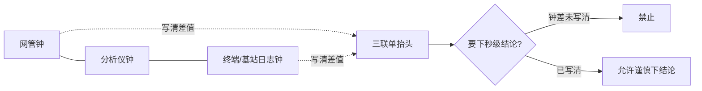

# 手册 15 · 运维制度：电源监控对时与告警风暴治理

> **手册模式 · 岗位深挖（运维 / 网管 / 电源监控治理）第 15 篇**（接第 40 课收官 · 手册 01–14 之后 · **不是第 41 课**）  
> 适合：手册 12 已经给你贴纸 K（市电、后备、倒换、告警、交维），可一到「网管铃狂响三分钟又全绿」「整流假绿其实采集断了」「分析仪时间比网管快 8 分钟导致因果颠倒」「交班把告警全部静音」「市电闪断被拆成二十条独立射频病」你就慌——有人说铃多说明网管灵敏，有人说静音完才好交班，有人要用加功率掩盖倒换窗假干扰——你想学会**先证明监控对象完整、时钟对齐、单条告警语义清楚，再谈风暴治理与结案**的人  
> 阅读量：约 **30–40 分钟** · **不重 dump CACH / EMB / Slot Type 全字段**（第 18–22 课已有）、**不重写手册12 电源全文 / 手册06 三联单全文 / 手册07–09 全文**（只给指针）、**不发明 ETSI 条款号**、**不写真实频点 / 站名 / 个号 / 密钥 / 真实单位名**（全部教学虚构、脱敏到 L3） · **不教告警绕过 / 监控攻击步骤**——只讲制度治理 · 要把「**先证监控与对时；时钟漂移未写清禁下秒级因果；禁静音全部当交班常态；禁加功率掩盖假绿/假干扰；风暴先找根因事件；假绿拒签；倒换窗主贴 N 可挂 K；公开包脱敏 L3**」钉成肌肉记忆  
> **频谱 / 调制提醒（弱项短补）**：一条 DMR 信道占 **12.5 kHz**；**4FSK** 装货；**2-slot TDMA** 把时间切成 **30 ms** 一格、两格一轮 **60 ms**。电源监控与对时 **不改变**这些物理台阶——它只是把「机房心跳与墙上钟」对齐到同一本账。若有人把「告警风暴」当覆盖/干扰/话务病的补丁，或用加功率叙事「铃响时先抬功率压掉话」，先回 `学习推送/加餐_频率带宽与调制解调.md`，再挂本篇贴纸 **N**，并指针手册07/09/12，而不是先开射频工单或静音全屏。

---

## 1. 为什么要写这篇手册（动机 + 现场对话）

前十四篇手册教你认病、交维、写频与空投边界：贴纸 A–E 协议层，F 射频，G 实验室，H 话务，I 室分，J 写频，K 电源物理层，L 井库，M 批量/OTAP。可现场还有一类「病」——**不是今晚空口才坏，而是监控铃把真火淹没，或各楼层钟没对时把因果写反**：

- 夜班：「铃响了半屏，先全部静音，明早再看。」——静音当交班常态；真火被盖住。  
- 新人：「网管全绿，肯定没事。」——采集断了也会假绿；假绿 = 拒签。  
- 射频同事：「凌晨两点 BER 跳，肯定是同频。」——没先对分析仪/网管/终端三钟；时钟漂移把因果颠倒。  
- 班长：「风暴来了，逐条认领成独立射频/话务工单。」——市电闪断被拆成二十条假病。  
- 领导：「铃多说明网管灵敏，别关。」——没有关联与抑制；海量铃掩盖真火。  
- 电源同事：「手册12 交维过了，监控还要管？」——K 管物理倒换；本篇管监控链、对时与风暴治理。  
- 手册06 学过的人：「三联单要对时——风暴时来不及写？」——越风暴越要写清时钟差与根因事件，否则秒级结论作废。  
- 有人：「加功率压一下，铃就少了。」——加功率是手册07/09/12 禁区；本篇也禁。

这几句背后是同一件事：

> **「电源监控 / 对时 / 告警」这个词在现场至少有五个坑**：  
> **① N-监**：监控对象与采集链——电源/整流/电池/油机/环境/网管链路是否完整、是否假绿  
> **② N-时**：对时——NTP/PTP/本机漂移、时区、夏令、分析仪/网管/终端三钟；漂移会把因果颠倒  
> **③ N-告**：单条告警语义与级别——欠压、整流故障、电池低、油机未起、链路中断、温度…  
> **④ N-风**：告警风暴 / 抖动 / 闪断风暴 / 静音过度 / 关联缺失——海量铃掩盖真火  
> **⑤ N-治**：治理——关联规则、抑制/静音窗口、升级路径、结案、脱敏公开包  
> 把 ①–⑤ 当成「网管厂商自动搞定」或「出了事用手册07/09 先开射频/话务单」，会把时钟债与监控债留给下一班。

本篇目标：能背出**电源监控对时与告警风暴治理工作流**；会用新贴纸 **N（监控/对时/风暴）** 与五个子类；会填 **插页 N（R1–R8）** 和《本网电源监控对时与告警风暴治理卡》；能用「**消防中控室火警面板 + 各楼层钟没对时**」故事讲清假绿与因果颠倒；能拒绝「全静音交班、假绿放行、漂移下秒级结论、风暴逐条拆成射频病、加功率压铃」；自测过关后，回库把本网最近一次监控风暴事件（脱敏到 L3）按本篇重对一遍。

**本篇硬禁令（写进脑子）**：不发明 ETSI 条款号；**不写真实批复频点、真实站号、真实个号、真实密钥、真实单位名进公开仓库**；**不教告警绕过、监控链路攻击、静音后门**——只讲制度治理；不重写手册12 / 06 / 07–09 全文（只给指针）；**手册12 的 K 规则物理倒换仍生效，本篇加深监控侧**；**不把加功率/加信道当假绿或风暴的止痛药**；监控/对时/风暴问题**主贴 N**，倒换窗可挂 K，假 F/H 可次挂，禁止把「铃多」写成「用户捣蛋」；结案词用贴纸 N + 本网证据；公开 ISA-18.2 / EEMUA 191 精神、NTP BCP、电信直流监控资料只借**精神与顺序**——**不背条款号当 ETSI**。

---

## 2. 总图 / 故事：监控像「消防中控室火警面板 + 各楼层钟没对时」

### 2.1 一句话：必须先证明探头在线、钟对齐、单铃语义清楚，再谈抑制风暴——否则假绿放行、真火被淹没、因果写反

```text
   ┌──────────────────────────────────────────────────────────────┐
   │  消防中控室（本网网管 / NOC 告警墙）                            │
   │                                                              │
   │   各楼层探头 = 市电/整流/电池/油机/环境/链路传感器（N-监）       │
   │   各楼层挂钟 = 基站钟、分析仪钟、网管钟、终端日志钟（N-时）       │
   │   单条火警灯 = 一条可行动告警：欠压/整流故障/电池低…（N-告）     │
   │   火警风暴   = 一分钟刷屏铃；闪断抖动；关联缺失（N-风）         │
   │   治理台账   = 关联规则、抑制窗、升级路径、结案、脱敏（N-治）     │
   │                                                              │
   │   ┌─────────┐   ┌─────────┐   ┌─────────┐   ┌─────────┐     │
   │   │ 探头在线 │──▶│ 三钟对齐 │──▶│ 单铃语义 │──▶│ 风暴分诊 │     │
   │   │ (N-监)  │   │ (N-时)  │   │ (N-告)  │   │ (N-风)  │     │
   │   └────┬────┘   └────┬────┘   └────▲────┘   └────┬────┘     │
   │        │             │             │              │           │
   │        │采集断假绿    │漂移颠倒因果  │级别乱/无动作 │全静音/逐条拆│
   │        ▼             ▼             │              ▼           │
   │   ┌─────────┐   ┌─────────┐       │         ┌─────────┐     │
   │   │ 拒签放行│   │ 禁秒级  │───────┘         │ 真火淹没│     │
   │   │ (N-监)  │   │ 结论    │                 │ (N-风)  │     │
   │   └─────────┘   └─────────┘                 └────┬────┘     │
   │        ▲                                          │           │
   │   关联找到根因事件 → 抑制抖动窗 → 升级路径 → 结案（N-治）◀─┘   │
   │   禁：静音全部当交班；加功率压铃；风暴拆成独立射频病            │
   └──────────────────────────────────────────────────────────────┘
```

口诀：

> **先探头，再对钟，后认铃，末治风暴。**  
> 探头断了却全绿 = 中控室假装没事——**假绿拒签。**  
> 各楼层钟差八分钟还写「谁先谁后」= 把纵火写成灭火。

### 2.2 「中控室」五段直觉（弱项短补，钉死）

| 段 | 像什么 | 运维直觉 | 本篇贴纸 |
|----|--------|----------|----------|
| **监控对象** | 各楼层烟感/温感探头 | 市电、整流、电池、油机、环境、网管链路是否在采；假绿=探头掉线仍显示正常 | N-监 |
| **对时** | 各楼层挂钟与中控母钟 | NTP/PTP、时区、漂移；分析仪/网管/终端三钟差必须写进三联单 | N-时 |
| **单条告警** | 一盏可行动火警灯 | 语义、级别、建议动作；「铃响但无人该做什么」= 坏铃 | N-告 |
| **风暴** | 整面墙同时闪 | 闪断抖动、链路抖、NTP 跳变引发刷屏；海量铃掩盖真火 | N-风 |
| **治理** | 中控规程：关联、抑制、升级、结案 | 根因事件优先；禁止全静音交班；公开包脱敏 L3 | N-治 |

> 公开 NTP 最佳实践（多源、监控偏移/抖动）、告警管理精神（可行动才叫告警、风暴要关联与合理化）、电信直流电源监控资料（整流/电池/市电最小采集集）——本篇只借**顺序直觉**：探头完整 → 钟对齐 → 单铃语义 → 根因关联 → 抑制窗 → 升级结案。**不背厂商菜单步骤 / 不背标准条款号当 ETSI / 不教绕过告警。**

### 2.3 和手册12 / 06 / 07 / 09 的咬合（指针，不重写）

- **手册12 贴纸 K**：市电/后备/倒换/告警/交维的**物理层**——**本篇是 K-告 与监控侧的加深册**。倒换演练窗可挂 K，但**监控风暴与对时主贴 N**。  
- **手册06**：三联单五要素与对时——时钟漂移未写清 → **禁下秒级因果结论**（本篇规则硬钉）。  
- **手册07 贴纸 F**：覆盖/干扰；倒换窗或欠压窗 BER 跳 → 先问 N/K，**禁加功率叙事**。  
- **手册09 贴纸 H**：话务；多站间歇掉电被当成容量病 → 先 N/K，禁加信道掩盖。  
- **手册08 贴纸 G**：实验室闭环；台架验证「假绿」时可用 G 气质，不重写六闭环。  
- **手册10 / 13**：室分/井库；远端有源掉电引发铃风暴 → 主贴常仍是 N（监控链）或 K（物理），次挂 I/L。  
- **手册11 / 14**：写频/OTAP；管理台掉电或时钟乱导致完成账错位 → 可挂 N-时，回 J/M 结案。  
- **手册01–05**：风暴后登记/Grant 异常——可次挂，**先冻结射频玄学，先证监控与对时**。

### 2.4 新贴纸 N：监控 / 对时 / 告警风暴（五个子类）

```text
                    ┌──────── 贴纸 N · 监控/对时/风暴 ────────┐
                    │  N-监  监控对象与采集链：电源·整流·电池·油机·环境·链路；假绿拒签 │
                    │  N-时  对时：NTP/PTP·漂移·时区·分析仪/网管/终端三钟              │
                    │  N-告  单条告警语义与级别：欠压·整流故障·电池低·油机·链路·温度   │
                    │  N-风  风暴/抖动/闪断/静音过度/关联缺失：海量铃掩盖真火           │
                    │  N-治  治理：关联规则·抑制窗·升级路径·结案·脱敏 L3               │
                    └──────────────────────────────────────────────────────────────┘
```

| 子类 | 一句话 | 典型拒签 / 拒静音触发 |
|------|--------|----------------------|
| **N-监** | 采集链完整且非假绿才谈放行 | 探头离线仍显示正常；关键对象未进网管 |
| **N-时** | 三钟差写清才允许秒级因果 | 漂移未记录仍写「谁先谁后」 |
| **N-告** | 每条铃要有语义、级别、建议动作 | 「未知告警」刷屏无人认领 |
| **N-风** | 风暴先找根因事件，禁逐条拆射频病 | 市电闪断被拆成二十条 F/H 工单 |
| **N-治** | 关联+抑制窗+升级+结案；禁全静音交班 | 交班把告警墙一键静音当常态 |

### 2.5 监控 / 对时 / 风暴最小工作流（背下来）

```text
1. N-监：列出本站最小监控对象 → 抽查采集是否在线 → 假绿？→ 拒签
2. N-时：读网管钟 / 分析仪钟 / 终端或基站日志钟 → 写清差值与时区
3. N-告：挑最高级别未结案铃 → 语义/级别/建议动作是否清楚
4. N-风：是否风暴？（短时海量 / 抖动重复 / 静音过度）→ 先找根因事件
5. N-治：关联抑制 → 升级路径 → 三联单结案（脱敏 L3）→ 可挂 K/F/H 但主贴 N
```

---

## 3. 核心交付：插页 N + 拒签/拒静音卡 + 与总三联单怎么写

### 3.1 什么时候贴 N（而不是先贴 K / F / H）

| 现象 | 优先贴纸 | 说明 |
|------|----------|------|
| 交维要证市电→后备→回切物理动作 | **K**（手册12） | 本篇不替代倒换验收 |
| 网管铃风暴、假绿、时钟乱、静音过度 | **N** | 本篇主场 |
| 倒换窗 BER 跳、欠压远端掉 | **N 主，可挂 K/F** | 先监控/电源，后射频 |
| 多站间歇「忙」其实掉电 | **N 主，可挂 H** | 禁加信道 |
| 写频完成账时间对不上 | **N-时 可挂，主常仍 J/M** | 指针手册11/14 |

口诀：**物理倒换看 K；监控铃与钟看 N；射频/话务是次挂，不是先开枪。**

**和贴纸 F / H 的「咬一口」提醒（不重写 07/09）**：

- 倒换窗或欠压窗出现「同步差 / BER 跳 / 数字悬崖」——先问是否 N/K 事件窗，再考虑 F。  
- 多站同期「信道忙 / 排队长」——先问是否电源相关铃族，再考虑 H。  
- 两本账（控制∥业务）若时间戳互相打架，先 N-时，再谈话务分诊。

### 3.2 插页 N · 监控 / 对时 / 风暴（挂在总三联单或网管交班首页后）

| 行 | 检查项 | 过/否 | 证据位 |
|----|--------|-------|--------|
| **R1** | 最小监控对象清单存在（市电/整流/电池/油机/环境/链路） |  | 清单编号·脱敏站类 |
| **R2** | 采集链抽查：关键点非假绿（断采能报红或离线） |  | 截图·探测时间 |
| **R3** | 三钟差值已记录（网管 / 分析仪 / 终端或基站日志） |  | 差值·时区·来源 |
| **R4** | NTP/PTP 或本机对时状态可读（偏移/是否同步） |  | 状态摘要·非密钥 |
| **R5** | 最高级别未结案告警有语义+级别+建议动作 |  | 告警名·动作栏 |
| **R6** | 若风暴：已标根因事件（市电闪断/链路抖/NTP跳变/…） |  | 根因一句话 |
| **R7** | 抑制/静音仅限声明窗口；非「全静音交班」 |  | 窗起止·审批 |
| **R8** | 结案：升级路径走完或书面挂起；公开包脱敏 L3 |  | 结案号·脱敏勾 |

> R1–R2 不过 → **拒签 / 拒放行**。R3–R4 不过 → **禁下秒级因果**。R7 若「全静音」→ **拒静音卡**。

### 3.3 「假绿拒签 / 禁全静音交班」卡（贴网管 / NOC）

```text
┌────────────────────────────────────────────┐
│  假绿拒签 / 禁全静音交班卡（贴纸 N）          │
│                                            │
│  □ 采集链未证非假绿 → 禁止签字放行          │
│  □ 三钟差未写清 → 禁止写秒级谁先谁后        │
│  □ 「一键静音全部」不得作为交班常态          │
│  □ 风暴未标根因事件 → 禁止逐条拆射频/话务单 │
│  □ 禁加功率 / 加信道掩盖假绿或倒换窗假干扰  │
│                                            │
│  例外静音必须：起止时间 · 原因 · 审批人 ·   │
│  到期自动恢复提醒                            │
└────────────────────────────────────────────┘
```

### 3.4 和总三联单怎么写（接手册06）

| 三联单栏 | 本篇要多写的 |
|----------|-------------|
| 时间 | **三钟差**、时区、是否夏令；写「网管快 +Xm / 分析仪慢 −Ys」 |
| 现象 | 铃密度（约 X 条/10 分钟）、是否抖动重复、是否假绿 |
| 证据 | 根因事件、采集在线证明、对时状态摘要（无密钥/无真实站名） |
| 处置 | 关联/抑制窗/升级；**未**全静音 |
| 结案 | 主贴 N-?；可挂 K/F/H；脱敏 L3 |

### 3.5 《本网电源监控对时与告警风暴治理卡》预告

第七章给可复印模板：封面拒签门槛、主表对齐插页 R1–R8、根因事件页、抑制窗与升级页、夜班速填五行。

---

## 4. 深潜：八条硬规则 + 对时/风暴直觉 + 假病禁令

### 4.1 八条硬规则（本篇钉子）

1. **先证监控与对时，再写空口/干扰玄学**——探头与钟没过关，射频单先冻结。  
2. **时钟漂移未写清 → 禁下秒级因果结论**——呼应手册06；差几分钟就把灭火写成纵火。  
3. **禁「静音全部告警」当交班常态**——例外必须有窗、原因、审批、到期恢复。  
4. **禁「加功率/加信道」掩盖电源监控假绿或倒换窗假干扰**——呼应手册07/09/12。  
5. **风暴时先找根因事件（市电闪断/链路抖/NTP跳变），禁逐条认领成独立射频病**——一因多铃是常态。  
6. **监控假绿（采集断了显示正常）= 拒签 / 拒放行**——中控室假装没事比铃响更危险。  
7. **倒换/油机演练窗可挂 K，但监控侧风暴与对时主贴 N**——物理与监控分工，不互相顶替。  
8. **公开材料脱敏 L3；不写真实站名/频点/个号/密钥**——教学与公开仓双禁。

### 4.2 对时 / 风暴直觉（不背厂商菜单）

```text
  铃墙亮了 / 有人要下秒级结论
        │
        ▼
  采集链非假绿？──否──▶ 拒签（N-监 / 规则6）
        │是
        ▼
  三钟差已写清？──否──▶ 禁秒级因果（N-时 / 规则2）
        │是
        ▼
  单铃语义/级别/动作清楚？──否──▶ 先 N-告 合理化，不盲目升级射频
        │是
        ▼
  是否短时海量/抖动重复？──是──▶ 标根因事件（N-风）→ 关联抑制（N-治）
        │否（单条可行动）
        ▼
  升级路径 / 倒换窗？──物理倒换──▶ 可挂 K；监控主贴仍可能是 N
        │
        ▼
  结案 + 脱敏 L3；禁全静音交班；禁加功率压铃
```

现场口诀：

> **先假绿，再漂移，后根因，末结案。**  
> 跳过根因的逐条认领 = 把一场市电闪断写成二十个同频事故。

**最小监控对象清单（教学默认，按本网裁剪）**：

| 对象 | 为什么必须进墙 | 假绿典型样子 |
|------|----------------|--------------|
| 市电状态 | 闪断是风暴第一大根因 | 市电断了墙仍「市电正常」 |
| 整流模块/系统 | 模块挂了靠电池偷时间 | 模块离线仍显示输出正常 |
| 电池组电压/低电压告警 | 后备是否真有油 | 电压采死、告警永不亮 |
| 油机/ATS 状态 | 演练与真启动要可区分 | 油机未起却无铃 |
| 机房环境（温湿度等） | 高温先杀电源后杀射频 | 温感掉线墙仍舒适 |
| 网管/采集链路本身 | 链路断=整面假绿风险 | 链路断了业务墙仍绿 |

> 清单不是为了「铃越多越好」，而是为了**断采可被看见**。看不见的探头 = 中控室的盲区。

### 4.3 三钟差：多少算「必须写」

| 场景 | 教学阈值直觉（非厂商指标） | 动作 |
|------|---------------------------|------|
| 排障写「谁先谁后」 | 差 **≥ 数秒** 且结论依赖顺序 | 必须写清差值；差大则只写「先后不明」 |
| 日常交班 | 差 **≥ 约 1 分钟** | 记入交班；安排对时 |
| 风暴关联 | 差 **≥ 约数分钟** | **禁止**用未校正时间线做根因排序 |
| 批量/OTAP 完成账（指针 M） | 管理台钟 vs 终端日志钟差大 | 完成窗时间线作废重对；可挂 N-时 |
| 实验室对照（指针 G） | 台架钟 vs 网管钟未对齐 | 证据包时间戳无效；先对时 |
| NTP 明显未同步 | 状态显示未锁定/偏移异常 | 主贴 N-时；先修钟再写因果 |



> 本篇**不规定**你网必须用 NTP 还是 PTP，只要求：**凡写秒级因果，必须先暴露时钟差。**  
> 夏令时/时区只写「显示层」也算坑：同一瞬间 UTC 一致，面板却差一小时——三联单要写**时区标签**，不要只抄面板数字。

### 4.4 「假绿 / 假干扰 / 假容量 / 假协议」怎么认

| 假病外表 | 常见监控真因 | 错误处置 | 正确主贴 |
|----------|--------------|----------|----------|
| 假绿 | 采集断、代理僵死、链路断仍显示正常 | 签字放行 | N-监 拒签 |
| 假干扰 | 倒换窗/欠压窗 BER 跳 | 开同频工单、加功率 | N/K（次挂 F） |
| 假容量 | 多站间歇掉电像「忙」 | 加信道 | N/K（次挂 H） |
| 假协议 | 时钟乱导致日志「登记失败在前」 | 改鉴权参数 | N-时（次挂 A） |
| 假灵敏 | 铃多=网管好 | 拒绝合理化 | N-风/N-治 |
| 假消缺 | 全静音后墙面干净 | 交班走人 | N-治 拒静音 |

**三问快判（背）**：

1. **假绿？** 断采能不能报红/离线？（R2）  
2. **钟差？** 三钟差值写了没有？（R3）  
3. **根因？** 风暴有没有一句话根因事件？（R6）  

三问里有「否」，就**先写 N**；三问全「是」且仍有持续空口病，再进手册01–05/07/09。切记：风暴夜优先关联与对时，不是先开同频或加信道。

### 4.5 假病禁令墙（与加功率叙事）

1. 禁止用「全静音」代替消缺与结案。  
2. 禁止用加功率压掉倒换窗/欠压窗的「假干扰」观感。  
3. 禁止用加信道掩盖多站掉电造成的「假忙」。  
4. 禁止在时钟差未写清时做秒级根因排序。  
5. 禁止把监控假绿说成「网管显示正常就是正常」。

### 4.6 和弱项加餐的衔接

12.5 kHz / 4FSK / 30 ms 两槽背熟，你才说得清：**监控与对时管的是机房心跳与证据钟，不是调制台阶**。有人要用加功率/加信道治铃或多站掉话时，回加餐 + 手册07/09/12 + 本篇八条硬规则。

---

## 5. 现场映射：原话 → N 子类；对话脚本；反例

### 5.1 原话速查表

| 现场原话 | 主子类 | 你先要的证据 |
|----------|--------|--------------|
| 「全绿没事」 | N-监 | 断采探测；离线是否变红 |
| 「分析仪比网管快八分钟」 | N-时 | 三钟读数；时区 |
| 「这条铃是什么意思谁都说不清」 | N-告 | 语义/级别/建议动作栏 |
| 「一分钟来了上百条」 | N-风 | 根因事件候选；抖动重复模式 |
| 「交班先静音完」 | N-治 | 拒静音卡；例外窗审批 |
| 「倒换时铃爆了」 | N（可挂 K） | 演练窗声明；关联规则 |
| 「BER 跳肯定同频」 | N/K 先于 F | 是否倒换/欠压窗；钟差 |
| 「多站一起忙」 | N/K 先于 H | 是否掉电相关铃 |

### 5.2 对话脚本（六则）

**脚本 A · 假绿**  
新人：「网管全绿，可以放行。」  
你：「先做断采探测——拔掉或隔离一条测试采集，看墙会不会变红/离线。不变 = 假绿，拒签（N-监）。」

**脚本 B · 漂移**  
射频：「日志显示干扰在登记失败之前。」  
你：「三钟差写了吗？差八分钟就不能写谁先谁后。先 N-时，禁秒级结论。」

**脚本 C · 全静音**  
夜班：「铃太多，我静音全部好交班。」  
你：「禁止。要静音必须写窗口、原因、审批、到期恢复。真火被盖住谁负责？（N-治）」

**脚本 D · 风暴拆单**  
班长：「每条铃派一个射频单。」  
你：「先标根因事件——像不像市电闪断或链路抖？一因多铃先关联，禁止拆成二十个同频故事（N-风）。」

**脚本 E · 加功率**  
领导：「铃响时抬功率，用户感觉好点。」  
你：「禁。那是假干扰止痛药，手册07/09/12 与本篇规则4 都禁。先 N/K。」

**脚本 F · 倒换窗**  
电源：「今晚油机演练，铃会爆。」  
你：「物理走 K；监控侧提前声明抑制窗与根因标签，主贴 N，可挂 K。演练不是全静音许可证。」

### 5.3 反例墙（贴网管 / NOC）

1. 交班一键静音全部。  
2. 假绿签字放行。  
3. 钟差不问就写秒级因果。  
4. 风暴逐条拆成 F/H 工单。  
5. 加功率/加信道压铃或压掉话观感。  
6. 倒换演练无声明窗却事后怪网管「太灵敏」。  
7. 公开包带真实站名/频点/个号。  
8. 用「厂商默认阈值」代替本网可行动语义（N-告 空转）。

### 5.4 夜班 15 分钟怎么用

```text
0–3 min   扫最高级别未结案铃（N-告）+ 目视是否风暴
3–6 min   抽查 1 个关键点非假绿（N-监）
6–9 min   读三钟差，记入交班（N-时）
9–12 min  若风暴：写一句根因候选（N-风）
12–15 min 抑制仅限已批窗口；否则升级/挂起（N-治）
```

### 5.5 单次风暴治理 40 分钟标准节奏（可复印；大风暴加倍）

```text
00–05  声明：是否已知演练窗 / 市电事件（可挂 K）
05–10  R1–R2 假绿筛查；不过则拒签扩面
10–15  R3–R4 三钟与对时状态
15–25  聚类：同一根因事件下的铃族（N-风）
25–35  关联抑制 / 升级路径；禁全静音
35–40  三联单结案：主贴 N；脱敏 L3；次挂列表
```

---

## 6. 工作实例（10 个厚例，均教学虚构、已脱敏到 L3）

### 例 1 · 「市电闪断，铃墙爆炸，被拆成同频故事」→ N-风（次挂 K）

- **现象**：某脱敏站类凌晨短时市电闪断；网管 10 分钟内上百条；早班开了多张「同频干扰」单。  
- **分诊**：三钟差 2 分钟已记录；铃族时间线对齐市电事件；BER 跳仅在倒换窗。  
- **主贴**：N-风；可挂 K-市/K-切。  
- **禁令**：禁止逐条拆 F；禁止加功率。  
- **结案**：根因=市电闪断；关联规则补「市电→整流/电池/链路」族；公开包脱敏。

### 例 2 · 「全绿放行，次日才发现采集进程僵死」→ N-监

- **现象**：交维签字时网管全绿；次日才发现电源采集代理僵死两天。  
- **分诊**：断采探测不变红 = 假绿。  
- **主贴**：N-监；拒签门槛写进交维包。  
- **教训**：假绿比铃响更危险。

### 例 3 · 「分析仪快 8 分钟，把灭火写成纵火」→ N-时

- **现象**：报告写「干扰先于登记失败」；对表后发现分析仪快 8 分钟。  
- **分诊**：手册06 + 本篇规则2；秒级结论作废。  
- **主贴**：N-时；重写时间线为「先后不明，待对时后重判」。

### 例 4 · 「交班全静音，真电池低被盖住」→ N-治 / N-告

- **现象**：夜班一键静音；清晨电池低未升级，站点掉电。  
- **分诊**：静音无窗口无审批。  
- **主贴**：N-治；启用「禁全静音交班」卡；电池低升级路径重训。

### 例 5 · 「倒换演练未声明，网管被骂太灵敏」→ N-风（挂 K）

- **现象**：油机演练铃爆；事后怪阈值。  
- **分诊**：无演练窗声明；无根因标签。  
- **主贴**：N；可挂 K-切。补「演练前声明抑制窗」。

### 例 6 · 「链路抖引发 SNMP 风暴」→ N-风 / N-监

- **现象**：网管链路间歇，trap 重传刷屏；真整流故障铃被淹没。  
- **分诊**：先标链路根因；抑制抖动重复；保留高级别电源铃。  
- **主贴**：N-风；修链路（N-监）。  
- **诚实**：本篇只讲制度抑制与关联，不教攻击或绕过。

### 例 7 · 「NTP 跳变后日志全部错位」→ N-时

- **现象**：对时源切换导致时钟跳变；完成账与投诉窗对不上。  
- **分诊**：写明跳变时刻与幅度；相关 J/M 事件时间线作废重对。  
- **主贴**：N-时；可挂手册11/14 指针。

### 例 8 · 「用加功率压倒换窗掉话观感」→ 禁令（N + F）

- **现象**：倒换窗用户喊差；有人建议抬功率。  
- **分诊**：规则4 + 手册07/12。  
- **主贴**：N/K；明确拒绝加功率叙事。

### 例 9 · 「多站间歇掉电被当成话务忙」→ N（次挂 H）

- **现象**：话务账「忙」；其实多站电源相关铃同期。  
- **分诊**：先 N/K，禁加信道（手册09）。  
- **主贴**：N；次挂 H 仅作症状。

### 例 10 · 「未知告警刷屏无人认领」→ N-告 / N-治

- **现象**：厂商代码无中文语义；夜班只得静音。  
- **分诊**：合理化：语义、级别、建议动作写入本网库；无动作则降噪或改通知策略（制度内）。  
- **主贴**：N-告 → N-治；借告警合理化精神，**不背条款号**。


### 例厚补 · 现场「半绿半风暴」怎么排优先级（5 分钟口诀）

1. **先假绿**：任一关键采集假绿 → 全网「看起来没事」不可信，扩面抽查优先于认铃。  
2. **再钟差**：要写因果或合并工单前，先把三钟差钉在三联单抬头。  
3. **后根因**：风暴铃按时间簇/对象簇折叠，写出一句根因，再决定是否挂 K/F/H。  
4. **末升级**：仍有可行动顶级铃 → 走升级路径；不要用全墙静音换安静。  

> 口诀再缩一句：**绿要真，钟要齐，风暴归一事，静音要有窗。**

### 6.5 监控对齐会：20 分钟议程

```text
1. 本周假绿抽查结果（N-监）
2. 三钟差趋势（N-时）
3. Top 坏铃 / 无动作铃（N-告）
4. 风暴次数与根因分布（N-风）
5. 抑制窗例外审批是否合规（N-治）
6. 与 K 交维窗冲突项
```

---

## 7. 《本网电源监控对时与告警风暴治理卡》模板

### 7.1 封面 · 拒签 / 拒静音门槛（贴网管）

```text
本网电源监控对时与告警风暴治理卡（脱敏 L3）
站类/作业代号：__________  日期：__________  填写人：__________

拒签：□ 假绿未排除  □ 最小对象清单缺失
拒秒级结论：□ 三钟差未写清
拒静音：□ 拟全静音交班  □ 抑制窗无审批/无到期
禁令勾选：□ 不加功率  □ 不加信道掩盖  □ 不逐条拆射频病
```

### 7.2 主表（与插页 N 对齐）

| 行 | 项 | 结果 | 备注（脱敏） |
|----|----|------|--------------|
| R1 | 最小对象清单 | 过/否 |  |
| R2 | 非假绿抽查 | 过/否 |  |
| R3 | 三钟差 | __分__秒 | 时区： |
| R4 | 对时状态 | 同步/否 |  |
| R5 | 顶级铃语义 | 过/否 |  |
| R6 | 根因事件 | 有/无 | 一句话： |
| R7 | 抑制窗 | 无/有（起止） | 审批人： |
| R8 | 结案与脱敏 | 过/否 | 主贴 N-__ |

### 7.3 根因事件页（N-风）

```text
根因候选：□市电闪断 □整流模块 □电池低 □油机未起/演练
         □链路抖 □NTP跳变 □环境高温 □其它：______
时间窗（以网管钟）：______ → ______
关联铃族数量（约）：______
是否误拆 F/H 单：□是 □否  → 已撤回/合并：______
```

### 7.4 抑制窗与升级页（N-治）

```text
抑制范围（非全墙）：________________
起止：______ → ______  到期恢复提醒：□已设
升级路径：L1 夜班 → L2 电源值班 → L3 ______
结案号：______  公开包：□已脱敏 L3
```

### 7.5 夜班速填（5 行）

```text
1. 假绿抽查：过/否
2. 三钟差：
3. 风暴？根因一句：
4. 抑制窗：无/有（起止）
5. 主贴 N-__；次挂：
```

---

## 8. 术语表（本篇约 30 词）+ 易错观念

| 术语 | 白话 |
|------|------|
| 监控对象 | 被采集的电源/环境/链路点 |
| 采集链 | 传感器→代理/RTU→网管的路径 |
| 假绿 | 断采仍显示正常 |
| NTP | 网络时间协议（常用对时） |
| PTP | 精密时间协议（更高精度场景） |
| 偏移/抖动 | 相对参考钟的偏差与波动 |
| 三钟 | 网管钟、分析仪钟、终端/基站日志钟 |
| 时区/夏令 | 显示层陷阱；要写明 |
| 告警语义 | 这条铃到底说什么 |
| 级别 | 紧急/重要/次要等本网分级 |
| 可行动告警 | 有人该在时限内做什么 |
| 告警风暴 | 短时海量铃超出有效处置 |
| 抖动/闪断风暴 | 同一条件反复跳变刷屏 |
| 关联 | 多铃归到同一根因事件 |
| 抑制窗 | 声明期内降噪；非永久静音 |
| 静音过度 | 把真火一起关掉 |
| 合理化 | 按哲学删改无动作/重复铃（借精神） |
| 根因事件 | 风暴背后的那一个触发 |
| 升级路径 | 谁在何时接手 |
| 结案 | 关闭或书面挂起并留证 |
| 脱敏 L3 | 去站名/频点/个号/密钥 |
| 整流 | AC→DC 模块（指针 K） |
| 电池组 | 后备储能（指针 K） |
| 油机/ATS | 发电与切换（指针 K） |
| SNMP trap | 设备主动上送的告警消息（概念） |
| NOC/网管墙 | 中控室告警呈现面 |
| 倒换窗 | 市电↔后备切换时段（指针 K） |
| 加功率禁令 | 不得用抬功率治假干扰（指针 F） |
| 加信道禁令 | 不得用加信道治假忙（指针 H） |
| 12.5 kHz / 4FSK / 30 ms | 弱项物理台阶提醒 |

**易错观念**

1. 「全绿=健康」→ 可能假绿。  
2. 「铃多=灵敏=好事」→ 无关联的风暴掩盖真火。  
3. 「静音=消缺」→ 只是把火警灯拧掉。  
4. 「有手册12 就不用监控治理」→ K 管物理，N 管监控与钟。  
5. 「时间差不多就行」→ 秒级结论必须暴露钟差。  
6. 「风暴就派射频单」→ 先根因事件。  
7. 「加功率让用户舒服点」→ 禁。  
8. 「公开分享可以带站名方便」→ L3 禁。

---

## 9. 自测（10 题）+ 参考答案

1. 贴纸 N 五个子类叫什么？各举一个拒签/拒静音触发。  
2. 为什么假绿比铃响更危险？  
3. 三钟差未写清时，能否写「干扰先于登记失败」？  
4. 市电闪断引发上百条铃，应主贴什么？能否拆成二十个同频单？  
5. 交班一键静音全部是否允许？例外要写什么？  
6. 倒换演练铃爆，K 与 N 怎么分工？  
7. 多站间歇掉电像话务忙，能否加信道？  
8. 插页 R1–R8 里哪两行不过必须拒签？哪两行不过禁秒级结论？  
9. 本篇与手册12/06/07/09 的指针关系各一句。  
10. 公开包脱敏 L3 要去掉哪些？

### 参考答案

1. 监/时/告/风/治；例：假绿拒签、漂移禁秒级、无语义坏铃、风暴禁拆单、禁全静音交班。  
2. 断采仍显示正常会让人签字放行，真故障零可见。  
3. 不能；规则2 / 手册06。  
4. 主贴 N-风（可挂 K）；禁止逐条拆 F。  
5. 不允许当常态；例外要起止、原因、审批、到期恢复。  
6. 物理倒换挂 K；监控风暴与对时主贴 N；可声明抑制窗。  
7. 不能；先 N/K，禁加信道（规则4 / 手册09）。  
8. R1–R2 拒签；R3–R4 禁秒级结论。  
9. 12=物理母册；06=对时证据；07=假 F/禁加功率；09=假 H/禁加信道。  
10. 真实站名、频点、个号、密钥、可识别单位名等。

---

## 10. 加深阅读与视频（均已用 curl 核对 HTTP 200；视频用 YouTube oEmbed 核对存在）

1. **[RFC 8633 · Network Time Protocol Best Current Practices](https://datatracker.ietf.org/doc/html/rfc8633)**  
   - NTP 运维 BCP：多源、监控、安全意识；对照 N-时。**只借精神，不背成 ETSI。**  
2. **[RFC Editor · RFC 8633 信息页](https://www.rfc-editor.org/info/rfc8633/)** · **[HTML 全文](https://www.rfc-editor.org/rfc/rfc8633.html)**  
   - 备份入口。  
3. **[Cisco · Use Best Practices for NTP](https://www.cisco.com/c/en/us/support/docs/availability/high-availability/19643-ntpm.html)**  
   - 经典 NTP 实践文；对照「时间是分析前提」。  
4. **[Cisco · IOS XR NTP 配置与监控要点](https://www.cisco.com/c/en/us/td/docs/iosxr/cisco8000/timing/b-timing-sync-config-guide-cisco8000/m-network-time-protocol.html)**  
   - 多源、认证、状态监控气质。  
5. **[CISA · Time Guidance for Network Operators / CIOs / CISOs（PDF）](https://www.cisa.gov/sites/default/files/publications/time_guidance_network_operators_cios_cisos_508.pdf)**  
   - 对时治理检查问句；对齐「要有对时策略与异常处置」。  
6. **[CAST / ORNL · Technical Bulletin 004（PDF）](https://cast.ornl.gov/downloads/CAST-Technical-Bulletin-004.pdf)**  
   - 对时监测与运维讨论；借监控偏移的重要性。  
7. **[Netverge · NTP Monitoring](https://netverge.com/blog/ntp-monitoring)**  
   - 偏移/抖动/reach 等一并看的白话。  
8. **[NTP FAQ · Troubleshooting](https://ntp.org/ntpfaq/NTP-s-trouble/)** · **[NTP 项目首页](https://www.ntp.org/)**  
   - 排障入口与项目门户。  
9. **[RFC 5905 · NTPv4](https://datatracker.ietf.org/doc/html/rfc5905)**  
   - 协议基础（选读）；不要求背字段。  
10. **[NIST · Using NTP: Introduction and Recommended Practices](https://www.nist.gov/publications/using-ntp-introduction-and-recommended-practices)**  
    - NIST 对时实践入口页。  
11. **[NIST Internet Time Service 服务器页](https://tf.nist.gov/tf-cgi/servers.cgi)**  
    - 公开时间源列表气质（本网是否外采另议）。  
12. **[ISA · Alarm management questions everyone asks](https://www.isa.org/intech-home/2020/march-april/features/alarm-management-questions-that-everyone-asks)**  
    - 告警管理生命周期白话；对照 N-告/N-治。**借精神，不背条款号。**  
13. **[ISA-18 委员会页](https://www.isa.org/standards-and-publications/isa-standards/isa-standards-committees/isa18)**  
    - 标准家族入口（了解用）。  
14. **[Emerson · Alarm Management By the Numbers（PDF）](https://www.emerson.com/is/content/emerson/en/corporate/news-and-events/articles/documents/alarm-management-by-the-numbers.pdf)**  
    - 风暴/速率类 KPI 直觉（过程工业语境，借「风暴要度量」）。  
15. **[IChemE · Alarm rationalisation metrics guidance（PDF）](https://www.icheme.org/media/17392/lc-0151_21-lead-process-safety-metrics-alarm-rationalisation-final.pdf)**  
    - 合理化与洪水定义气质；对照 N-风。  
16. **[Wikipedia · Alarm management](https://en.wikipedia.org/wiki/Alarm_management)** · **[IEC 62682](https://en.wikipedia.org/wiki/IEC_62682)**  
    - 名词地图；**不把百科当本网制度。**  
17. **[ETSI ES 202 336-2 · DC power monitoring information model（PDF）](https://www.etsi.org/deliver/etsi_ES/202300_202399/20233602/01.01.01_60/es_20233602v010101p.pdf)**  
    - 电信直流电源监控信息集气质（市电/整流/电池等）；**只借对象清单直觉，不背条款当 DMR ETSI。**  
18. **[DPS · Rectifier Monitoring via SNMP](https://www.dpstele.com/blog/rectifier-monitoring-snmp-alarms-dialer.php)** · **[Rectifier Monitoring](https://www.dpstele.com/rectifier-monitoring.php)** · **[Remote Battery Monitoring](https://www.dpstele.com/network-monitoring/remote-battery-monitoring-telecom-utility-sites.php)**  
    - 电信场景整流/电池远程监控白话（厂商博客；借对象与链路直觉）。  
19. **[Pandora FMS · SNMP traps 与 storm protection](https://pandorafms.com/manual/!current/en/documentation/pandorafms/monitoring/08_snmp_traps_monitoring)**  
    - trap 风暴保护参数气质；对照 N-风/N-治（制度抑制，非攻击）。  
20. **[Netdata · SNMP traps sizing](https://learn.netdata.cloud/docs/network-performance-monitoring/snmp-traps/sizing-and-capacity-planning)** · **[Alerts](https://learn.netdata.cloud/docs/network-performance-monitoring/snmp-traps/alerts)**  
    - 容量与告警侧补充。  
21. **[NetXMS · SNMP Traps 文档](https://docs.netxms.org/admin/dev/snmp/traps/)**  
    - 开源网管 trap 处理入口。  
22. **[Network Management Experts · SNMP Trap Design That Doesn't Flood Your NOC](https://networkmanagementexperts.com/knowledge/snmp-trap-design-noc/)**  
    - 「别把 NOC 灌爆」设计文；对照关联与限速精神。  
23. **[Wikipedia · Network Time Protocol](https://en.wikipedia.org/wiki/Network_Time_Protocol)** · **[Precision Time Protocol](https://en.wikipedia.org/wiki/Precision_Time_Protocol)** · **[UTC](https://en.wikipedia.org/wiki/Coordinated_Universal_Time)**  
    - 对时名词垫脚石。  
24. **[Wikipedia · SNMP](https://en.wikipedia.org/wiki/Simple_Network_Management_Protocol)** · **[SCADA](https://en.wikipedia.org/wiki/Supervisory_control_and_data_acquisition)** · **[RTU](https://en.wikipedia.org/wiki/Remote_terminal_unit)** · **[NOC](https://en.wikipedia.org/wiki/Network_operations_center)** · **[Telemetry](https://en.wikipedia.org/wiki/Telemetry)**  
    - 监控链路名词包。  
25. **[Wikipedia · UPS](https://en.wikipedia.org/wiki/Uninterruptible_power_supply)** · **[Rectifier](https://en.wikipedia.org/wiki/Rectifier)** · **[Battery](https://en.wikipedia.org/wiki/Battery_(electricity))** · **[Diesel generator](https://en.wikipedia.org/wiki/Diesel_generator)** · **[ATS](https://en.wikipedia.org/wiki/Automatic_transfer_switch)**  
    - 电源对象百科（指针回手册12）。  
26. **[Wikipedia · Digital mobile radio](https://en.wikipedia.org/wiki/Digital_mobile_radio)** · **[LMR](https://en.wikipedia.org/wiki/Land_mobile_radio_system)** · **[Two-way radio](https://en.wikipedia.org/wiki/Two-way_radio)**  
    - DMR/专网弱项补。  
27. **[DMR Association · Key Benefits](https://dmrassociation.org/dmr-key-benefits.html)** · **[Scanner School · Intro to DMR](https://www.scannerschool.com/introduction-to-dmr/)**  
    - 官方/白话入门。  
28. **[NIST SP 800-128（PDF）](https://nvlpubs.nist.gov/nistpubs/SpecialPublications/NIST.SP.800-128.pdf)** · **[NIST CSF](https://www.nist.gov/cyberframework)** · **[CISA Secure by Design](https://www.cisa.gov/resources-tools/resources/secure-by-design)** · **[CISA Best Practices](https://www.cisa.gov/topics/cybersecurity-best-practices)**  
    - 配置/检测/响应气质；监控异常要进响应，不是静音了事。  
29. **[Motorola Solutions · MOTOTRBO 入口](https://www.motorolasolutions.com/en_us/products/two-way-radios/mototrbo.html)** · **[Support](https://support.motorolasolutions.com/)**  
    - 查本网机型网管文档时用；本篇不绑定菜单课。  
30. **[Wikipedia · Configuration management](https://en.wikipedia.org/wiki/Configuration_management)** · **[Change management (ITSM)](https://en.wikipedia.org/wiki/Change_management_(ITSM))**  
    - 变更与配置名词；抑制规则变更也要可控。

**视频：**

31. **[Scanner School · What is DMR?（YouTube）](https://www.youtube.com/watch?v=aQX_JbTbXuY)**  
    - 双时隙入门弱项补；提醒监控/对时不改变 12.5 kHz/两槽物理。  
32. **[Scanner School · Why Digital Radio Sounds Like Robots（YouTube）](https://www.youtube.com/watch?v=-hLiTz7oSKE)**  
    - 数字悬崖/BER 直觉；倒换窗「突然差」别先骂同频。  
33. **[P25 vs DMR（YouTube）](https://www.youtube.com/watch?v=tsVFV_XTQw8)**  
    - 数字制式对比扫盲；避免把监控风暴说成「数字电台玄学」。

> **诚实说明**：没有找到「DMR 专网电源监控对时与告警风暴治理（含假绿拒签 + 三钟差禁秒级因果 + 根因关联 + 禁全静音交班制度 + 插页 N）」专项中文/公开视频教程；上面的视频与文档分别讲 NTP 实践、告警管理/合理化精神、电信直流监控对象、SNMP trap 风暴防护与 DMR 基础，需要你自己按本篇贴纸 N 与插页 R1–R8 把它们拼进网管交班包。`video_found=true`（通用 DMR 入门视频 + 文档侧 NTP/告警管理/直流监控），**非**专项「DMR NMS 告警风暴制度」教程。

**库内必回：** `学习推送/手册12_基站电源与后备切换交维.md`（本篇的物理母册 K）、`手册06_日志三联单深化.md`（对时/脱敏）、`手册07_覆盖与同频干扰分诊.md`（假 F / 禁加功率）、`手册09_话务与容量分诊.md`（假 H / 禁加信道）、`手册08_测试实验室最小闭环.md`（台架气质）、`手册10`/`手册13`（远端有源/井库）、`手册11`/`手册14`（写频账时钟）、`加餐_频率带宽与调制解调.md`。

---

## 11. 收束：你今天带走什么；下一篇候选

### 11.1 带走的钉子

- 贴纸 **N** 五子类：监 / 时 / 告 / 风 / 治。  
- 故事：消防中控室火警面板 + 各楼层钟没对时；先探头、再对钟、后认铃、末治风暴。  
- 八条硬规则；**假绿拒签**；**漂移禁秒级因果**；**禁全静音交班**。  
- 风暴先根因事件；倒换窗可挂 K，监控主贴 N。  
- 禁加功率/加信道掩盖；公开包脱敏 L3。

### 11.2 回库路径

```text
总索引.md
  └─ 集群 / Tier III → 运维手册
       ├─ 手册01–05（A–E）06（总单）07（F）08（G）09（H）10（I）11（J）12（K）13（L）14（M）
       └─ 本篇手册15（贴纸N + 插页N + 电源监控对时与告警风暴治理卡）
            └─ 回：手册12（母册）、06–09、10/13、11/14、加餐弱项
```

### 11.3 下一篇手册候选（本篇不写正文）

- **室分有源隔离与减敏台架专项**（手册08 G + 手册10 I 的加深）。  
- **口部切换与邻站泄漏治理**（覆盖边界 / 邻站）。  
- **大批量写频后金机基线漂移巡检**（手册11/14 的巡检册）。  
- **（可选）网管采集高可用与假绿演练剧本**（本篇 N-监 的演习加深）。

### 11.4 给带新人的三句话

> 假绿拒签；没有写清钟差，就没有秒级因果。  
> 风暴先找根因事件，禁止拆成二十个同频故事。  
> 全静音不是交班技能，加功率也不是灭火器。

### 11.5 运维一周里怎么用这篇（复印到周历）

```text
周一  默写 N 五子类 + 假绿拒签卡
周二  抽查 1 站采集非假绿 + 记三钟差
周三  演练脚本 C（全静音）与脚本 D（风暴拆单）
周四  对一份旧风暴单：有无 R6 根因
周五  对齐会：抑制窗例外是否合规；与 K 演练窗对齐
```

### 11.6 和弱项加餐的衔接

把 12.5 kHz / 4FSK / 30 ms 两槽背熟，你才说得清「监控与对时管心跳与证据钟，不改调制台阶」。有人要用加功率/加信道治铃或掉话时，回加餐 + 手册07/09/12。

### 11.7 一张图记住本篇（收工贴纸）

```text
        铃墙亮了 / 要下秒级结论 / 要交班
                      │
          ┌───────────┴───────────┐
          │ 采集非假绿？            │否 → 拒签（N-监）
          ▼
        三钟差写清？──否──▶ 禁秒级因果（N-时）
          │是
          ▼
        单铃语义/级别/动作清楚？──否──▶ 先 N-告 合理化
          │是
          ▼
        风暴？──是──▶ 标根因事件 → 关联抑制（N-风/N-治）
          │否
          ▼
        物理倒换相关？──可挂 K；监控主贴 N
          │
          ▼
        结案 + 脱敏 L3
        禁令：全静音交班；加功率/加信道；逐条拆射频病；假绿放行
```

---

## 12. 本篇检查清单（自学打勾）

- [ ] 能背 N 五子类并各举一个拒签/拒静音例子  
- [ ] 能画「消防中控室 + 楼层钟」链并指出五段  
- [ ] 能背八条硬规则  
- [ ] 能说明假绿、三钟差、根因事件三问  
- [ ] 能拒绝「全静音交班 / 假绿放行 / 漂移下秒级结论 / 风暴拆射频单 / 加功率压铃」  
- [ ] 会填插页 N 的 R1–R8  
- [ ] 会填《本网电源监控对时与告警风暴治理卡》封面与夜班五行  
- [ ] 能说明与手册12/06/07/09 的指针关系（不重写）  
- [ ] 自测 10 题过关  
- [ ] 知道 §10 诚实说明：无专项 DMR NMS 风暴制度视频，仅通用视频+文档  
- [ ] 弱项：12.5 kHz / 4FSK / 30 ms·60 ms 仍能口述  
- [ ] 公开分享前完成脱敏 L3 自检  

---

*手册15 · 电源监控对时与告警风暴治理 · 贴纸 N · 教学虚构 · 脱敏 L3 · 2026-10-16*
