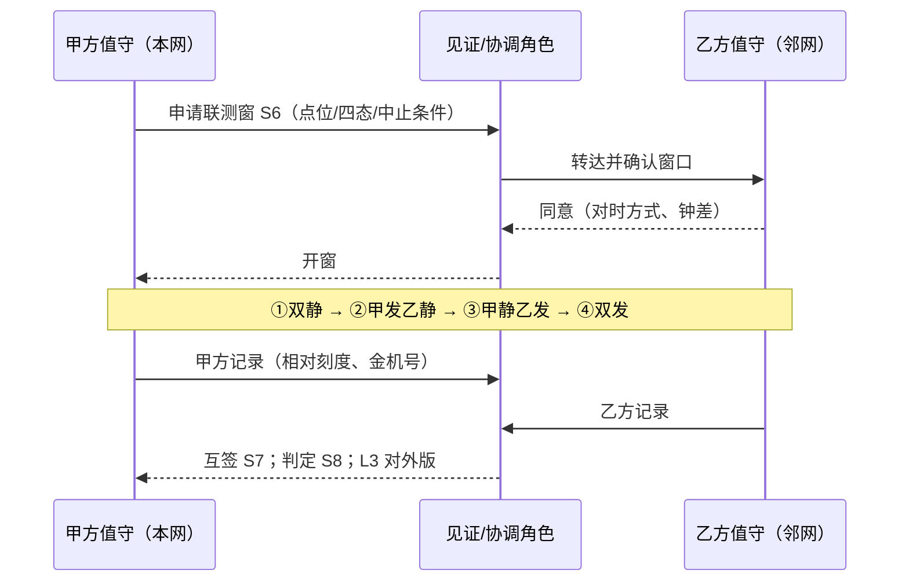

# 手册 20 · 运维制度：邻频协调与边界联测制度

> **手册模式 · 岗位深挖（邻居台账 / 邻频兼容核算 / 边界与外溢上限 / 双方边界联测 / 拒签治理）第 20 篇**（接第 40 课收官 · 手册 01–19 之后 · **不是第 41 课**）  
> 适合：已有贴纸 F / O / P / Q，可一到「隔壁单位新开信道、我们边界 BER 变差」「邻网说我们压线」「共址铁塔又挂上别家中继」「对方迁 6.25 kHz 栅格没通知」「两家互相抬功率」「边界验收只有我方跑了一圈」就慌——想学会**先证邻居与频率关系、算清邻道兼容、写清边界上限、双方同窗四态联测，再谈开通 / 扩容 / 改参**的人  
> 阅读量：约 **30–40 分钟** · **不重写手册07 / 16 / 17 全文**（只给指针）、**不 dump 空口字段**、**不发明条款号**、**不写真实频点 / 站名 / 单位名 / 联系人 / 坐标**（教学虚构、L3）· **不教干扰、压制、报复性发射**——只讲协调与联测制度 · 要把「**先证邻居与频率关系；禁功率战与私自挪频；无书面协调禁签；单方自测禁签边界验收；共址近址混栅格未核算禁签；主贴 S 可挂 F/P/O/Q/N；边界侧变更先通知后复测；争议走主管部门、脱敏 L3**」钉成肌肉记忆  
> **频谱 / 调制提醒（弱项短补，本篇会多讲一点）**：一条 DMR 信道的「车道宽」是 **12.5 kHz**（ETSI TS 102 361-1 V2.7.1 §10.1.2：*operates within a 12,5 kHz RF carrier bandwidth*）；车道里跑的是 **4FSK**；**2-slot TDMA** 一格 **30 ms**、两格一轮 **60 ms**。本篇的主角是**车道和隔壁车道之间那条线**：你的信号不可能刀切一样只待在 12.5 kHz 里，总有一点「裙边」溢到隔壁；隔壁的接收机也不可能百分之百只听自己那一道。邻频协调就是**两家把「溢多少、挡多少、离多远、谁先来」写成白纸黑字，再一起到边界上量一遍**。概念生疏先回 `学习推送/加餐_频率带宽与调制解调.md`。

---

## 1. 为什么要写这篇手册（动机 + 现场对话）

前十九篇手册把「本网自己家里」的病基本认全了：A–E 协议层，F 射频（同频 / 邻道 / 互调 / 时隙），G 实验室，H 话务，I 室分，J 写频，K 电源，L 井库，M 批量 / OTAP，N 监控对时，O 有源隔离，P 口部切换与**本网**邻站泄漏，Q 金机漂移，R 网管采集与假绿。可现场还有一类债——**病根不在你家，也不全在别人家，而在两家之间那条线上**：

- 网优：「边界那片最近 BER 一直飘，我们什么都没改。」——隔壁单位上个月新开了两个**第一邻道**信道，**谁也没通知谁**。  
- 对方单位：「你们的中继把我们的上行压了。」——可能是你家发射机的**邻道功率**（裙边）在共址铁塔上漏进他家接收机，也可能是他家接收机**邻道选择性**不够——**没联测，谁说了都不算**。  
- 班长：「他们压我们，我们也把功率开大！」——**功率战**：两家一起抬，边界外溢一起变大，互调产物一起变强，**双输**（手册07 规则同向）。  
- 领导：「对方是兄弟单位，打个电话就行，不用写协议。」——打电话的人调岗了，**协调记录在谁的脑子里？**  
- 手册17 学过的人：「这不就是 P-邻 吗？」——P 管**本网内**自己邻站的口部外溢；本篇管**跨网 / 跨单位 / 跨制式 / 跨行政区**的邻频与边界，主贴新贴纸 **S**。  
- 验收方：「边界我们跑过了，没问题。」——只有你方单方跑、对方没在场、没有「我发你静 / 你发我静」对照——**单方自测不等于边界联测**。

这几句背后是同一件事：

> **「邻频协调与边界联测」在现场至少有五个坑**：**① S-协** 邻居台账与协调书；**② S-邻** 同道 / 邻道 / 混栅格 / 共址的兼容核算（ACP、ACS、阻塞、互调）；**③ S-界** 边界线与外溢上限；**④ S-测** 双方同窗**四态**联测；**⑤ S-治** 无协调禁签、单方自测禁签、私改禁、争议上报、L3。  
> 把 ①–⑤ 当成「邻频没事」「出事再分诊」「打电话就算协调」，会把两家的长期扯皮留给下一任。

本篇目标：能背出**邻频协调与边界联测工作流**；会用新贴纸 **S（协 / 邻 / 界 / 测 / 治）** 与五个子类；会填**插页 S（S1–S8）**和《本网邻频协调与边界联测卡》；能用「**相邻两家 KTV 共用一堵墙 + 物业陪同隔墙试唱**」故事讲清邻道功率、邻道选择性、互调、边界与联测；能拒绝「无协调就开通、单方自测当联测、功率战、私改不通知、把跨网问题塞进 P 或 F 结案」；自测过关后，回库把本网最近一次跨网 / 共址 / 边界投诉（脱敏到 L3）按本篇重对一遍。

**本篇硬禁令（写进脑子）**：凡引条款均已核原文（TS 102 361-1 / TR 102 398 / EN 300 113 V3.1.1 / ITU-R SM.337-6 / 《无线电管理条例》/ 国无办〔2025〕1号），**数字以原文为准，本篇只作教学转述**；**频率关系一律用「本道 F0、第一邻道 F0±1 道、相对偏移 Δ」表述，禁真实频点 / 站名 / 单位名 / 联系人 / 坐标**；**不教干扰、压制、报复性发射或绕过许可**；F / O / P 仍生效，跨网边界**主贴 S**；外国资料（CEPT / HCM / ITU）只借**方法与顺序**，**国内以法规、通知与本网批复为准**。

---

## 2. 总图 / 故事：邻频像「相邻两家 KTV 共用一堵墙 + 物业陪同隔墙试唱」

### 2.1 一句话：必须先证明邻居是谁、隔墙漏多少挡多少、墙两边音量上限写清、双方一起隔墙试唱过，再谈开业（开通）/ 扩包厢（扩容）/ 换音箱（改参）——否则两家越唱越大声、谁也听不清、物业天天调解

```text
   ┌──────────────────────────────────────────────────────────────────┐
   │   一栋楼里两家 KTV：甲店（本网）  │墙│  乙店（邻网 / 邻单位）       │
   │                                  │  │                              │
   │   甲店音箱 ──漏音──▶ 墙 ──▶ 乙店包厢   = 发射邻道功率 ACP（S-邻）   │
   │   乙店包厢隔音 / 耳朵能否只听自己  = 接收邻道选择性 ACS（S-邻）    │
   │   甲乙两首歌在破音箱里混出第三首怪调 = 互调 IMD（S-邻）            │
   │   墙有多厚、两店包厢隔多远          = 频率间隔 + 距离间隔（S-邻/界）│
   │   物业《隔音公约》+ 店长联系人表    = 协调台账与协议（S-协）        │
   │   公约写明：墙那边最大能听到多大    = 边界外溢上限（S-界）          │
   │   物业陪两店店长，在墙两边同时试唱  = 边界联测四态（S-测）          │
   │   没公约、没试唱，物业不签开业      = 拒签治理（S-治）              │
   │                                                                  │
   │   ✗ 甲店嫌乙店吵就把音量开到最大 → 乙店也开大 → 两家都听不清     │
   │     = 功率战（规则2）                                            │
   │   ✗ 甲店自己在自家包厢里听了听说「不漏音」→ 单方自测（规则4）     │
   └──────────────────────────────────────────────────────────────────┘
```

口诀：

> **先认邻居，再算隔墙，后定上限，末上联测。**  
> 嫌隔壁吵就把自己音量开大 = 功率战——**两家一起聋。**  
> 只在自家包厢里听一听 = 单方自测——**墙那边听到什么，你根本不知道。**

### 2.2 「隔墙 KTV」五段直觉（弱项短补，钉死）

| 段 | 像什么 | 运维直觉 | 本篇贴纸 |
|----|--------|----------|----------|
| **认邻居** | 物业的店长联系人表 + 隔音公约 | 邻居单位角色、制式、信道间隔、联系人角色、协调书版本、变更通知机制——书面 | S-协 |
| **算隔墙** | 墙多厚、音箱漏多少、包厢挡多少 | 同道 / 邻道 / 隔道 / 混栅格 / 共址；ACP、ACS、阻塞、互调候选；频率-距离权衡 | S-邻 |
| **定上限** | 公约：墙那边音量不得超过多少 | 边界线、外溢上限（协议值）、控制手段（经批准） | S-界 |
| **一起试唱** | 物业陪同，墙两边同时听 | 双方同窗、对时、见证、点位清单、四态对照、证据互签 | S-测 |
| **不签开业** | 没公约没试唱就不签 | 无协调 / 单方自测 / 私改 / 功率战 → 拒签；争议找物业（主管部门） | S-治 |

> 公开方法（ITU-R SM.337 的频率-距离计算、HCM 协定的统一计算程序 + 地形与边界数据、CEPT T/R 25-08 规划与协调准则、EN 300 113 的邻道 / 互调 / 阻塞测试项）告诉我们：协调靠**数据 + 统一算法 + 双边 / 多边书面约定**，不靠电话。本篇只借顺序，不抄门限。

### 2.3 和手册07 / 16 / 17 / 18 / 15 / 06 的咬合（指针，不重写）

- **手册07 F**：F-邻 / F-互是**现场诊断**（病长什么样、3:1 衰减器指纹）；本篇是**事前制度 + 双方联测**。诊断走 F，**跨网协调主贴 S**。  
- **手册16 O / 手册17 P**：**本网自家**的隔离减敏、口部邻站泄漏；泄漏来自**别家网**时主贴 S，O / P 仅在自家侧需配合时次挂。  
- **手册18 Q**：联测双方**各带一台在档金机**。**手册15 N**：四态要对时，钟差先写清。  
- **手册06**：联测记录对外交换前脱敏，公开仓 L3。**手册09 H / 手册11 J**：加信道、改频点都是变更——先过 S，再走 J 变更单。

### 2.4 新贴纸 S：协 / 邻 / 界 / 测 / 治（五个子类）

```text
                ┌──────────── 贴纸 S · 协/邻/界/测/治 ────────────┐
                │  S-协  协调台账与协议：邻居·制式·间隔·联系人·协调书·变更通知 │
                │  S-邻  邻频兼容核算：同/邻/隔道·混栅格·共址·ACP/ACS·阻塞·互调 │
                │  S-界  边界与外溢上限：边界线·外溢上限·经批准的控制手段       │
                │  S-测  边界联测：双方同窗·对时·见证·点位·四态对照·互签        │
                │  S-治  治理与拒签：无协调禁签·单方禁签·私改禁·争议上报·L3     │
                └──────────────────────────────────────────────────────────────┘
```

| 子类 | 一句话 | 典型拒签 / 拒放行触发 |
|------|--------|----------------------|
| **S-协** | 邻居说不清 / 无协调书 / 无变更通知机制 → 禁签开通、扩容、改参 | 「隔壁是谁？好像是某某单位，电话不知道」 |
| **S-邻** | 共址、近址、第一邻道、混栅格未核算 ACP/ACS/阻塞/互调 → 禁签 | 「邻频又不是同频，没事」 |
| **S-界** | 边界线 / 外溢上限未定义 → 无法判定谁越界 | 「我们覆盖到哪算哪」 |
| **S-测** | 单方自测、无对时、无四态、对方未见证 → 禁签边界验收 | 「我们自己跑过了」 |
| **S-治** | 功率战、私改不通知、争议私了 / 报复、公开泄密 → 治理 | 「他们压我们，我们也开大」 |

### 2.5 邻频协调与边界联测最小工作流（背下来）

```text
  要开通 / 扩容 / 改参（功率·天线·台址·信道·制式/间隔迁移）/ 签边界验收
        │
        ▼
  邻居台账清楚？协调书 + 变更通知机制在？──否──▶ 拒签（S-协 / 规则1、3）
        │是
        ▼
  频率关系已标（同/邻/隔道·混栅格·共址）？兼容已核算？──否──▶ 禁签（S-邻 / 规则5）
        │是
        ▼
  边界线与外溢上限写进协调书？控制手段经批准？──否──▶ 补 S-界 再谈
        │是
        ▼
  双方同窗、对时、见证、四态联测做过且证据互签？──否──▶ 禁签边界验收（S-测 / 规则4）
        │是
        ▼
  结案 + 脱敏 L3；主贴 S；可挂 F/P/O/Q/N
  任一方边界侧再变更 → 先通知、后复测（规则7）；争议 → 主管部门（规则8）
  全程禁：功率战 / 私自挪频借频（规则2）
```

现场口诀：

> **先邻居，再隔墙，后上限，末联测。**  
> 跳过联测的「边界验收」= 甲店在自家包厢里听了听，就对物业说墙不漏音。

---

## 3. 核心交付：插页 S + 拒签卡 + 与总三联单怎么写

### 3.1 什么时候贴 S（而不是先贴 F / P / O）

| 现场信号 | 主贴 | 可次挂 |
|----------|------|--------|
| 计划在边界区开通 / 扩容 / 改功率 / 改天线 / 改台址 | **S**（事前协调 + 联测） | J（写频变更单） |
| 邻单位新开信道后，本网边界 BER / 噪底变差 | **S-协 / S-测** | F-邻 / F-互（诊断） |
| 共址铁塔新增别家发射机 | **S-邻**（互调候选 + 隔离） | O（自家减敏）、F-互 |
| 对方投诉「你们压了我们」 | **S-测**（四态联测分清是谁的 ACP 还是谁的 ACS） | F |
| 邻单位从 12.5 kHz 迁到 6.25 kHz 栅格 / 改制式 | **S-邻**（混栅格核算）+ **S-协**（变更通知） | — |
| 「他们压我们，我们也开大」 | **S-治** + 规则2 | F（排除后） |

> **口诀**：病长什么样 → **F**；自家口部 → **P**；自家直放 / 室分隔离 → **O**；**跨网 / 跨单位 / 跨制式 / 跨行政区的邻居、隔墙、上限、联测 → S**。可叠挂，**跨网边界主贴 S**。

### 3.2 插页 S · 协 / 邻 / 界 / 测 / 治（挂在总三联单或开通 / 变更单后）

| 行 | 名称 | 填写示例（教学虚构，L3） |
|----|------|--------------------------|
| **S1** | 主子类 + 次子类 | 「主 S-测 / 次 S-邻」（或 S-协 / S-界 / S-治） |
| **S2** | 邻居台账 | 「邻居角色标签：邻单位乙（脱敏）；制式：数字 4FSK / 模拟调频 / 其他；信道间隔：12.5 / 6.25 kHz；联系人角色：对方网优岗；协调书版本 v（脱敏）；变更通知时限（协议约定）」——禁真实单位名、电话 |
| **S3** | 频率关系 | 「本道 F0；对方 F0+1 道（第一邻道）/ F0+2 道 / 混栅格偏移 Δ（小于一个 12.5 kHz 道）/ 共址同塔 / 近址」——**只写相对关系，禁真实频点** |
| **S4** | 兼容核算 | 「ACP（发射邻道功率）依据：设备型号核准 / 检测报告指标；对方 ACS（接收邻道选择性）依据；阻塞 / 互调候选清单（相对偏移）；粗算：保护比是否满足（§4.4）」 |
| **S5** | 边界与上限 | 「边界线定义（图层版本，脱敏）；边界处外溢上限（协议值，教学写 X）；控制手段：经批准的方向 / 下倾 / 高度 / 功率」 |
| **S6** | 联测窗 | 「双方 + 见证角色；起止；对时方式与钟差；点位清单版本；四态顺序；中止条件」 |
| **S7** | 联测证据 | 「四态结果（相对刻度）；金机编号（脱敏）；双方签字；对外交换版脱敏等级」 |
| **S8** | 判定与动作 | 「可签 / 带条件（限期复测）/ 拒签；如需上报主管部门写明；脱敏 L3」 |

> **S2 不过 → 禁止以任何名义签开通 / 扩容 / 改参（规则1、3）。**  
> **S3 为共址 / 第一邻道 / 混栅格而 S4 为空 → 禁签（规则5）。**  
> **S6 / S7 为单方或缺四态 → 禁签边界验收（规则4）。**  
> **S8 若写「我方加功率」「对方挪一下就好（未经批准）」→ 本页作废重填（规则2、8）。**

### 3.3 「无协调禁签 / 单方自测禁签」卡（贴网优 / 站务 / 验收台）

```text
  ┌────────────── 邻频协调与边界联测拒签卡（贴纸 S）──────────────┐
  │  × 说不清边界区的邻居是谁、什么制式、什么信道间隔            │
  │  × 没有书面协调记录 / 没有变更通知机制就开通、扩容、改参      │
  │  × 共址、近址、第一邻道、混栅格未核算 ACP/ACS/阻塞/互调        │
  │  × 边界线和外溢上限没写进协调书，就争论「谁越界」            │
  │  × 只有我方单方跑测、对方不在场、无四态对照就签边界验收      │
  │  × 用加功率 / 抬增益 / 私自挪频借频去「压过」邻网（功率战）  │
  │  × 任何一方边界侧变更未通知、未复测，就宣称「边界无影响」    │
  │  × 把跨网问题塞进 P（本网口部）或 F（诊断）就结案            │
  │  × 公开包出现真实频点 / 站名 / 单位名 / 联系人 / 坐标          │
  │  √ 例外：主管部门书面要求的临时安排——写进 S5/S8 并限期复测  │
  └────────────────────────────────────────────────────────────┘
```

### 3.4 和总三联单怎么写（接手册06）

- **现象**：写「边界区第一邻道邻单位新开后 BER 劣化」，**未联测前不写「对方干扰」**，只写「候选」。  
- **证据**：邻居角色标签、相对道号、四态结果（相对刻度）、金机号、双方钟差（指针 N-时）；全部 L3。  
- **贴纸栏 / 结案词**：主 **S-?**，次挂 F / P / O / Q / N；结案用子类 + 动作，禁「开大就好了」「对方挪了就好了」（未经批准同样违规）。

### 3.5 《本网邻频协调与边界联测卡》预告

第七章给可复印模板：封面拒签门槛、主表对齐插页 S1–S8、邻居台账页、兼容核算页、联测四态记录页、夜班速填五行。

---
## 4. 深潜：八条硬规则 + 隔墙算术（弱项补）+ 联测四态

### 4.1 八条硬规则（本篇钉子）

1. **先证邻居台账与频率关系，再谈「邻网干扰我」与加站加功率**——说不清隔壁是谁、在哪一道，射频单先冻结。  
2. **禁用加功率 / 抬增益 / 私自挪频借频去压过邻网**——功率战双输；功率、频率、台址、天线都是许可事项，变更要走变更手续（《无线电管理条例》第三十八条：变更许可事项应办理变更手续）。  
3. **无书面协调记录（邻居台账 + 边界条件 + 变更通知机制）→ 禁签开通 / 扩容 / 改参**——电话里说好的不算协调。  
4. **边界联测须双方同窗、对时、见证、四态对照、证据互签；单方自测 → 禁签边界验收**——墙那边听到什么，只有一起听才算数。  
5. **共址 / 近址 / 第一邻道 / 混栅格新增信道，未核算 ACP、ACS、阻塞、互调候选 → 禁签**——「邻频又不是同频」是本篇头号错觉。  
6. **本网口部走 P、现场诊断走 F、自家隔离走 O；跨网 / 跨单位 / 跨制式 / 跨行政区的协调与联测主贴 S**——可叠挂，不可偷换。  
7. **任一方边界侧变更（功率、天线高度 / 方向 / 下倾、台址、信道、制式或信道间隔迁移）→ 先通知、后复测；未复测禁宣称「边界无影响」**。  
8. **争议不私了、不报复：协调不成按规定报无线电管理机构；公开材料脱敏 L3（禁真实频点 / 站名 / 单位名 / 联系人 / 坐标）**。

> 法规锚点（已核原文，教学转述）：《无线电管理条例》**第六条**不得造成有害干扰；**第三十九条**定期维护、避免干扰；**第五十二条**边境遵守协调协议；**第六十五条**受扰可投诉，处理遵循「频带外让频带内、次要业务让主要业务、后用让先用、无规划让有规划」；**第六十六条**管理机构可要求维修、校准或降功率。**国无办〔2025〕1号 第八条**：省级规划须考虑同邻频兼容、地理隔离，与相邻省协调；**第十五条**：边境按协议协调。**这些是主管部门的处理规则，不是你方单方「判对方让频」的依据。**

### 4.2 弱项补 ①：车道、裙边与「dBc」（频率与带宽）

把 12.5 kHz 信道想成一条车道。国无办〔2025〕1号附件1 对专用对讲机写得很具体（已核原文）：**12.5 kHz 信道间隔时占用带宽不大于 8.5 kHz**，数字体制采用 **4FSK** 等调制。也就是说，车（信号主体）只占车道中间约三分之二，两边留了「路肩」。

```text
   功率
    ▲           本道 F0（12.5 kHz 车道）
    │          ┌──────────────┐
    │         ╱│  信号主体    │╲            ← 主体 ≤ 8.5 kHz 宽
    │        ╱ │  （4FSK）    │ ╲
    │  裙边 ╱  │              │  ╲ 裙边     ← 裙边溢进隔壁 = 邻道功率
    │ ─────────┼──────────────┼─────────
    │ 第一邻道 │              │ 第一邻道
    │ F0−1道   │              │ F0+1道
    └──────────┴──────────────┴──────────▶ 频率
```

**dBc 是什么？**「比载波低多少 dB」。附件1 表 1-2（12.5 kHz 间隔）：**第一邻道（偏移 12.5 kHz）调制邻道功率 −60 dBc、瞬态切换邻道功率 −50 dBc；第二邻道（偏移 25 kHz）−70 dBc / −60 dBc**。ETSI EN 300 113 V3.1.1 §7.4.3 对 12.5 / 20 / 25 kHz 间隔的邻道与隔道功率也写为**比发射功率低 60.0 dB**（无需低于 −37 dBm）。

把 dB 翻成大白话（弱项钉子）：

| dB | 功率比 | 生活比喻 |
|----|--------|----------|
| −3 dB | 一半 | 音量拧小一半 |
| −10 dB | 十分之一 | 隔一道门 |
| −30 dB | 千分之一 | 隔一堵砖墙 |
| −60 dB | 百万分之一 | 隔一堵厚墙——但你若贴着墙放大音箱，隔壁仍听得见 |

**教学粗算（虚构数字）**：一台基站端口 30 W ≈ +44.8 dBm（国无办附件1 基站 / 转发台端口功率上限即 30 W）。−60 dBc 意味着第一邻道里还剩约 **−15 dBm**。−15 dBm 听起来很小，但对方接收机的灵敏度在 **−110 dBm 量级**——差了 95 dB。所以**邻道功率是否成问题，全看「两家隔多远、天线隔离多少」**。这就是为什么「共址 + 第一邻道」是本篇最高风险组合。

**还有一个时间维度**：表 1-2 的**瞬态切换邻道功率（−50 dBc）比调制邻道功率（−60 dBc）宽松 10 dB**——发射机「开口 / 收口」那一瞬裙边更宽。DMR 是 TDMA 突发发射（30 ms 一格），**联测要在真实话务 / 突发状态下看，不能只开一个连续载波就下结论**。

### 4.3 弱项补 ②：接收侧——耳朵能不能只听自己这一道（ACS / 阻塞 / 互调）

发射端「漏多少」只是一半；接收端「挡多少」是另一半。ETSI EN 300 113 V3.1.1 把接收机这几项分得很清楚（已核目录与原文）：

| 指标（EN 300 113 V3.1.1） | 一句话 | 原文要点（教学转述，以原文为准） |
|---------------------------|--------|----------------------------------|
| **§8.5 同频抑制** | 同一道上来了别人，能扛多少 | 12.5 kHz、按速率分档给限值 |
| **§8.6 邻道选择性 ACS** | 隔壁一道很强时，还能不能解对本道 | 表 12：12.5 kHz 正常条件下无用信号可到 **−47 dBm** 而不超过规定劣化（极端条件 −51 dBm）；旧版 EN 300 113-1 V1.5.1 以「不小于 60 dB」表述 |
| **§8.7 杂散响应抑制** | 其他某些频率「钻空子」进来 | 搜索法 + 限值 |
| **§8.8 互调响应抑制** | 两个强信号在接收机里混出本道 | 无用信号可到基站 **−37 dBm** / 移动与手持 **−42 dBm** |
| **§8.9 阻塞或减敏** | 远一点的超强信号把前端顶饱 | 阻塞电平不小于 **−23 dBm**（杂散响应频点除外） |

**发 + 收合起来看（工程常用近似）**：邻道干扰的总「隔离能力」由发射邻道泄漏比和接收邻道选择性共同决定，**谁差谁说了算**；两者一样好时，合起来还要再差约 3 dB（常用近似：1/总 = 1/发射泄漏比 + 1/接收选择性，线性值相加）。所以「我的发射机达标」不能证明「对方不受扰」，反之亦然——**这就是为什么必须双方联测**。

### 4.4 隔墙算术：ITU-R SM.337 的「频率-距离」思路（S-邻 / S-界）

ITU-R SM.337-6《频率与距离间隔》（已核原文）给出的思路非常朴素：

```text
   到达受扰接收机的干扰电平：
     Pi = Pt + Gr − Lp(d) − OCR(Δf)
       Pt   干扰发射机等效辐射功率（e.i.r.p.）
       Gr   受扰接收天线增益
       Lp   路径损耗（随距离 d 增大）
       OCR  频率偏移 Δf 下的「偏道抑制」（发射裙边 + 接收选择性的合效果）

   可容忍的条件：  Pd − Pi ≥ 保护比
       Pd   受扰接收机收到的有用信号电平
```

**直觉**：要让干扰「够小」，只有四个旋钮——**降低对方发射（Pt）、拉开距离（Lp）、拉开频率（OCR）、提高有用信号（Pd）**。SM.337 的目录里还专门有「陆地移动系统应用：基站对基站干扰」和「一条互调的频率-距离规则」，说明这是陆地移动的老问题。

**教学虚构例（共址 + 第一邻道）**：对方中继等效 +50 dBm；两副天线之间隔离（含路径与天线增益）只有 60 dB；第一邻道 OCR 取 60 dB → Pi ≈ 50 − 60 − 60 = **−70 dBm**。本网边界手台上行到达本站约 **−100 dBm**。Pd − Pi = −30 dB——**远低于任何保护比**，本站上行会被「隔壁车道」压住。四个旋钮怎么拧？**加隔离（天线垂直间距、滤波 / 空腔，走站务规程）、拉开频率（改到第二邻道以外，须主管部门批准）、或者双方协商**——唯独**不是**把本网手台功率开大（规则2）：Pd 抬几 dB，换来的是边界外溢和互调一起变大。

> **注意**：上面只用来练直觉，**不是**本网协议值；真实核算用本网批复参数、设备检测报告和主管部门认可的方法。

### 4.5 互调候选：相对偏移就能算（S-邻）

三阶互调最常见的产物在 **2f1 − f2** 和 **2f2 − f1**（手册07 §4.5 已讲指纹与 3:1 衰减器测试）。协调时**不需要写真实频点**，用「道号偏移」就能先筛：

```text
  设本道 F0，道宽 12.5 kHz，用整数 a、b 表示两部发射机相对 F0 的道号偏移
     发射机 1：F0 + a 道      发射机 2：F0 + b 道
     三阶产物：F0 + (2a − b) 道   与   F0 + (2b − a) 道

  例（教学虚构）：共址两家发射在 +3 道、+5 道
     产物 = +1 道、+7 道
     若本网某接收频点恰在 +1 道 → 互调候选命中 → S-邻 拒签，先改方案
```

两个提醒：

- **要算到接收频点上**：异频中继的接收频点 = 发射频点 ∓ 收发间隔。国无办〔2025〕1号附件1 写明专用对讲机异频单工收发间隔：**150 MHz 频段 5.7 MHz、400 MHz 频段 10 MHz**。共址多家时，把所有发射频点两两组合，再对照所有**接收**频点。  
- **无源互调**（生锈接头、松动金属结构）不在任何一家的设备检测报告里——共址联测时要专门安排「双发」态观察（§4.8）。

### 4.6 远近效应：为什么邻频有时比同频更凶（S-界）

```text
   本网站 A ●───────────────────────────── ✦ 本网手台（边界区）
                       远：有用信号弱 −105 dBm（教学虚构）
                                           ✦ ── 200 m ── ● 邻网站 B（第一邻道）
                                                 近：邻道信号强 −40 dBm（教学虚构）
   接收选择性 60 dB → 漏进本道约 −100 dBm ≈ 有用信号 → 边界区掉话 / BER 飘

   另一个同频站 C 在 50 km 外：到达 −120 dBm → 反而不是主要矛盾
```

**结论**：边界区的「远我近他」最危险——这正是**边界联测点位必须包括「对方站附近、本网覆盖边缘」**的原因（§4.8 点位清单）。这也解释了为什么加功率没用：你把 A 站开大，B 站附近手台的有用信号多几 dB，但 A 站在 B 网那边的外溢也一样多几 dB，对方必然跟着开大。

### 4.7 混栅格与跨制式邻居（S-协 / S-邻）

- **混栅格**：国无办〔2025〕1号允许专用对讲机使用 **12.5 kHz 或 6.25 kHz** 信道间隔。两种栅格的中心频点不一定对齐，**偏移可能小于一个 12.5 kHz 道**。只要台账里出现「对方 6.25 kHz」或「对方迁栅格」，就按**比第一邻道还近**处理，直到核算完成。  
- **跨制式**：邻居可能是模拟调频、其他 4FSK 数字制式、6.25 kHz 窄带数字制式或宽带系统。**制式不同，接收机对「隔壁那种波形」的抗性也不同**——这正是 S2 要写「制式 + 间隔」的原因。DMR 设计本身尽量「入乡随俗」：ETSI TR 102 398 V1.5.1 §5.1.4 说明编码增益用于**保证规划覆盖边缘的话音质量，而不是把覆盖推得更远**，边缘之外较快滚降，以免破坏原有频率复用与干扰规划假设；§5.2 说明 DMR 按 EN 300 113 / EN 300 390 的 12.5 kHz 信道栅格、依各国规定使用；TS 102 361-1 V2.7.1 §10.1.0 要求 DMR 设备满足 EN 300 113-2 或 EN 300 390-2 的基本要求。**换句话说：DMR 不比模拟更「霸道」——边界区出事，多半是配置、台址、功率、隔离或协调缺位，不是「数字信号天生干扰大」。**

### 4.8 边界联测四态（S-测）——本篇最重要的现场动作

**四态对照**（双方在同一书面窗内、对时后执行；状态切换由双方值守角色口令确认）：

| 态 | 甲（本网）边界侧 | 乙（邻网）边界侧 | 看什么 | 能回答的问题 |
|----|------------------|------------------|--------|--------------|
| **① 双静** | 停发 | 停发 | 双方接收噪底（相对刻度） | 背景噪声本来多高？有无第三方？ |
| **② 甲发乙静** | 发（真实突发） | 停发 | 乙接收点噪底 / BER、频谱偏侧能量 | 甲的裙边 / 外溢进乙多少？ |
| **③ 甲静乙发** | 停发 | 发（真实突发） | 甲接收点噪底 / BER | 乙的裙边 / 外溢进甲多少？ |
| **④ 双发** | 发 | 发 | 双方 BER、互调候选道有无能量 | 真实负载下是否可共存？互调是否命中？ |

**点位清单（教学模板）**：边界线两侧各若干点（脱敏编号）+ 「远我近他」点（对方站附近、本网覆盖边缘）+ 共址 / 近址机房接收口 + 历史投诉点 + 制高点。**每点双方各用一台在档金机**（手册18 Q），再加一台共同参考接收机或频谱仪（截图改相对刻度）。

**判定（教学写法）**：② / ③ 态下受扰侧噪底抬升与 BER 劣化不超过**协调书约定值**；④ 态互调候选道无命中；边界外溢不超过 **S5 上限**。任何一项不过 → S8 写「带条件 / 拒签」+ 整改项 + 复测日期。

**中止条件**：任何一方真实业务受影响超阈、出现紧急呼叫、见证方要求中止——立即回到正常发射态，记录原因。**联测窗只能停「边界侧约定信道」，禁止扩大范围**；停发安排必须经各自单位审批（这是业务中断，不是网优一个人的事）。



---

## 5. 现场映射：原话 → S 子类；对话脚本；联测节奏

### 5.1 原话速查表

| 现场原话 | 先贴 | 一句话动作 |
|----------|------|------------|
| 「隔壁单位新开了信道，我们边界变差了」 | S-协 / S-测 | 查台账有无变更通知；约四态联测 |
| 「铁塔上又挂了一家」 | S-邻 | 互调候选（算到接收频点）+ 隔离核算 |
| 「他们压我们，我们也开大」 | S-治 | 规则2；禁功率战 |
| 「对方从 12.5 迁到 6.25 了」 | S-邻 / S-协 | 按比第一邻道还近处理，先核算 |
| 「边界我们自己跑过了，签吧」 | S-测 | 单方自测禁签（规则4） |
| 「兄弟单位，打个电话就行」 | S-协 | 无书面协调禁签（规则3） |
| 「我们覆盖到哪算哪」 | S-界 | 补边界线与外溢上限 |
| 「洞口听到隔壁站」 | 先分：本网 → P；他网 → S | 看邻居台账 |
| 「挪到旁边那个空频点试试」 | S-治 | 频率是许可事项；禁私自挪频借频 |
| 「公开周报里写了对方站名和频点」 | S-治 | 撤回，L3 重写（规则8） |

### 5.2 对话脚本（四则）

**脚本 A · 边界变差**  
- 网优：「边界那片 BER 飘，肯定是隔壁单位。」  
- 你：「插页 S2 / S3 呢？对方在哪一道、什么制式、有没有变更通知？」  
- 网优：「听说他们上月加了信道，没正式通知。」  
- 你：「先 S-协：补变更通知记录；再约四态联测。没联测之前，结论只写『候选』。」

**脚本 B · 功率战**  
- 班长：「他们压我们，把我们中继功率开到顶。」  
- 你：「禁止，规则2。功率是许可事项，改要走变更；而且你开大，对方也开大，边界一起烂。」  
- 班长：「那怎么办？」  
- 你：「四个旋钮：拉距离、拉频率、加隔离、协商。频率要批复，隔离走站务规程，协商走 S-协，谈不拢报主管部门。」

**脚本 C · 单方自测**  
- 施工方：「边界我们跑了 20 个点，都正常，签验收吧。」  
- 你：「对方在场吗？做了『你发我静 / 我静你发』吗？双方钟差多少？」  
- 施工方：「就我们自己跑的。」  
- 你：「单方自测不算边界联测，规则4。排 S6 联测窗。」

**脚本 D · 共址新增**  
- 站务：「铁塔租给了另一家，下周装。」  
- 你：「他们的发射 / 接收道号偏移给我，S-邻 先算互调候选，要算到我们的接收频点。没算完不签我方同意书。」  
- 站务：「他们说设备都达标。」  
- 你：「单台达标 ≠ 共址可共存。规则5。」

### 5.3 夜班 15 分钟怎么用

1. **3 分钟**：边界区告警 / 噪底趋势（相对刻度）；有抬升记 S 候选，不写「干扰」。  
2. **4 分钟**：查邻居台账有无近期变更通知；无通知而有变化 → 交班写「S-协 待核」。  
3. **4 分钟**：本周有无联测窗 / 复测到期。  
4. **4 分钟**：三联单现象栏禁写「对方干扰」除非已联测；贴纸栏主 S 若适用。

### 5.4 单次边界联测 60 分钟标准节奏（可复印）

| 分钟 | 动作 |
|------|------|
| 0–8 | 开窗：双方 + 见证到位；对时、写钟差；复述点位、四态顺序、中止条件 |
| 8–18 | ① 双静：各点噪底（相对刻度） |
| 18–30 | ② 甲发乙静：乙侧各点噪底 / BER / 频谱偏侧能量 |
| 30–42 | ③ 甲静乙发：甲侧各点同上 |
| 42–52 | ④ 双发：双方 BER；互调候选道能量 |
| 52–60 | 恢复正常发射；双方互签 S7；判定 S8；对外版 L3 |

点位多时按点位分批开多个窗；**禁止与重大保障 / 真实事故窗重叠**。

### 5.5 「邻网三问」（贴网优班）

1. 边界区邻居是谁、在哪一道、什么制式、最近变过没有？（S-协 / S-邻）  
2. 边界线和外溢上限写在哪里？（S-界）  
3. 最近一次双方四态联测是什么时候、结果互签了吗？（S-测）  
三问不过，**禁止先开加功率 / 挪频工单**。

---

## 6. 工作实例（8 个厚例，均教学虚构、已脱敏到 L3）

### 例 1 · 「隔壁新开信道无通知」→ S-协 / S-测
- **现象**：边界区 BER 两周内变差，本网无任何变更。  
- **排除**：本网金机正常（Q）、口部无变化（P）；频谱偏侧能量（F-邻 指纹）。  
- **贴法**：主 S-协，次 S-测 + F-邻。  
- **动作**：书面询问；补变更通知；四态联测；③ 态确认乙侧外溢 → 协商经批准的方向 / 下倾调整，复测。  
- **禁令**：联测前不得在投诉单写「恶意干扰」。

### 例 2 · 「共址新增未算互调」→ S-邻
- **现象**：铁塔新增另一家两部发射机，本网中继上行偶发噪底抬升。  
- **排除**：衰减器 3:1 指纹（手册07 F-互）；道号偏移筛查：(2a−b) 命中本网接收频点。  
- **贴法**：主 S-邻，次 F-互 / O。  
- **动作**：撤回共址「无异议」；与对方及铁塔方协调频率组合或滤波 / 隔离（走站务规程与批复）。  
- **禁令**：不得以本网加功率「顶过去」。

### 例 3 · 「功率战」→ S-治 + 规则2
- **现象**：两家在边界区先后各自抬功率，边界越来越差，投诉互指。  
- **贴法**：主 S-治。  
- **动作**：双方回到许可参数；协调书补外溢上限（S-界）；四态联测定基线；争议上报。  
- **禁令**：功率、天线、台址都是许可事项——私改本身就违规（条例第三十八条）。

### 例 4 · 「单方自测当验收」→ S-测
- **现象**：新站开通验收材料只有我方 20 点路测。  
- **贴法**：主 S-测。  
- **动作**：拒签边界验收；排 S6 窗；点位补「远我近他」点与共址接收口。  
- **禁令**：签字代替四态不算过。

### 例 5 · 「迁栅格」→ S-邻 / S-协
- **现象**：邻单位通知从 12.5 kHz 迁 6.25 kHz 栅格。  
- **贴法**：主 S-邻，次 S-协。  
- **动作**：按「比第一邻道还近」核算；迁移后四态复测（规则7）；台账更新版本。  
- **禁令**：沿用旧联测结论。

### 例 6 · 「洞口串台」→ P 还是 S
- **现象**：隧道口听到「隔壁站」。  
- **排除**：查台账：那个站属于邻单位，不是本网。  
- **贴法**：主 S-界，次 P（本网口部切换窗要配合调整）。  
- **动作**：与邻单位联测洞口外溢；本网口部按手册17 调参。  

### 例 7 · 「私自挪到空频点」→ S-治
- **现象**：有人把一个受扰信道改到「扫频看着空」的频点。  
- **贴法**：主 S-治，次 J（写频变更单）。  
- **动作**：立即回退到许可频点；走正规改频申请。  
- **禁令**：「看着空」≠ 没人用——可能是别家低占空比的许可信道。

### 例 8 · 「公开报告泄露」→ S-治
- 联测总结截图含真实频点、站名、坐标、联系人 → 撤回；按 L3 重写（道号偏移、角色标签、相对刻度）（规则8）。

---

## 7. 《本网邻频协调与边界联测卡》模板

### 7.1 封面 · 拒签门槛（贴网优 / 验收台）
```text
  ┌──── 本网邻频协调与边界联测卡 · 封面 ────┐
  │  缺以下任一项 → 禁止签开通 / 扩容 / 改参 / 边界验收： │
  │  □ 邻居台账（角色·制式·间隔·联系人角色·协调书版本）   │
  │  □ 频率关系（相对道号偏移；共址/近址/混栅格标注）       │
  │  □ 兼容核算（ACP/ACS/阻塞/互调候选，算到接收频点）     │
  │  □ 边界线 + 外溢上限 + 经批准的控制手段                 │
  │  □ 双方四态联测 + 对时 + 互签（有效期内）               │
  │  □ 结案无功率战 / 私改叙事；脱敏 L3                     │
  └──────────────────────────────────────────┘
```

### 7.2 邻居台账页（S-协）
| 邻居角色标签 | 制式 | 信道间隔 | 与本网关系（相对） | 联系人角色 | 协调书版本 | 变更通知时限 | 最近联测日期 |
|--------------|------|----------|--------------------|------------|------------|--------------|--------------|
| 邻单位乙 | | 12.5 / 6.25 | 第一邻道 / 共址 / 混栅格 | | | | |

### 7.3 联测四态记录页（S-测）
| 点位（脱敏） | ① 双静 噪底 | ② 甲发乙静 | ③ 甲静乙发 | ④ 双发 BER / 互调道 | 金机号 | 双方签字 |
|--------------|-------------|------------|------------|---------------------|--------|----------|
| 边界-01 | | | | | | |
| 远我近他-01 | | | | | | |
| 共址接收口 | | | | | | |

---

## 8. 术语表（本篇约 17 词）+ 易错观念

| 术语 | 一句话 |
|------|--------|
| **信道间隔** | 相邻两条车道中心的距离；DMR 为 12.5 kHz（国内也有 6.25 kHz 栅格） |
| **占用带宽** | 信号主体实际占的宽度；国无办附件1：12.5 kHz 间隔时 ≤ 8.5 kHz |
| **混栅格** | 12.5 与 6.25 kHz 栅格并存，中心不一定对齐 |
| **共址 / 近址** | 同塔同机房 / 相距很近的两家台站 |
| **dBc** | 比载波低多少 dB；−60 dBc = 百万分之一 |
| **邻道功率 ACP** | 发射机漏进邻道的功率（裙边） |
| **瞬态邻道功率** | 发射开 / 关瞬间漏进邻道的功率；限值更宽松 |
| **邻道选择性 ACS** | 接收机在邻道强信号下仍能解对本道的能力 |
| **阻塞 / 减敏** | 强信号把接收前端顶饱、灵敏度下降 |
| **互调 IMD** | 多个强信号混出新频率；三阶 2f1−f2 |
| **保护比** | 有用信号需比干扰高出的 dB 数 |
| **OCR** | 频率偏移下的合成抑制（发射裙边 + 接收选择性） |
| **远近效应** | 有用信号远而弱、邻道信号近而强 |
| **边界线 / 外溢上限** | 服务区分界与越界信号的约定上限 |
| **四态联测** | 双静 / 甲发乙静 / 甲静乙发 / 双发 |
| **功率战** | 双方互相抬功率，双输 |
| **脱敏 L3** | 教学 / 公开最高脱敏；禁真实频点站名单位联系人坐标 |

**易错观念**

| 错 | 对 |
|----|----|
| 邻频不是同频，没事 | 近处第一邻道可能比远处同频更凶（远近效应） |
| 我的设备达标，问题在对方 | ACP 与 ACS 合效果谁差谁说了算；要联测 |
| 自己跑一圈就是边界验收 | 必须双方同窗四态互签 |
| 被压了就开大 | 功率战双输；功率是许可事项 |

---

## 9. 自测（10 题）+ 参考答案

1. 贴纸 S 五个子类各是什么？各用一句话。  
2. 「12.5 kHz 信道」和「占用带宽 ≤ 8.5 kHz」是什么关系？两边的「路肩」有什么用？  
3. −60 dBc 大约是多少分之一？为什么共址时仍可能出事？  
4. 发射邻道功率（ACP）和接收邻道选择性（ACS）为什么必须一起看？  
5. 按 SM.337 思路，减小干扰有哪四个旋钮？哪个旋钮本篇禁止你单方面去拧？  
6. 两部发射机在 +2 道、+5 道，三阶互调产物落在哪？  
7. 四态联测是哪四态？② 态能回答什么问题？  
8. 什么叫远近效应？它对联测点位有什么要求？  
9. 洞口听到「隔壁站」，什么时候贴 P，什么时候主贴 S？  
10. 对方迁到 6.25 kHz 栅格，你要做哪三件事？公开记录怎么写？

### 参考答案
1. **S-协** 邻居台账与协调书；**S-邻** 邻频兼容核算；**S-界** 边界线与外溢上限；**S-测** 双方四态联测；**S-治** 拒签、禁功率战与私改、争议上报、L3。  
2. 车道 12.5 kHz，车身（信号主体）≤ 8.5 kHz（国无办附件1）；路肩给裙边与滤波留余量，减少漏进隔壁。  
3. 百万分之一；但发射功率大、两家天线贴得近时，剩下的百万分之一仍远高于对方接收灵敏度（§4.2）。  
4. 干扰的合效果由两者共同决定，谁差谁说了算；单边达标不能证明可共存（§4.3）。  
5. 降低干扰方发射、拉开距离、拉开频率、提高有用信号；**单方面抬自己功率 / 私自挪频**被禁止（规则2）——改频、改功率都须走许可变更。  
6. (2×2−5) = **−1 道**，(2×5−2) = **+8 道**。  
7. 双静 / 甲发乙静 / 甲静乙发 / 双发；② 态回答「甲的外溢进乙多少」。  
8. 有用信号远而弱、邻道信号近而强；点位必须包括「对方站附近、本网覆盖边缘」与共址接收口。  
9. 隔壁站属本网 → P；属别家网 → 主贴 S，本网口部要配合调参时次挂 P（规则6）。  
10. 更新台账（S-协）、按比第一邻道还近核算（S-邻）、迁移后四态复测（规则7）；公开只写道号偏移、角色标签、相对刻度（L3）。

---

## 10. 加深阅读与视频（均已用 curl 核对 HTTP 200；视频用 YouTube oEmbed 核对存在）

**标准与 DMR 本体（看原文，别背本篇转述）**
1. **[ETSI EN 300 113 V3.1.1（PDF）](https://www.etsi.org/deliver/etsi_en/300100_300199/300113/03.01.01_60/en_300113v030101p.pdf)**——§7.4 邻道/隔道功率、§8.6 邻道选择性、§8.8 互调响应抑制、§8.9 阻塞。  
2. **[ETSI EN 300 113-1 V1.5.1（PDF）](https://www.etsi.org/deliver/etsi_en/300100_300199/30011301/01.05.01_60/en_30011301v010501p.pdf)**——TS 102 361-1 引用的旧版分册。  
3. **[ETSI TS 102 361-1 V2.7.1（PDF）](https://www.etsi.org/deliver/etsi_TS/102300_102399/10236101/02.07.01_60/ts_10236101v020701p.pdf)**——§10.1 物理层通用参数；本地 `01-空中接口/`。  
4. **[ETSI TR 102 398 V1.5.1（PDF）](https://www.etsi.org/deliver/etsi_TR/102300_102399/102398/01.05.01_60/tr_102398v010501p.pdf)**——§5.1.4、§5.2、§10.2.3；参考文献列 CEPT T/R 25-08。本地 `00-入门/`。  
5. **[DMR Association · DMR Standards](https://www.dmrassociation.org/dmr-standards.html)**

**ITU / 欧洲协调方法（借方法，不抄门限）**
6. **[ITU-R SM.337 条目](https://www.itu.int/rec/R-REC-SM.337/en)** · **[SM.337-6 PDF](https://www.itu.int/dms_pubrec/itu-r/rec/sm/R-REC-SM.337-6-200810-I!!PDF-E.pdf)** · **[SM.337-6 目录](https://www.itu.int/dms_pubrec/itu-r/rec/sm/R-REC-SM.337-6-200810-I!!TOC-HTM-E.htm)**——频率与距离间隔。  
7. **[ITU-R SM.329](https://www.itu.int/rec/R-REC-SM.329/en)**（杂散域无用发射）· **[ITU-R SM.1541](https://www.itu.int/rec/R-REC-SM.1541/en)**（带外域无用发射）· **[ITU-R P.1546](https://www.itu.int/rec/R-REC-P.1546/en)**（30 MHz–4 000 MHz 点对面预测）。  
8. **[ITU 无线电规则](https://www.itu.int/pub/R-REG-RR)** · **[ITU-R 第1研究组（频谱管理）](https://www.itu.int/en/ITU-R/study-groups/rsg1/Pages/default.aspx)** · **[ITU 国家频谱管理手册](https://www.itu.int/pub/R-HDB-21)**。  
9. **[CEPT ECC · 专业陆地移动无线电专题](https://www.cept.org/ecc/topics/private-professional-land-mobile-radio)**（CEPT 文档库核验超时，未单列）。  
10. **[HCM Agreement 正文（PDF，RSGB 转载）](https://thersgb.org/publications/governmental/hcm-main-text.pdf)**——欧洲跨境协调协定，借方法。

**国内法规与通知（以官方原文为准）**
11. **[国无办〔2025〕1号 通知（工信部）](https://www.miit.gov.cn/jgsj/wgj/wjfb/art/2025/art_31a0765b521e4dc493262188aea65618.html)** · **[含附件 PDF（北京市政府转载）](https://www.beijing.gov.cn/zhengce/zhengcefagui/qtwj/202505/W020250508533710250422.pdf)**——第八、十五条；附件1 技术要求。  
12. **[《中华人民共和国无线电管理条例》](https://www.gov.cn/zhengce/zhengceku/2016-11/25/content_5137687.htm)**  
13. **[《无线电频率使用许可管理办法》](https://www.gov.cn/zhengce/2022-08/23/content_5722706.htm)**。  
14. **[《边境地区地面无线电业务频率国际协调规定》（工信部）](https://www.miit.gov.cn/jgsj/wgj/bmgz/art/2021/art_e99e6576549f491bb2a36ff971114191.html)** · **[国务院公报版](https://www.gov.cn/gongbao/content/2017/content_5210512.htm)**  
15. **[工信部标准信息问答 · 无线电干扰是怎样分类的？](https://bzxx.miit.gov.cn/bzxx/problem/detail?id=4FFC66BB85204DE3953EBB50B82C2645)**（需浏览器 JS）。  
16. **[APCO · Radio Frequency Management](https://www.apcointl.org/spectrum-management/)**——只借「协调人」角色概念。

**测量与站点工程（厂商教程，只借原理）**
17. **[R&S · Understanding ACLR](https://www.rohde-schwarz.com/us/products/test-and-measurement/analyzers/signal-and-spectrum-analyzers/understanding-adjacent-channel-leakage-ratio-aclr_258371.html)** · **[R&S · Channel Power Measurements（视频页）](https://www.rohde-schwarz.com/us/knowledge-center/videos/understanding-channel-power-measurements_251220-1513229.html)**。  
18. **[Keysight · Making an ACP Measurement](https://helpfiles.keysight.com/csg/89600B/Webhelp/Subsystems/gui/content/markers_acpr_makacprmeas.htm)**。  
19. **[Tait · When and where to use a duplexer](https://www.taitcommunications.com/en/about-us/news/2014/05/13/when-and-where-to-use-a-duplexer)** · **[Tait · Interference-free RF site design](https://www.taitcommunications.com/en/about-us/news/tait-talks-a-tait-engineer-is-sharing-his-extensive-expertise-on-ensuring-interference-free-rf-site-design)**  
20. **[Shure · What is Intermodulation?](https://www.shure.com/en-gb/insights/what-is-intermodulation)**  
21. **[Anritsu · LMR Master Basics（视频门户）](https://video-test-measurement.anritsu.com/en-us/detail/videos/land-mobile-radio/video/6166764567001/anritsu-site-master-spectrum-master-and-lmr-master-basics?autoStart=true)**。

**弱项补（频率与带宽 / 窄带化）**
22. **[Scanner School · AM, FM, Narrowband & Wideband FM](https://www.scannerschool.com/am-fm-sideband-narrowband-fm-and-wideband-fm/)** · **[Scanner School · Intro to DMR](https://www.scannerschool.com/introduction-to-dmr/)** · **[Electronics Notes · FM sidebands & bandwidth](https://www.electronics-notes.com/articles/radio/modulation/frequency-modulation-fm-sidebands-bandwidth.php)**。  
23. **[EMCI · Why Does Narrowbanding Matter?](https://www.emciwireless.com/our-blog/what-is-narrowbanding/)** · **[Motorola Solutions · What is Narrowbanding?（视频页）](https://video.motorolasolutions.com/detail/video/1187545050001)**。  
24. **Wikipedia 名词垫脚石**：[Adjacent-channel interference](https://en.wikipedia.org/wiki/Adjacent-channel_interference) · [Co-channel interference](https://en.wikipedia.org/wiki/Co-channel_interference) · [Intermodulation](https://en.wikipedia.org/wiki/Intermodulation) · [Passive intermodulation](https://en.wikipedia.org/wiki/Passive_intermodulation) · [Selectivity (radio)](https://en.wikipedia.org/wiki/Selectivity_%28radio%29) · [Frequency coordination](https://en.wikipedia.org/wiki/Frequency_coordination)。

**视频（YouTube oEmbed 均 200）**
25. **[R&S · Understanding Spectrum Analyzers – ACLR](https://www.youtube.com/watch?v=mco_BJ1mjNo)** · **[R&S · Getting Started with the FSW – ACLR](https://www.youtube.com/watch?v=vr_4dKYmF1g)**  
26. **[Shure · What is Intermodulation?](https://www.youtube.com/watch?v=IrlyAei02_o)** · **[electronics unmessed · Mystery of Intermodulation (EP131c)](https://www.youtube.com/watch?v=Ahlw4jVjnxY)**  
27. **[Wireless Workbench 6 · Introduction to Frequency Coordination](https://www.youtube.com/watch?v=k7qjqPOZC3E)** · **[Practical Show Tech · Basics of Frequency Coordination](https://www.youtube.com/watch?v=pWbdpMRS32M)** · **[SoundBase · Cleaner RF Coordination](https://www.youtube.com/watch?v=dKczj33QKkA)**——借「先扫、再算互调、再分配」顺序。  
28. **[BearCom · Narrowbanding Tutorial](https://www.youtube.com/watch?v=7ZFM9WwneSc)** · **[BridgeCom · Narrowband vs Wideband](https://www.youtube.com/watch?v=gYGV7J4QrmU)** · **[Scanner School · Secret of Bandwidth (Lesson 3)](https://www.youtube.com/shorts/Md32WlReUP8)**  
29. **[Scanner School · What is DMR?](https://www.youtube.com/watch?v=aQX_JbTbXuY)** · **[Scanner School · Why Digital Radio Sounds Like Robots](https://www.youtube.com/watch?v=-hLiTz7oSKE)** · **[Scanner School · P25 vs DMR](https://www.youtube.com/watch?v=tsVFV_XTQw8)** · **[Tait Radio Academy · P25 Phase 1 vs Phase 2](https://www.youtube.com/watch?v=lt3F1xgNB4I)**

> **诚实说明**：没有找到「DMR 专网邻频协调与边界联测制度（含邻居台账 + 兼容核算 + 双方四态联测 + 插页 S）」的专项中文 / 公开制度视频；上文视频为 ACLR 测量、互调、无线话筒频率协调、窄带化与 DMR 基础的**通用**内容，需按贴纸 S 与 S1–S8 拼进本网流程。`video_found=true`（通用），**非**专项。Ofcom（英国）与 FCC / eCFR（美国）相关协调页面从核验环境返回 403 或访问校验页，**未列入**；B 站相关射频课程返回 412，亦未列入。

**库内必回：** 手册07（F 诊断）、16（O）、17（P）、18（Q 金机）、15（N 对时）、06（脱敏）、11（J 变更单）、`加餐_频率带宽与调制解调.md`。

---

## 11. 收束：你今天带走什么；下一篇候选

### 11.1 带走的钉子
- 贴纸 **S** 五子类：协 / 邻 / 界 / 测 / 治。  
- 故事：相邻两家 KTV 共用一堵墙 + 物业陪同隔墙试唱。  
- 八条硬规则：**先证邻居台账**；**禁功率战与私自挪频**；**无书面协调禁签**；**单方自测禁签**；**共址近址混栅格未核算禁签**；**主贴 S 可挂 F/P/O/Q/N**；**变更先通知后复测**；**争议上报、L3**。  
- 弱项：12.5 kHz 车道、≤ 8.5 kHz 车身、−60 dBc = 百万分之一；ACP 与 ACS 谁差谁说了算。

### 11.2 回库路径
现场「边界变差 / 共址新增 / 对方投诉 / 迁栅格」→ 本篇（贴纸 S + 插页 S + 联测卡）→ 诊断指针手册07 F → 自家侧 O / P → 金机 Q、对时 N → 争议交无线电管理机构；全程禁功率战。

### 11.3 下一篇手册候选（本篇不写正文）
- **干扰投诉分诊与证据链**（向主管部门 / 对方单位投诉时，证据怎么组织、怎么脱敏、怎么不越权）  
- **频率许可变更与台站执照台账**（功率 / 天线 / 台址 / 信道变更与 J 写频单、S 协调书三账对齐）  
- （可选）**重大保障临时频率与联测窗**（临时设台、48 小时报告类要求与本网保障预案的衔接）

### 11.4 给带新人的三句话
1. 边界变差，先问邻居变没变，再问是本道中心还是偏一侧。  
2. 邻频不是没事——近处第一邻道可能比远处同频更凶。  
3. 被压了不许开大；一起到边界上四态联测，谈不拢找主管部门。

### 11.5 一张图记住本篇（收工贴纸）
```text
  ┌────────── 贴纸 S ──────────┐
  │ 协 邻居台账·协调书·通知   │
  │ 邻 同/邻/混栅格·ACP/ACS   │
  │ 界 边界线·外溢上限         │
  │ 测 双方同窗·四态·互签     │
  │ 治 禁功率战·禁私改·L3     │
  └────────────────────────────┘
    隔墙 KTV · 一起试唱才算数
```

### 11.6 十分钟给领导的电梯演讲
> 边界问题一家解决不了：认清邻居、算清隔墙、上限写进协调书、和对方四态联测并互签；做不到不签开通和验收。抬功率只会引发功率战，频率功率都是许可事项；谈不拢交主管部门。贴纸 S，与 F / P / O 分工清楚。

---

## 12. 本篇检查清单（自学打勾）
- [ ] 能背贴纸 S 五子类与隔墙 KTV 故事  
- [ ] 能背八条硬规则（含禁功率战、单方自测禁签、混栅格核算、变更先通知）  
- [ ] 会用 dB 表换算 −60 dBc，能说清 ACP 与 ACS 的合效果  
- [ ] 会用道号偏移算三阶互调候选，并算到接收频点  
- [ ] 10 题自测过关  
- [ ] 知道 §10 诚实说明：无专项中文 DMR 邻频协调视频，仅通用视频 + 文档  
- [ ] 回库用 L3 重对一次本网边界 / 共址事件  

---

*手册20 · 邻频协调与边界联测制度 · 学习推送 · 2026-10-18 18:52 +08:00*
