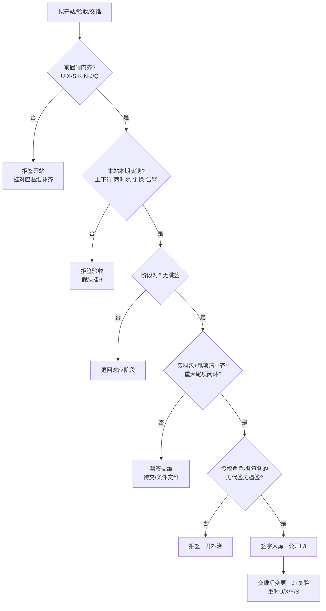

# 手册 27 · 运维制度：开站验收与交维签字边界

> **手册模式 · 岗位深挖（开站前置闸门 / 验收实测 / 交维资料与边界 / 分阶段签字边界 / 带病交维治理）第 27 篇**（接第 40 课收官 · 手册 01–26 之后 · **不是第 41 课**）  
> 适合：已有贴纸 I / K / J / Q / N / U / X / Y / R / S，可一到「执照没下来先试发射」「打通了就签验收」「只测下行就交维」「资料后补、尾项口头答应」「工期到了让运维先签」「交维后又改了功率」「屏绿就是验收通过」就慌——想学会**先证前置再开站、本站本期实测上下行再签验收、分阶段签禁跳签、资料与尾项齐才交维、禁代签逼签、交维后变更须复验、主贴 Z、假绿≠验收、跨网挂 S、脱敏 L3**的人  
> 阅读量：约 **30–40 分钟** · **不重写手册10 / 11 / 12 / 15 / 18 / 19 / 20 / 22 / 25 / 26 全文**（只给指针）、**不 dump 空口字段**、**不发明条款号**、**不写真实频点 / 站名 / 单位名 / 验收单全文号 / 合同号 / 联系人 / 坐标**（教学虚构、L3）· **不教无证开站、不教伪造或套用验收记录、不教用功率战掩盖覆盖与干扰问题过验收、不教规避监测**——只讲开站前置、验收实测、交维资料、签字边界与拒签 · 要把「**先证前置闸门再开站；验收看本站本期实测；分阶段签禁跳签；资料与尾项齐才交维；各签各的禁代签；变更须复验；主贴 Z；假绿≠验收；跨网挂 S；脱敏 L3**」钉成肌肉记忆  
> **频谱 / 调制提醒（弱项短补）**：一条 DMR 信道「车道宽」**12.5 kHz**，信号主体「车身」占用带宽通常更窄（国无办〔2025〕1号附件1：12.5 kHz 间隔时 ≤ 8.5 kHz），调制是 **4FSK**，时隙是 **2-slot TDMA**（30 ms / 格）。中继站**收发异频**：基站「说」用发射频率（**下行**，基站→手台），基站「听」用接收频率（**上行**，手台→基站）——手台功率小、天线短，**上行往往比下行先不够用**，所以「只测下行就签验收」是本篇头号坑。本篇主角是**整站「能不能开、验没验、交没交、谁签的」**——像新房交付验房 + 物业承接查验签字。概念生疏先回 `学习推送/加餐_频率带宽与调制解调.md`。

---

## 1. 为什么要写这篇手册（动机 + 现场对话）

前二十六篇手册从 A–E 协议一路写到 Y 重大活动设备准入：其中 **I 管室分隧道交维、K 管电源倒换交维、Q 管金机、N 管监控、U 管执照、X 管环境报告、Y 管活动设备**——每张贴纸都是一个分项闸门。可**谁来把这些拼成「这座站可以开、可以验、可以交给运维」并签下名字？** 这就是本篇的 Z——**开站验收与交维签字边界**。

- 项目经理：「执照批文下周就到，先开站试发射，验收那天再补。」——**前置闸门未齐先开站** = 本篇拒签（规则1，挂 U）。  
- 施工队：「开通当天手台打通了，调度台也听得见，签验收吧。」——**打通 ≠ 验收实测**；没有上下行双向、覆盖、倒换、告警记录 = 规则2。  
- 建设方：「开站、验收、交维一张单签完，省得来回跑。」——**跳签 / 开站即交维** = 规则3。  
- 运维新人：「竣工图下个月给，三个问题口头答应改。」——**资料缺项无期限、尾项无主人** = 禁签交维（规则4）。  
- 领导：「工期节点到了，运维先签交维，有问题再说。」——**被工期逼签** = 规则5 红线（类比《物业承接查验办法》第三十八条「不得以交付期限届满为由要求承接未经查验的物业」）。  
- 施工队：「交维之后我们回来把功率调大了一点、换了根跳线，没事。」——**交维后未走变更复验** = 规则5。  
- 协调岗：「新站跟邻网共址，我们先开，邻居投诉再说。」——**跨网开站须先通知或挂 S**（规则7）。  

这几句背后是同一件事：

> **「开站验收与交维签字」在现场至少有五个坑**：**① Z-开** 开站前置闸门（U 执照覆盖、X 环境报告、S 邻频通知、K 电源倒换、J/Q 写频与金机基线、N 监控接入；重大保障另加 V/Y）；**② Z-验** 验收实测（本站本期、上下行双向、覆盖 / 功能 / 倒换 / 告警联测、方法与仪器有效、记录可追溯）；**③ Z-交** 交维资料包与责任边界（竣工资料、配置与金机基线、备件、巡检周期、告警归属、尾项清单有主人有期限）；**④ Z-签** 分阶段签字边界（开站 / 初验 / 试运行 / 终验 / 交维各签各的；谁可签；禁代签、禁跳签、禁被工期逼签）；**⑤ Z-治** 治理（未验先开、带病交维、尾项无主、套他站记录、假绿顶替、交维后私改、功率战掩盖、公开泄密）。  
> 把 ①–⑤ 当成「打通就算验收」「签了就算交维」「资料以后补」「工期到了先签」，这座站以后每次故障都会先吵「当初到底交没交清楚」。

本篇目标：能背出**开站验收与交维签字工作流**与阶段梯；会用新贴纸 **Z（开 / 验 / 交 / 签 / 治）**；会填**插页 Z（Z1–Z8）**和《本网开站验收与交维签字台账卡》；能用「**新房交付验房 + 物业承接查验签字**」故事讲清前置、实测、分段签、资料尾项、变更复验；能拒绝未验先开、打通即验、只测下行、跳签、带病交维、逼签代签、假绿顶替、交维后私改；自测过关后，回库把本网最近一座新站或改造站的材料（L3）重对一遍。

**本篇硬禁令（写进脑子）**：凡引法规与标准只指向已公开发布的文书标题与官方链接（无线电管理条例、频率使用许可管理办法、地面无线电台（站）管理规定、无线电台执照管理规定、国无办〔2025〕1号；**只作故事类比**的建设工程质量管理条例、竣工验收规定、物业承接查验办法），**程序、期限、责任以原文与属地最新要求为准，本篇只作教学转述，不发明条款号与内部口径**；房建与物业文件**不是台站法定依据**；**现象与台账一律用相对道号、角色标签、脱敏编号，禁真实频点 / 站名 / 单位名 / 验收单全文号 / 合同号 / 联系人 / 坐标**；**不教无证开站、不教伪造或套用验收记录、不教功率战掩盖覆盖或干扰、不教规避监测**；I / K / Q / N / U / X / Y / J / M / R 各管各的分项——**开站验收与交维签字边界主贴 Z**；Tait 验收六阶段、FAT/SAT 教材、TSB-88 覆盖验证只借**方法级**表述，**签字与交维以国内法规、本网合同与书面判据为准**。

---

## 2. 总图 / 故事：开站交维像「新房交付验房 + 物业承接查验签字」

### 2.1 一句话：开站验收与交维像新房交付——开发商说「能住了」不算数；竣工验收合格、业主逐户验房、资料移交、问题清单有人有期限、物业承接查验签协议、双方签交接记录，才算交到「管家」手里；交付期限到了也不能逼物业接收未经查验的房子

```text
   ┌────────────────────────────────────────────────────────────┐
   │  新房交付验房 + 物业承接查验  =  本网开站验收 + 交维签字      │
   │                                                            │
   │  竣工验收 + 认可文件 + 水电通  ≈ Z-开  U·X·S·K·N·J/Q 前置     │
   │  逐户验房：开龙头试门窗看渗漏  ≈ Z-验  上下行·两时隙·倒换告警 │
   │  竣工图·清单·保修书·问题单     ≈ Z-交  资料包·基线·尾项清单   │
   │  竣工验收≠收房≠物业承接       ≈ Z-签  开站≠初验≠终验≠交维    │
   │  逼收房·带病交付·假验收        ≈ Z-治  逼签·带病交维·假绿·私改 │
   └────────────────────────────────────────────────────────────┘
```

口诀：

> **先证前置再开站，实测上下行再签验；分段签字不跳步，资料尾项齐才交。**  
> 打通就签验收 = 开发商说「灯能亮」就让你签收房——**拒签**。  
> 工期到了逼运维签 = 交付日到了逼物业接一栋没查验的楼——**拒签**。

### 2.2 「验房 + 物业承接」五段直觉（钉死）

| 段 | 像什么 | 运维直觉 | 本篇贴纸 |
|----|--------|----------|----------|
| **开站前置** | 竣工验收合格、拿到规划消防等认可文件、水电通了才能交付 | U 执照覆盖、X 环境报告、S 通知、K 电源、N 监控、J/Q 基线齐再开站发射入网 | Z-开 |
| **验收实测** | 业主逐户验房：开水龙头、关门窗、泼水看渗漏，写在验房单上 | 本站本期、上下行双向、覆盖 / 功能 / 倒换 / 告警联测，可追溯记录 | Z-验 |
| **交维资料** | 竣工图、设备清单、保修书、使用说明书移交物业；缺的列清单写补交期限 | 竣工资料、配置与金机基线、备件、巡检、告警归属、尾项清单 | Z-交 |
| **分阶段签字** | 竣工验收、业主收房、物业承接查验各签各的；谁参加谁签 | 开站 / 初验 / 试运行 / 终验 / 交维各签各的；授权角色签，禁代签 | Z-签 |
| **治理** | 开发商逼收房、假验收、串通弄虚作假 → 追责 | 逼签、跳签、带病交维、套记录、假绿顶替、私改 → 拒签 / 治理 | Z-治 |

> 公开文书告诉我们（**教学转述，以原文为准**）：房建领域「**验收合格方可交付使用**」、验收组**签署意见**、意见不一致**协商后重新验收**；物业领域承接查验按「方案→移交资料→现场查验→解决问题→确认结果→签协议→办交接」走，**未移交资料要列清单并书面承诺补交时限**，且**不得以交付期限届满为由逼物业承接未经查验的物业**（出处见 §10 第 12–14 条）。本篇只借这串顺序直觉——**台站开站的合法前提仍是无线电管理条例与台站、执照规定（走 U），房建文件不是台站法定依据**。

### 2.3 和手册10 / 11 / 12 / 15 / 18 / 19 / 22 / 25 / 26 的咬合（指针，不重写）

- **I（手册10）/ K（手册12）**：室分隧道、电源倒换是交维的**专业分项**；Z 是整站**签字总闸门**——分项实测包挂进 Z-验 / Z-交，不重写。  
- **J（手册11）/ Q（手册18）**：交维那一刻的配置与金机基线就是站的「出生证明」，入 Z-交 资料包；交维后变更走 J。  
- **N（手册15）**：没接网管、告警没归属、没对时，就不叫交维。  
- **R（手册19）**：屏上全绿 ≠ 验收通过（规则6）；挂 R 提醒，主贴 Z。  
- **U（手册22）/ X（手册25）**：无证不开站、无本站本期环境报告不开站——它们是 Z-开 的前置闸门，本身仍各走 U / X。  
- **V（手册23）/ Y（手册26）**：重大保障临时站开站加挂 V/Y；闭幕回收与 V 呼应。  
- **S（手册20）/ T（手册21）**：跨网共址新站先通知或挂 S；开站后投诉挂 T。

### 2.4 新贴纸 Z：开 / 验 / 交 / 签 / 治（五个子类）

> 小彩蛋：**Z** 是字母表最后一张贴纸，角色也正好是「收口」——**把前面各分项闸门收拢成一张签字总单**。以后新专题用双字母或分册编号续写，不改 A–Z 既有含义。

```text
                ┌──────────── 贴纸 Z · 开/验/交/签/治 ────────────┐
                │  Z-开  开站前置：U·X·S·K·N·J/Q（保障加 V/Y）齐   │
                │  Z-验  验收实测：本站本期·上下行·覆盖·倒换·告警  │
                │  Z-交  交维资料与边界：竣工资料·基线·备件·尾项   │
                │  Z-签  分阶段签字：开≠初验≠试运行≠终验≠交维     │
                │  Z-治  治理：逼签·跳签·带病交维·套记录·假绿·私改 │
                └──────────────────────────────────────────────────────┘
```

| 子类 | 一句话 | 典型拒签触发 |
|------|--------|----------------------|
| **Z-开** | 前置闸门缺一（无执照覆盖、无环境报告、邻居未通知、电源未演、未接监控）仍开站 → 拒签开站 | 「批文下周到，先试发射」 |
| **Z-验** | 无本站本期可追溯实测、只测下行、套他站记录 → 拒签验收 | 「开通当天打通了就签」 |
| **Z-交** | 资料包缺项无书面补交期限、尾项无主人无期限、责任边界不清 → 禁签交维 | 「竣工图下个月给」 |
| **Z-签** | 跳签、代签、无授权角色签、被工期逼签 → 拒签 | 「一张单把开站验收交维全签了」 |
| **Z-治** | 未验先开、带病交维、交维后私改、假绿顶替、功率战掩盖、公开泄密 → 治理 | 「交维后施工队自己又调了功率」 |

### 2.5 开站 → 验收 → 交维 阶段梯（背下来）

很多现场吵架，是因为大家嘴里的「验收」不是同一个东西。先把阶段梯钉死（**阶段名称以本网合同与制度为准，下面是教学通用梯**，方法级参考 Tait 公开文章的验收六阶段：出厂验收 FAT、客户验收/系统联调 CAT、站点验收 SAT、覆盖验证、系统终验、试运行 Burn-in + 尾项清单 punch list）：

```text
  ① 出厂/台架验收（FAT · 可挂 G 实验室）
        │  设备本身合格；不等于装到站上合格
        ▼
  ② 开站（前置闸门齐 → 允许发射入网）          ← Z-开 签字点
        │  上电、入网、能发能收；≠ 验收
        ▼
  ③ 初验 / 站点验收（SAT：本站实测）            ← Z-验 签字点
        │  上下行双向、两时隙、倒换、告警、室分分项（I）、电源分项（K）
        ▼
  ④ 覆盖验证（按设计承诺区抽样实测，TSB-88 思路可借）
        │  不是「领导车里听得见」
        ▼
  ⑤ 试运行 / 观察期（Burn-in：真实业务跑一段）
        │  尾项清单记录；重大尾项可重启观察期
        ▼
  ⑥ 终验（全部分项 + 观察期无重大尾项）          ← Z-签 终验签字点
        │
        ▼
  ⑦ 交维（资料包 + 责任边界 + 尾项移交 + 告警归属）← Z-交 交维签字点
        │  从此运维方「全面履行维护义务」，建设方保修与尾项责任仍在
        ▼
  ⑧ 运维期变更（改频/改功率角色/换天线/改写频基线）
        └─▶ 走 J 变更 + 局部复验；触发 U/X/Y/S 重对（规则5）
```

> **一句话分辨**：**开站**回答「能不能发射」；**初验**回答「这一座站做得对不对」；**覆盖验证**回答「承诺的地方有没有信号」；**试运行**回答「真实业务下稳不稳」；**终验**回答「合同交付齐没齐」；**交维**回答「从今天起谁负责、拿什么负责」。**六个问题，六个签字点，不能一笔带过。**

### 2.6 开站验收与交维最小工作流（背下来）

每次准备签字前，按下图从上往下走；任何一个「否」都停在那一格，先补齐再往下（交维后变更回到 J + 复验）。



现场口诀：

> **先证前置再开站，实测上下行再签验；分段签字不跳步，资料尾项齐才交。**  
> 跳过实测的「验收合格」= 没开过水龙头就签了验房单。

---

## 3. 核心交付：插页 Z + 签字闸门 + 与总三联单怎么写

### 3.1 什么时候贴 Z（而不是先贴 I / K / U / X / Y / R）

| 现场信号 | 主贴 | 可次挂 |
|----------|------|--------|
| 新站 / 改造站要开站发射、签初验、终验、交维 | **Z** | I / K / Q / N / U / X |
| 室分 / 隧道那一段管子测没测、签没签 | **I**（分项） | 整站签字仍 Z |
| 电源倒换剧本演没演 | **K**（分项） | 整站签字仍 Z |
| 执照 / 环境报告是否覆盖本站 | **U / X** | 缺则拒签开站（Z-开） |
| 交维后改频、改功率角色、换天线、改写频基线 | **J / M** + 挂 **Z**（复验） | U / X / S |
| 屏绿 / 假绿 / 打通想顶替验收实测 | **Z-治** + 挂 **R** | — |
| 新站跨网 / 共址开站 | **Z** + 挂 **S** | T（开站后投诉） |

> **口诀**：分项管子 → **I**；电源倒换 → **K**；证照 → **U**；环境报告 → **X**；活动设备 → **Y**；临时窗 → **V**；写频/OTAP → **J/M**；假绿 → **R**；邻居 → **S**；**整站「能不能开、验没验、交没交、谁签的」→ Z**。可叠挂，**该类签字主贴 Z**。

### 3.2 插页 Z · 开 / 验 / 交 / 签 / 治（挂在总三联单或交维单后）

| 行 | 名称 | 填写示例（教学虚构，L3） |
|----|------|--------------------------|
| **Z1** | 站点角色与当前阶段 | 「站点角色甲·新建/改造·当前拟签：□开站 □初验 □覆盖验证 □试运行 □终验 □交维 □交维后变更复验」 |
| **Z2** | 开站前置闸门 | 「□U 执照覆盖本站本参数 □X 环境报告本站本期 □S 已通知/已协调 □K 倒换剧本已演 □N 已接入对时 □J/Q 配置与金机基线已备份 □（保障站）V/Y」——缺一拒签开站 |
| **Z3** | 验收实测包 | 「□下行 □上行 □两时隙 □主要业务（组呼/个呼/短信/紧急） □倒换 □告警联测 □室分隧道挂 I □方法角色 □仪器有效期」——缺项拒签验收 |
| **Z4** | 覆盖验证与试运行 | 「覆盖抽样角色·承诺区角色·通过□/未过□；观察期起止角色·重大尾项触发重启□」 |
| **Z5** | 交维资料包 | 「□竣工资料（图纸角色） □设备清单角色 □配置备份 + 金机基线 □备件 □巡检周期 □告警归属 □保修与联系角色 □验收记录原件受控」——缺项须附清单 + 书面补交期限 |
| **Z6** | 尾项清单（punch list） | 「每条：编号脱敏·等级（重大/一般）·主人角色·期限·复验方式·状态」——重大尾项未闭环禁签交维 |
| **Z7** | 签字角色 | 「建设方角色 / 施工方角色 / 运维方角色 / 授权会签角色；本人签□ 无代签□ 无工期逼签□」 |
| **Z8** | 拒签门槛 + 变更复验触发 | 「缺任一正式项 → 拒签；交维后变更触发：□改频 □改功率角色 □换天线/馈线 □改写频基线 □搬迁 □其他____ → 走 J + 局部复验 + 重对 U/X/Y/S」 |

> 插页每一行都对应一条硬规则：Z2→规则1，Z3→规则2，Z1→规则3，Z5/Z6→规则4，Z7/Z8→规则5，公开包→规则8。**任何一行缺项，就停在那一行。**

### 3.3 和总三联单怎么写（接手册06）

- **现象**：「拟签阶段 + Z 子类」；未过闸门前**不写**「已验收」「已交维」「运行正常」。  
- **证据**：Z2–Z7 勾选与指针；互挂 I/K/U/X/Y/J 编号（脱敏）。  
- **结论**：Z 子类 + 阶段 + 待验 / 待交 / 条件交维 / 已交维 / 拒签；次挂时写明主贴仍 Z。  
- **动作**：补前置、补测、补资料、派尾项、复验、挂 S、拒签——**禁写**「打通即验」「先签后补」「交维后小改不用报」。

### 3.4 《本网开站验收与交维签字台账卡》预告

§7 给出可复印模板：封面拒签门槛（兼作拒签卡，贴项目办 / 交维会议室 / 值班台）、资料包与尾项页、分阶段签字页与交维后变更复验页。本插页 Z1–Z8 是「贴在三联单后的短页」；台账卡是「本网每座站维护一辈子的厚页」——**站在，卡在；站搬，卡跟着搬**。

---

## 4. 深潜：八条硬规则 + 冻结清单 + 验收实测最小集 + 交维资料包 + 15分钟清单

### 4.1 八条硬规则（本篇钉子）

1. **先证开站前置闸门齐（U 执照覆盖本站本参数、X 环境报告本站本期、S 已通知或协调、K 倒换剧本已演、N 已接入对时、J/Q 配置与金机基线已备份；保障站加 V/Y）再开站发射入网；缺一拒签开站**。  
2. **验收以本站本期可追溯实测记录为准（上下行双向、两时隙、主要业务、倒换、告警联测；方法角色清楚、仪器在有效期）；无记录、只测下行、套他站他期记录 → 拒签验收**。  
3. **开站 ≠ 初验 ≠ 覆盖验证 ≠ 试运行 ≠ 终验 ≠ 交维，分阶段签字；禁跳签、禁「开站即交维」；试运行期出现重大尾项须重启观察期**。  
4. **交维资料包与责任边界未齐 → 禁签交维；资料缺项须列清单并书面写明补交期限；尾项清单每条须有主人、期限、复验方式；重大尾项未闭环禁带病交维**（内部可挂「待交」，一般尾项可「条件交维」但须书面列明）。  
5. **签字各方各签各的、授权角色本人签；禁代签、禁被工期逼签；交维后任何改频、改功率角色、换天线馈线、改写频基线须走变更（J）+ 局部复验，并重对 U/X/Y/S；禁「交维后先用着再说」**。  
6. **可挂 I/K/Q/N/U/X/Y/J/M/G 支撑，但开站验收与交维签字主贴 Z；屏绿、假绿演练、开通当天打通都不等于验收通过（挂 R 提醒）**。  
7. **跨网 / 共址新站开站须先通知协调或挂 S；开站后投诉挂 T；争议走无线电管理机构；禁功率战掩盖覆盖或干扰问题以过验收、禁私了**。  
8. **对外 / 公开仓一律脱敏 L3；禁贴真实频点 / 站名 / 单位名 / 坐标 / 验收单全文号 / 合同号 / 联系人**。

> 法规锚点（已核公开原文，教学转述，**以原文为准**）：《无线电管理条例》与台站、执照规定决定「能不能开」——**无证不开站是第一道闸门**；《无线电频率使用许可管理办法》对不得擅自扩大范围或改变用途等作要求——**交维后私自改频改参数，本质是「擅自改变」的风险**。房建与物业文件只作故事类比（§2.2）。**这些是合规与交付秩序，不是「打通就签」「工期到了先签」的借口。**

**签字前冻结清单**（未过 §2.6 流程图任何一格时）：签「开站」「验收合格」「终验」「交维」、对外宣传「新站已投运」、把站点写进正式运维排班并承诺时限、交维后自行改参。允许做的：补前置、补测、补资料、尾项派主人、复验安排、挂 S、内部挂待验/待交。

### 4.2 验收实测最小集（Z-验）——缺页不能签「验收合格」

| 序号 | 最小集项（教学） | 为什么必须有 | 缺了会怎样 |
|------|------------------|--------------|------------|
| 1 | **本站本期标识**（站点角色 + 测试时间段角色） | 防套他站他期记录 | 对不上 → 拒签 |
| 2 | **下行实测**（基站→手台：场强/误码或话音质量角色） | 「基站说得出去」 | 缺 → 拒签 |
| 3 | **上行实测**（手台→基站：边缘点手台能否被基站听见） | 上行常先不够；对讲是双向的 | 缺 → 拒签（头号坑） |
| 4 | **两时隙与主要业务**（组呼、个呼、短信、紧急呼叫角色） | 2-slot TDMA 两格都要能用 | 只测一格 → 拒签 |
| 5 | **倒换与告警联测**（K 电源倒换、主备、告警送达 N 网管） | 坏的时候有没有人知道 | 缺 → 拒签 |
| 6 | **分项包指针**（室分/隧道挂 I、电源挂 K、环境挂 X） | 分项各管各的 | 分项缺 → 整站不签 |
| 7 | **方法角色 + 仪器有效期 + 测试人/复核人角色** | 可复核 | 「测过了」三个字不够 |

> **口诀**：站、下、上、隙、倒、分、法——**七字验钉**（教学记忆；现场以合同与本网书面验收方案为准，但 **本站本期 + 上下行双向 + 倒换告警 + 方法可追溯** 几乎不可砍）。  
> **弱项短补（上行为什么常先不够）**：基站发射功率大、天线高；手台功率小、天线短、还常常贴着人体（人体会吸收一部分信号）。所以在覆盖边缘，常见现象是「手台能听见基站（下行够），基站听不见手台（上行不够）」——用户感受就是「我能听见调度，调度听不见我」。**只测下行就签验收，等于只试了水龙头出水，没试下水道排不排得掉。**  
> **覆盖验证不是「领导车里听得见」**：公开的 TSB-88 思路是把承诺覆盖区划成网格（tile），在每格里按规则采样，再统计「多少比例的格子达到约定的信道性能标准」——**本篇只借「按承诺区系统抽样、事先约定判据」这一方法直觉**，具体格子大小、采样数、门限以合同与书面方案为准，不发明数字。

### 4.3 交维资料包（Z-交）——物业要的「图纸 + 清单 + 说明书 + 问题单」

| 步 | 资料项（教学） | 对应故事 | 拒签点 |
|----|----------------|----------|--------|
| 1 | **竣工资料**（站点布置、天馈与室分图纸角色、接地与防雷角色） | 竣工图 | 「图在施工队电脑里」 |
| 2 | **设备清单角色 + 序列受控另册** | 共用设施设备清单 | 公开序列全文（规则8） |
| 3 | **配置备份 + 金机基线（J/Q）** | 出厂设置与使用说明书 | 交维时无基线 → 以后无法判漂移 |
| 4 | **验收实测包原件受控 + 指针** | 查验记录 | 只有结论无原始记录 |
| 5 | **告警归属与对时确认（N）** | 物业监控室接管 | 告警没人收 = 没交 |
| 6 | **备件、巡检周期、保修与联系角色** | 保修书 + 物业服务内容 | 「坏了再说」 |
| 7 | **责任边界表**（建设 / 施工 / 运维 / 业主侧谁管哪段） | 物业不管的入户管线另有主人 | 边界空白 = 以后互相推 |
| 8 | **尾项清单（punch list）** | 问题清单 + 复验 | 无主人无期限 → 禁签交维 |
| 9 | **未移交资料清单 + 书面补交期限** | 「未能全部移交的列清单并书面承诺补交时限」 | 口头「以后给」 → 禁签 |

与手册10：I 给了室分隧道的 R1–R8 交维插页——**Z-交 把 I 的插页当一个附件挂进来，不重写**。与手册12：K 的倒换剧本记录同理。与手册11/18：J/Q 的基线是交维那天的「出生证明」，**没有出生证明，以后谁也说不清是漂了还是本来就这样**。

### 4.4 尾项清单（punch list）怎么写才算数

```text
  尾项编号（脱敏）  等级      主人角色      期限        复验方式          状态
  ───────────────  ────────  ───────────  ──────────  ────────────────  ──────
  PL-甲-01         重大      施工方角色    角色日      运维方角色到场复测  未闭环 → 禁交维
  PL-甲-02         一般      建设方角色    角色日      资料核对            条件交维可列
  PL-甲-03         一般      运维方角色    角色日      巡检时复看          已闭环
```

- **重大尾项**（教学示例：上行在承诺区某片不达判据、电源倒换失败、告警未送达网管、执照参数与实际不一致）——**未闭环禁签交维**；试运行期出现重大尾项可**重启观察期**（Tait 文章提到「major punch list items can restart the entire test time period」，方法级参考）。  
- **一般尾项**（如标签不全、某份非关键资料晚到）——可「条件交维」，但必须**书面列明**主人、期限、复验，**并写进交维签字页**。  
- **口头答应不算尾项**：「他们说会改」在台账里等于不存在。

### 4.5 签字边界（Z-签 / 规则3–5）——谁有权写「已验收」「已交维」

| 本网可以签（教学） | 本网不可以签（红线） |
|--------------------|----------------------|
| 本阶段闸门齐、实测包可追溯、资料包齐或缺项有书面期限、重大尾项已闭环 | 前置缺项仍签开站；无实测仍签验收；重大尾项未闭环仍签交维 |
| 授权角色本人按制度签（教学不编造职务名） | 「谁在场谁签」「替领导签」「一张单全签」 |
| 各方意见不一致 → 记录分歧，协商后重新组织验收 | 「先签了，分歧以后说」 |
| 内部挂「待验 / 待交 / 条件交维」并冻结对外投运叙事 | 待交状态对外宣传「已投运交维」 |
| 拒签并开 Z-治 工单 | 被「工期节点」「领导催」逼签 |

> **运维方的底气从哪来**：物业承接查验的公开规则明确，建设单位**不得以交付期限届满为由**逼物业承接未经查验的物业，物业**擅自承接**未经查验的物业出了问题也要担责。翻译成本网语言：**工期是建设方的压力，不是运维方签字的理由；你签了，坏了就是你的。**（类比，以本网合同与制度为准。）

### 4.6 交维后变更与复验（Z-治 / 规则5）

| 交维后变更（教学） | 必走路径 | 必重对 |
|--------------------|----------|--------|
| 改频 / 改信道配置 | J 变更 + 回滚方案 | U 执照是否覆盖；S 邻居是否受影响 |
| 改功率角色 | J 变更 + 局部复测上下行 | U 参数；X 环境报告是否仍适用 |
| 换天线 / 馈线 / 合路器 | 局部复验（驻波、上下行、室分 I） | X；Q 金机基线更新 |
| 改写频基线 / 批量 OTAP | J/M + 金机更新 | Q |
| 搬迁 / 加装共址设备 | 视同新开站，回到 Z-开 | U / X / S 全部 |
| 保障期临时加站 | Z + V/Y | 闭幕回收与 V 呼应 |

**明确不教**：如何不报变更偷偷改、如何改完把记录改回去、如何用抬功率把「覆盖不达标」变成「看起来达标」。

### 4.7 签字前 15 分钟清单（可复印）

| 分钟 | 动作 |
|------|------|
| 0–3 | 打开台账卡：站点角色、当前阶段、上一次签字阶段与日期 |
| 3–6 | Z2 前置七勾：U / X / S / K / N / J-Q（保障站 V/Y） |
| 6–9 | Z3 实测七字验钉：站、下、上、隙、倒、分、法 |
| 9–12 | Z5/Z6：资料包缺项清单与期限；尾项每条主人期限；重大尾项是否闭环 |
| 12–15 | Z7 签字角色自检（本人签、无代签、无逼签）；拒签卡自检（无假绿顶替、无跳签）；交班口述 |

夜班压缩版：至少确认「**阶段说得清 + 前置无缺项 + 上行有记录 + 重大尾项为 0**」四项——**四项缺一仍禁签验收与交维**。


---

## 5. 现场映射：原话 → Z 子类；对话脚本；交班口述

### 5.1 原话速查表

| 原话 | 主贴 | 动作 |
|------|------|------|
| 「批文下周到，先开站试发射」 | Z-开 + U | 拒签开站；等 U 覆盖 |
| 「开通当天打通了，签验收」 | Z-验 | 打通≠实测；补七字验钉 |
| 「开站验收交维一张单签完」 | Z-签 | 拒跳签；分阶段 |
| 「竣工图下个月给」 | Z-交 | 列未移交清单 + 书面期限；否则禁签交维 |
| 「三个问题他们口头答应改」 | Z-交 | 写进尾项清单：主人、期限、复验 |
| 「工期到了运维先签」 | Z-签 / Z-治 | 拒逼签；记录分歧 |
| 「交维后调大了一点功率」 | Z-治 + J | 走变更 + 复验；重对 U/X |
| 「共址邻网先开再说」 | Z + S | 先通知或挂 S；禁功率战 |
| 「把验收单全文和坐标发群里表扬」 | Z-治 | L3 违规下架 |

### 5.2 对话脚本（五则）

**脚本1 · 未证先开**  
对方：「执照批文就差盖章，先开站让用户试用两天。」  
你：「规则1：开站前置第一道就是 U 执照覆盖本站本参数。没覆盖就是无证发射风险，拒签开站。其余前置先备齐，批文一到当天开。主贴 Z-开，挂 U。」

**脚本2 · 只测下行**  
对方：「整个片区手台都满格，验收肯定没问题。」  
你：「规则2：满格是下行。边缘点手台说话基站听不听得见是上行，必须单独测，两个时隙也要测。主贴 Z-验。」

**脚本3 · 工期逼签**  
对方：「今天是合同节点，运维先签交维，尾项后面施工队再弄。」  
你：「规则4、5：重大尾项未闭环禁签交维；工期是节点压力，不是签字理由。一般尾项可写条件交维（主人、期限、复验）；重大尾项闭环前不签，分歧如实记录。主贴 Z-签。」

**脚本4 · 交维后私改**  
对方：「交维后我们回去把功率调高一档，覆盖更好，小事。」  
你：「规则5：交维后改功率角色要走 J 变更、局部复测上下行，还要重对 U 执照参数和 X 环境报告。未走流程的先回滚到金机基线。主贴 Z-治，挂 J。」

**脚本5 · 假绿 + 跨网**  
对方：「网管全绿，假绿演练也过了；邻网共址那边投诉以后再说。」  
你：「规则6、7：屏绿和假绿演练不能顶替验收实测，挂 R 提醒；共址先通知或挂 S，投诉走 T，禁止抬功率打架。主贴 Z。」

### 5.3 交班口述模板（30 秒）

> 「站点角色甲，当前阶段初验；前置七项齐；实测缺上行边缘两点与第二时隙 → 已拒签验收；尾项三条，重大一条（告警未送达网管），主人乙，期限角色日；邻网共址已挂 S。下一班禁签验收与交维，先补测。」

---

## 6. 工作实例（8 个厚例，均教学虚构、已脱敏到 L3）

### 例 1 · 「批文没到先试发射」→ Z-开 + U
现象：新站硬件就绪，执照参数尚未覆盖，项目方要求先开站给用户试用。  
处置：拒签开站；U 侧跟进批复；并行完成 X/K/N/J-Q 前置，批复覆盖后当天开站。  
结案词：「Z-开：U 未覆盖，拒签开站；前置其余项已备。」

### 例 2 · 「打通即验收」→ Z-验
现象：开通当天调度台与几部手台互通，施工方递来验收单。  
处置：拒签；按七字验钉补测（含上行、两时隙、倒换、告警）；记录本站本期。  
结案词：「Z-验：打通≠实测，已补测后再签。」

### 例 3 · 「下行满格，上行不测」→ Z-验
现象：覆盖测试只采了下行；用户反馈「我听得见调度，调度听不见我」。  
处置：拒签验收；补上行边缘点测试；不达判据列重大尾项，派施工方角色整改并复验。**禁止用抬基站功率掩盖**（抬下行救不了上行）。  
结案词：「Z-验：上行缺测，重大尾项已派主人。」

### 例 4 · 「一张单签到底」→ Z-签
现象：建设方模板把开站、初验、终验、交维合成一页一个签名栏。  
处置：拒跳签；按阶段梯拆成独立签字点；已完成阶段补签、未完成阶段挂待验。  
结案词：「Z-签：拒跳签，已分阶段。」

### 例 5 · 「竣工图下个月给」→ Z-交
现象：交维会上资料包缺竣工图与配置备份，施工方口头承诺月底给。  
处置：列《未移交资料清单》并写明书面补交期限与责任角色；配置备份属关键项，未到位前禁签交维。  
结案词：「Z-交：缺项清单已签，关键项未到禁交维。」

### 例 6 · 「工期节点逼签」→ Z-签 / Z-治
现象：合同节点当天，管理方要求运维先签交维，重大尾项「后面再弄」。  
处置：拒签交维；一般尾项可条件交维书面列明；重大尾项闭环前不签；分歧如实记录并上报授权角色。  
结案词：「Z-签：拒工期逼签；重大尾项未闭环。」

### 例 7 · 「交维后私调功率」→ Z-治 + J
现象：交维两周后，网管发现某站功率角色与金机基线不一致，查明为施工方回访时调整。  
处置：冻结「运行正常」叙事；回滚到基线或补走 J 变更；局部复测上下行；重对 U/X。  
结案词：「Z-治：交维后未报变更，已回滚并走 J 复验。」

### 例 8 · 「共址新站未通知先开」→ Z + S
现象：新站与邻网同塔共址，未书面通知即计划开站。  
处置：暂缓开站；先通知或挂 S 做边界联测；开站后若有投诉走 T；禁功率战私了。  
结案词：「规则7：跨网先协调挂 S。」


---

## 7. 《本网开站验收与交维签字台账卡》模板

### 7.1 封面 · 拒签门槛（贴项目办 / 交维会议室 / 值班台）

```text
  ┌──── 本网开站验收与交维签字台账卡 · 封面 ────┐
  │  缺以下任一项 → 禁止签对应阶段：                       │
  │  □【开站】U 执照覆盖本站本参数 · X 本站本期 · S 已通知  │
  │          K 倒换已演 · N 已接入对时 · J/Q 基线已备份     │
  │  □【验收】本站本期 · 下行 · 上行 · 两时隙 · 倒换告警    │
  │          分项包（I/K/X）· 方法角色 · 仪器有效期        │
  │  □【终验】覆盖验证通过 · 观察期内无重大尾项            │
  │  □【交维】资料包九项齐或缺项有书面期限 · 重大尾项 0    │
  │          责任边界表 · 告警归属 · 备件巡检              │
  │  □【签字】授权本人 · 无代签 · 无逼签 · 无跳签 · 公开 L3 │
  └────────────────────────────────────────────────────────┘
```

### 7.2 开站前置页与验收实测页（Z-开 / Z-验）

直接按插页 **Z2（前置七勾）** 与 **Z3（七字验钉）** 逐项填，每项写「记录指针（L3）+ 结果 + 测试人 / 复核人角色 + 时段角色」；**任何一项只有结论没有指针，按缺项处理**。

### 7.3 资料包与尾项页（Z-交）

| 资料项 | 状态 | 未移交补交期限 |
|--------|------|----------------|
| 竣工资料 | 齐 / 缺 |  |
| 设备清单（序列另册） | 齐 / 缺 |  |
| 配置备份 + 金机基线 | 齐 / 缺（关键，缺则禁交维） |  |
| 验收实测原件受控 | 齐 / 缺 |  |
| 告警归属与对时 | 齐 / 缺 |  |
| 备件 / 巡检 / 保修联系角色 | 齐 / 缺 |  |
| 责任边界表 | 齐 / 缺 |  |
| 尾项清单 | 重大__条 / 一般__条 | 重大须为 0 |

### 7.4 分阶段签字页（Z-签）+ 交维后变更复验页（Z-治）

| 阶段 | 签字角色（建设 / 施工 / 运维 / 会签） | 日期角色 | 本人签□ 无代签□ |
|------|----------------------------------------|----------|-----------------|
| 开站 |  |  |  |
| 初验 |  |  |  |
| 覆盖验证 |  |  |  |
| 试运行起止 |  |  | 重启□ |
| 终验 |  |  |  |
| 交维（全部 / 条件） |  |  |  |

交维后变更复验：按 §4.6 表逐条登记「J 单脱敏 · 局部复验 · 重对 U/X/Y/S · Q 基线更新」四勾。

---

## 8. 术语表（本篇约 15 词）+ 易错观念

| 术语 | 一句话 |
|------|--------|
| **开站（教学用语）** | 前置闸门齐后允许本站发射、入网；≠ 验收 |
| **开站前置闸门** | U 执照、X 环境报告、S 通知、K 倒换、N 接入、J/Q 基线（保障站加 V/Y） |
| **SAT / 站点验收（初验）** | 设备装到本站后逐项实测；本篇 Z-验 主场 |
| **下行 / 上行** | 基站→手台 / 手台→基站；上行常先不够，必须双向测 |
| **覆盖验证** | 按承诺区系统抽样、事先约定判据的实测（TSB-88 思路可借） |
| **试运行 / 观察期（Burn-in）** | 真实业务跑一段；重大尾项可重启观察期 |
| **终验** | 全部分项 + 观察期无重大尾项后的合同交付确认 |
| **交维** | 把站「交给运维」：资料包 + 责任边界 + 告警归属 + 尾项移交 |
| **交维资料包** | 竣工资料、设备清单、配置与金机基线、实测原件、告警、备件巡检、边界表、尾项 |
| **尾项清单（punch list）** | 每条有编号、等级、主人、期限、复验方式；口头答应不算 |
| **条件交维** | 仅限一般尾项、书面列明后交维；重大尾项不适用 |
| **带病交维** | 重大尾项未闭环仍签交维，本篇红线 |
| **逼签 / 代签** | 被工期压着签、替别人签，本篇红线 |
| **交维后变更复验** | 改频、改功率角色、换天馈、改基线须走 J + 局部复验 + 重对 U/X/Y/S |
| **主贴 Z** | 开站验收与交维签字以 Z 为主键，可挂 I/K/Q/N/U/X/Y/J/M/G/R/S |

**易错观念**

1. ✗ 开通当天打通 = 验收合格 → ✓ 打通只说明「能发能收」，验收要七字验钉。  
2. ✗ 下行满格 = 覆盖好 → ✓ 上行必须单独测，边缘点更要测。  
3. ✗ 开站 = 交维 → ✓ 开站、初验、覆盖、试运行、终验、交维六个签字点。  
4. ✗ 资料以后补 → ✓ 缺项要清单 + 书面期限；关键项（配置基线）缺则禁交维。  
5. ✗ 尾项口头答应就行 → ✓ 每条主人、期限、复验写进清单。  
6. ✗ 工期到了运维就得签 → ✓ 工期不是签字理由；签了坏了是你的。  
7. ✗ 屏全绿 = 验收通过 → ✓ 假绿≠验收（挂 R）。  
8. ✗ 交维后小改不用报 → ✓ 走 J 变更 + 复验 + 重对 U/X。  
9. ✗ 覆盖不够抬功率就行 → ✓ 抬下行救不了上行，还可能伤邻居；禁功率战。  

---

## 9. 自测（12 题）+ 参考答案

1. 贴纸 Z 五个子类是什么？各用四个字以内说明。  
2. 「新房交付验房 + 物业承接查验」分别对应开、验、交、签中的哪段直觉？  
3. 八条硬规则里，哪一条要求先证前置闸门再开站？前置闸门至少有哪六项？  
4. 验收实测最小集「七字验钉」是哪七个字？  
5. 为什么上行往往比下行先不够？只测下行能否签验收？  
6. 开站、初验、覆盖验证、试运行、终验、交维——能否一张单一次签完？  
7. 竣工图和配置备份未到，施工方口头说月底给，能否签交维？应该怎么写？  
8. 合同节点当天被要求「先签交维、尾项后补」，重大尾项未闭环，怎么办？  
9. 交维后施工方回访时调高了功率角色，应走什么路径？要重对哪些贴纸？  
10. 屏全绿、假绿演练通过，能否代替现场验收？主贴谁？  
11. 新站与邻网共址，未通知能否先开？开站后投诉挂什么？  
12. 公开表扬稿能否出现验收单全文号、合同号、站点坐标、真实频点？

### 参考答案

1. 开/验/交/签/治：前置齐全、实测为准、资料尾项、分段签字、逼签私改治理。  
2. 竣工验收与认可文件、水电通→开；逐户验房→验；资料移交与问题清单→交；承接查验协议与交接记录各方签字→签（逼收房、串通弄虚作假→治）。  
3. 规则1；U 执照覆盖本站本参数、X 环境报告本站本期、S 通知或协调、K 倒换剧本已演、N 接入对时、J/Q 配置与金机基线（保障站加 V/Y）。  
4. 站、下、上、隙、倒、分、法。  
5. 手台功率小、天线短、贴近人体；不能，规则2。  
6. 不能；规则3，分阶段签，禁跳签。  
7. 不能直接签；列未移交资料清单 + 书面补交期限 + 责任角色；配置备份属关键项，到位前禁签交维（规则4）。  
8. 拒签交维；一般尾项可条件交维并书面列明；重大尾项闭环前不签；如实记录分歧并上报授权角色（规则4、5）。  
9. 走 J 变更（或先回滚到金机基线）+ 局部复测上下行；重对 U、X（必要时 S），更新 Q 基线（规则5）。  
10. 不能；主贴 Z，挂 R（规则6）。  
11. 不能；先通知或挂 S；投诉挂 T；禁功率战私了（规则7）。  
12. 不能；规则8。

---

## 10. 加深阅读与视频（均已用 curl / oEmbed 核对；以核验当时为准）

**本篇专项方法级阅读（验收阶段、FAT/SAT、覆盖验收思路；借方法，不替代本网合同与签字）**  
1. **[Tait Communications · The 6 Steps of Testing to get to "Final Acceptance"](https://www.taitcommunications.com/en/about-us/news/2012/10/25/the-6-steps-of-testing-to-get-to-final-acceptance)**——专网无线系统验收六阶段（FAT、CAT、SAT、覆盖验证、系统终验、试运行 + 尾项清单，重大尾项可重启观察期）。**本篇阶段梯的主要方法参考，强烈建议通读。**  
2. **[Engineversity · FAT, SAT and commissioning](https://engineversity.com/courses/process-control-systems-for-beginners/fat-sat-and-commissioning/)**——每个阶段证明前一阶段证明不了的东西；每阶段有书面程序、签字和尾项清单。  
3. **[Bioprocess Online · FAT, SAT & Commissioning Activities, Oh My!](https://www.bioprocessonline.com/doc/factory-acceptance-testing-site-acceptance-testing-commissioning-activities-oh-my-0001)**——FAT/SAT 与调试分工、尾项与授权把关（借方法）。  
4. **[FAT/SAT work instructions（electrical-engineering-portal 公开 PDF）](https://electrical-engineering-portal.com/res3/FAT-SAT-OF-electrical-and-automation-systems.pdf)**——FAT/SAT 作业模板；SAT 记录由**客户与调试方双方签字**。  
5. **[TIA TSB-88 标准条目（TIA 官网）](https://tiaonline.org/standard/tia-tsb-88/)** · **[Softwright · TSB-88 FAQ](https://www.softwright.com/faq/engineering/tsb88faq.html)** · **[Drive Test Guidelines（Pericle 公开 PDF）](https://www.pericle.com/wp-content/uploads/Drive_Test-Guidelines031210.pdf)**——LMR 覆盖预测与验证、网格抽样与可重复路测思路（**门限与样本数以合同为准**）。

**国内无线电法规（开站合法前提；以官方原文为准）**  
6. **[《中华人民共和国无线电管理条例》（中国政府网）](https://www.gov.cn/zhengce/zhengceku/2016-11/25/content_5137687.htm)** · **[国务院公报版](https://www.gov.cn/gongbao/content/2016/content_5148745.htm)** · **[工信部无线电管理局转载](https://www.miit.gov.cn/jgsj/wgj/flfg/art/2020/art_9e0f1197e2084ec19425ea2e0cd9586f.html)**。  
7. **[《无线电频率使用许可管理办法》（中国政府网）](https://www.gov.cn/zhengce/2022-08/23/content_5722706.htm)** · **[国务院公报 · 工信部令第40号](https://www.gov.cn/gongbao/content/2017/content_5240087.htm)**。  
8. **[《地面无线电台（站）管理规定》（中国政府网）](https://www.gov.cn/zhengce/202310/content_6908889.htm)** · **[国务院公报 · 工信部令第60号](https://www.gov.cn/gongbao/content/2023/content_5745291.htm)** · **[工信部转载](https://www.miit.gov.cn/jgsj/wgj/bmgz/art/2024/art_ac48d45b89ef4706a0f7fd8fd7f70a13.html)**。  
9. **[《无线电台执照管理规定》（工信部无线电管理局）](https://www.miit.gov.cn/jgsj/wgj/bmgz/art/2020/art_a23d32952faa494095758a24b7326710.html)**（以现行有效规定为准）。  
10. **[《中华人民共和国无线电管制规定》（中国政府网）](https://www.gov.cn/zhengce/2010-09/06/content_2602563.htm)** · **[国无办〔2025〕1号（工信部）](https://www.miit.gov.cn/jgsj/wgj/wjfb/art/2025/art_31a0765b521e4dc493262188aea65618.html)** · **[无线电管理局政策法规目录](https://www.miit.gov.cn/jgsj/wgj/zcfg/index.html)** · **[无线电管理局首页](https://www.miit.gov.cn/jgsj/wgj/index.html)**。  
11. **[生态环境部 · 《电磁环境控制限值》GB 8702—2014 公开页](https://www.mee.gov.cn/ywgz/fgbz/bz/bzwb/hxxhj/dcfsbz/201410/t20141022_290449.htm)**（与 X 前置咬合）。

**故事类比用的房建与物业公开文件（只借流程直觉，不是台站法定依据）**  
12. **[《物业承接查验办法》（建房〔2010〕165号，国务院公报）](https://www.gov.cn/gongbao/content/2011/content_1808607.htm)** · **[广东省政府门户转载](https://www.gd.gov.cn/zwgk/wjk/zcfgk/content/post_2531763.html)**——承接查验七步、资料移交与未移交清单、查验记录签字、问题书面通知复验、**不得以交付期限届满为由逼收**。  
13. **[《建设工程质量管理条例》（2019 修订，国务院公报）](https://www.gov.cn/gongbao/content/2019/content_5468867.htm)** · **[2000 年原发布公报](https://www.gov.cn/gongbao/content/2000/content_60658.htm)** · **[国家行政法规库](https://xzfg.moj.gov.cn/front/law/detail?LawID=776)**——验收合格方可交付使用、质量保修。  
14. **[《房屋建筑和市政基础设施工程竣工验收规定》（建质〔2013〕171号，国务院公报）](https://www.gov.cn/gongbao/content/2014/content_2629947.htm)**——验收组签署意见、意见不一致协商后重新验收。

**ITU / ETSI / DMR（参数与频谱管理指针；不替代验收签字）**  
15. **[ITU Handbook on National Spectrum Management（PDF）](https://www.itu.int/dms_pub/itu-r/opb/hdb/R-HDB-21-2015-PDF-E.pdf)** · **[出版物页](https://www.itu.int/pub/R-HDB-21-2015)** · **[ITU-R Report SM.2093-4（PDF）](https://www.itu.int/dms_pub/itu-r/opb/rep/R-REP-SM.2093-4-2021-PDF-E.pdf)** · **[ITU-R Terrestrial 入口](https://www.itu.int/en/ITU-R/terrestrial/Pages/default.aspx)**。  
16. **[ETSI EN 300 113 V3.1.1（PDF）](https://www.etsi.org/deliver/etsi_en/300100_300199/300113/03.01.01_60/en_300113v030101p.pdf)** · **[ETSI TS 102 361-1 V2.7.1（PDF）](https://www.etsi.org/deliver/etsi_TS/102300_102399/10236101/02.07.01_60/ts_10236101v020701p.pdf)** · **[ETSI TR 102 398 V1.5.1（PDF）](https://www.etsi.org/deliver/etsi_TR/102300_102399/102398/01.05.01_60/tr_102398v010501p.pdf)** · **[ETSI Standards 检索](https://www.etsi.org/standards)**。  
17. **[DMR Association · Standards](https://www.dmrassociation.org/dmr-standards.html)** · **[DMR Association 首页](https://www.dmrassociation.org/)** · **[Tait Communications 官网](https://www.taitcommunications.com/)** · **[R&S 测试测量入口](https://www.rohde-schwarz.com/us/products/test-and-measurement/network-analyzers_63665.html)**（有仪器≠已验收）。

**名词垫脚石（定义级）**  
18. Wikipedia：[Acceptance testing](https://en.wikipedia.org/wiki/Acceptance_testing) · [Commissioning](https://en.wikipedia.org/wiki/Commissioning) · [Building commissioning](https://en.wikipedia.org/wiki/Building_commissioning) · [Punch list](https://en.wikipedia.org/wiki/Punch_list) · [Operational acceptance testing](https://en.wikipedia.org/wiki/Operational_acceptance_testing) · [Burn-in](https://en.wikipedia.org/wiki/Burn-in) · [Drive testing](https://en.wikipedia.org/wiki/Drive_testing) · [Land mobile radio](https://en.wikipedia.org/wiki/Land_mobile_radio_system) · [Professional mobile radio](https://en.wikipedia.org/wiki/Professional_mobile_radio) · [Spectrum management](https://en.wikipedia.org/wiki/Spectrum_management)。

**视频（YouTube，已用 oEmbed 核验标题与频道）**  
19. **[Engineered Vision · FAT and SAT Explained for Manufacturers](https://www.youtube.com/watch?v=x7qNC6Rtp9I)**——**SAT 重复 FAT 同一套测试**，证明运输安装没改变任何东西（出厂合格≠到站合格）。  
20. **[Careers360 · FAT & SAT, why it's important](https://www.youtube.com/watch?v=3aafLF9o0NA)**——FAT/SAT 入门讲解（通用工程领域）。  
21. **[Scanner School · What is DMR? Digital Mobile Radio Explained for Beginners](https://www.youtube.com/watch?v=aQX_JbTbXuY)**（弱项：时隙与数字话音基础）。  
22. **[Rohde & Schwarz · Understanding Spectrum Analyzers – ACLR](https://www.youtube.com/watch?v=mco_BJ1mjNo)**（「看见」频谱的基础；**不是**验收造假教程）。  
23. **[Shure · What is Intermodulation?](https://www.youtube.com/watch?v=IrlyAei02_o)**（共址开站与抬功率的互调直觉；对照禁功率战与挂 S）。

> **诚实说明**：没有找到「DMR 专网开站验收与交维签字边界制度（含贴纸 Z + 插页 Z1–Z8 + 验房/物业承接查验隐喻 + 拒签卡）」的专项中文公开视频或制度文章；上文最贴题的是 **Tait 的验收六阶段公开文章**（专网无线领域）和 FAT/SAT 通用讲解视频，其余为国内无线电法规原文、房建与物业公开文件（仅作类比）、TSB-88 覆盖验证方法指针、ITU/ETSI/DMR 参数与通用射频视频，需按贴纸 Z 与 Z1–Z8 拼进本网流程。`video_found=true`（通用 FAT/SAT 与 DMR/射频基础），**非**专项。检索到的某厂商 BTS 开站 YouTube 视频仅有背景音乐无讲解，**未列入**；Scribd 上的覆盖验收方案样例需登录且非官方发布，**未列入**；维基「Snagging」条目 404，**未列入**。任何「教你如何把验收记录改好看」的页面即使 200，本篇也**不引用**。

**库内必回：** 手册10（I）、12（K）、11（J）、18（Q）、14（M）、15（N）、19（R）、20（S）、21（T）、22（U）、23（V）、25（X）、26（Y）、08（G）、06（脱敏）、`加餐_频率带宽与调制解调.md`。

---

## 11. 收束：你今天带走什么；下一篇候选

### 11.1 带走的钉子
- 贴纸 **Z** 五子类：开 / 验 / 交 / 签 / 治——字母表最后一张，负责把各分项闸门收拢成签字总单。  
- 故事：新房交付验房 + 物业承接查验——开发商说能住不算数；验房、资料移交、问题清单、双方签字；交付期限到了也不能逼收。  
- 阶段梯：FAT → 开站 → 初验（SAT）→ 覆盖验证 → 试运行 → 终验 → 交维 → 变更复验，**六个签字点不能一笔带过**。  
- 八条硬规则：**先证前置再开站**；**本站本期实测、上下行双向**；**分阶段禁跳签**；**资料尾项齐才交维、禁带病交维**；**各签各的禁代签禁逼签、交维后变更须复验**；**主贴 Z，假绿≠验收**；**跨网挂 S、禁功率战**；**脱敏 L3**。

### 11.2 下一篇手册候选（本篇不写正文）
- **交维后首年巡检与保修期尾项闭环**（与 Z/Q/N/K 咬合：保修期内谁修、尾项怎么关、首年巡检看什么）  
- **室分电磁环境复测周期与变更触发**（与 I/X/Z 咬合）  
- （可选）**应急通信车 / 机动站快速开站与撤收边界**（与 V/Y/Z 咬合，仍 L3）

### 11.3 给带新人的三句话
1. 打通不是验收，满格不是覆盖：上行、两个时隙、倒换、告警都测了、记录是本站本期的，才叫验收。  
2. 开站、验收、交维是不同的签字；资料缺项要清单和期限，重大尾项不闭环就不交维。  
3. 工期不是签字的理由；交维后任何改动都走变更复验；跨网挂 S；公开材料脱敏；主贴 Z。

### 11.4 一张图记住本篇（收工贴纸）
```text
  ┌────────── 贴纸 Z ──────────┐
  │ 开 前置齐：U·X·S·K·N·J/Q   │
  │ 验 本站本期·上下行·倒换告警 │
  │ 交 资料九项·尾项有主有期   │
  │ 签 分段签·本人签·不被逼签  │
  │ 治 跳签·带病·私改·假绿     │
  └────────────────────────────┘
    验房单 · 物业承接 · 签字有界
```


---

## 12. 本篇检查清单（自学打勾）
- [ ] 能背贴纸 Z 五子类与验房 + 物业承接查验故事  
- [ ] 能画阶段梯并说出六个签字点各回答什么问题  
- [ ] 能背八条硬规则（先证前置、实测双向、分段禁跳签、资料尾项齐才交、禁代签逼签与私改、假绿≠验收、挂 S、L3）  
- [ ] 能背「站、下、上、隙、倒、分、法」七字验钉，并能讲清上行为什么常先不够  
- [ ] 会填插页 Z1–Z8、资料包九项与尾项清单  
- [ ] 12 题自测过关  
- [ ] 知道 §10 诚实说明：无专项视频，仅 Tait 验收阶段文章 + 通用 FAT/SAT 视频  
- [ ] 回库用 L3 重对一次本网最近一座新站或改造站的开站—验收—交维材料（前置、上行记录、资料缺项期限、尾项主人、交维后变更）

---

*手册27 · 开站验收与交维签字边界 · 学习推送 · 2026-10-22 09:52 +08:00*
