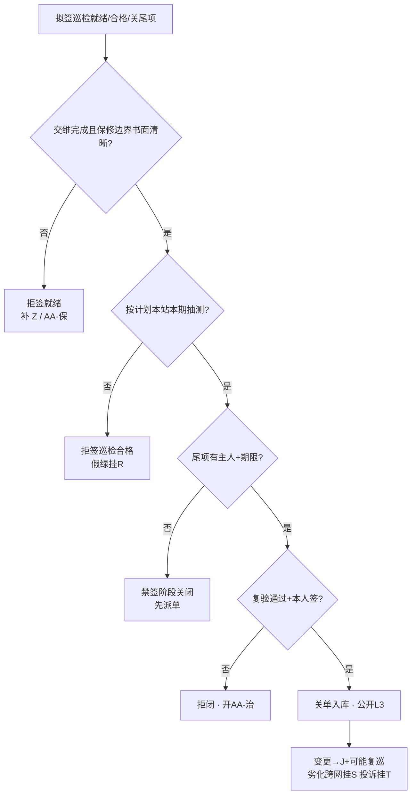

# 手册 28 · 运维制度：交维后首年巡检与保修期尾项闭环

> **手册模式 · 岗位深挖（首年巡检计划与实测 / 保修质保边界 / 交维尾项与新发现 / 尾项闭环与签字 / 过保甩锅与假闭环治理）第 28 篇**（接第 40 课收官 · 手册 01–27 之后 · **不是第 41 课**）  
> 适合：已有贴纸 Z / Q / N / K / I / R / J / S / T，可一到「交维签了就万事大吉」「还在保口头说说就行」「巡检套旧记录」「尾项过期自动关」「屏绿就当巡检合格」「跳一次巡检没事」「过保了就甩给运维」「功率大一点覆盖就回来了」就慌——想学会**先证交维完成且保修边界书面清晰再签首年巡检就绪、本站本期实测抽测、按计划巡禁跳巡、尾项有主有期、闭环须复验、主贴 AA、假绿≠巡检、跨网挂 S、脱敏 L3**的人  
> 阅读量：约 **30–40 分钟** · **不重写手册10 / 11 / 12 / 15 / 18 / 19 / 20 / 21 / 22 / 25 / 27 全文**（只给指针）、**不 dump 空口字段**、**不发明条款号**、**不写真实频点 / 站名 / 单位名 / 保修单全文号 / 合同号 / 联系人 / 坐标**（教学虚构、L3）· **不教伪造巡检记录、不教功率战掩盖劣化、不教规避监测、不教口头关尾项**——只讲首年巡检、保修边界、尾项清单、闭环签字与拒闭 · 要把「**先证交维与保修书面边界再签巡检就绪；本站本期实测抽测；按计划巡；尾项有主有期；复验才闭；主贴 AA；假绿≠巡检；跨网挂 S；脱敏 L3**」钉成肌肉记忆  
> **频谱 / 调制提醒（弱项短补）**：一条 DMR 信道「车道宽」**12.5 kHz**，信号主体「车身」占用带宽通常更窄（国无办〔2025〕1号附件1：12.5 kHz 间隔时 ≤ 8.5 kHz），调制是 **4FSK**，时隙是 **2-slot TDMA**（30 ms / 格）。中继站**收发异频**：基站「说」用发射频率（**下行**，基站→手台），基站「听」用接收频率（**上行**，手台→基站）——手台功率小、天线短，**上行往往比下行先不够用**。交维签字（Z）只证明「交那天」站是好的；**首年巡检**要回答的是：过了几个月、换了季节、邻居加了设备、馈线接头松了半圈之后，**上下行、覆盖抽测、电源倒换、网管心跳还在不在判据里**。劣化常先从上行边缘、室分口部、蓄电池倒换、告警漏报露出来——**屏上还绿，现场已经漂了**。概念生疏先回 `学习推送/加餐_频率带宽与调制解调.md`；开站验收与交维签字回手册27（贴纸 Z）。

---

## 1. 为什么要写这篇手册（动机 + 现场对话）

前二十七篇手册从 A–E 协议一路写到 Z 开站交维签字：其中 **Z 回答「交没交清楚」**，**Q 金机、N 监控、K 电源、I 室分**各管分项。可交维签字那天并不是故事的结局——**首年往往还在保修期内**，建设方 / 厂商仍有保修义务，运维方已开始「全面履行维护义务」。谁来把「首年该怎么巡、保什么不保什么、交维尾项和新发现怎么关」钉成一张可执行的台账？这就是本篇的 **AA**——**交维后首年巡检与保修期尾项闭环**。

- 项目经理：「交维签了，巡检你们自己看着办，保修我口头说还在保。」——**无书面保修边界仍签「首年巡检就绪」** = 本篇拒签（规则1）。  
- 巡检员：「上季度那份记录拿来改个日期就行，站又没动。」——**套他期记录** = 规则2。  
- 班长：「这个月忙保障，首年第二巡跳过，下季度补。」——**跳巡 / 超期未补巡仍签合格** = 规则3。  
- 施工队：「交维尾项三个问题我们口头答应改；新发现的也先记着。」——**尾项无主人无期限** = 规则4。  
- 协调岗：「厂商说修好了，电话里关单吧；过期了系统自动关。」——**口头关 / 过期自动关** = 规则5。  
- 网管：「屏全绿，巡检打勾就行。」——**假绿顶替巡检** = 规则6。  
- 施工队：「边缘差一点，我们把功率抬一点就回来了。」——**功率战掩盖劣化** = 规则7。  
- 宣传岗：「把保修单全文号、站坐标发群里表扬闭环率。」——**L3 违规** = 规则8。  

这几句背后是同一件事：

> **「交维后首年巡检与保修期尾项闭环」在现场至少有五个坑**：**① AA-巡** 首年巡检计划与实测（按周期走点：覆盖抽测、电源倒换抽测、网管心跳、室分口部等——指针到 I/K/N/Q，不重写）；**② AA-保** 保修 / 质保边界（谁修、保什么、不保什么、响应时限、书面依据；禁口头「还在保」）；**③ AA-尾** 交维尾项 + 首年新发现尾项清单（有主人、有期限、重大 / 一般分级）；**④ AA-闭** 尾项闭环与签字（复验通过才关单；禁口头关闭、禁过期自动关）；**⑤ AA-治** 治理（过保甩锅、假闭环、跳巡、用功率战掩盖劣化、假绿顶替巡检、公开泄密）。  
> 把 ①–⑤ 当成「交维签了就万事大吉」「口头还在保」「套旧记录」「过期自动关」，这座站首年每一次故障都会先吵「到底还在不在保、当初尾项关没关、巡检到底做没做」。

本篇目标：能背出**首年巡检与保修尾项闭环工作流**；会用新贴纸 **AA（巡 / 保 / 尾 / 闭 / 治）**；会填**插页 AA（AA1–AA8）**和《本网交维后首年巡检与保修期尾项闭环台账卡》；能用「**新车首年保养 + 质保期内故障保修单闭环**」故事讲清计划巡检、书面保修边界、尾项有主有期、复验才闭；能拒绝无书面保修边界、套记录、跳巡、口头关单、假绿顶替、功率战掩盖、过保甩锅；自测过关后，回库把本网最近一座交维未满一年的站（L3）重对一遍。

**本篇硬禁令（写进脑子）**：凡引法规与标准只指向已公开发布的文书标题与官方链接（无线电管理条例、频率使用许可管理办法、地面无线电台（站）管理规定、无线电台执照管理规定、国无办〔2025〕1号；**只作故事类比**的《家用汽车产品修理更换退货责任规定》、《房屋建筑工程质量保修办法》、《建设工程质量管理条例》质量保修章），**程序、期限、责任以原文与属地最新要求及本网合同为准，本篇只作教学转述，不发明条款号与内部口径**；汽车三包与房建保修文件**不是台站法定依据**；**现象与台账一律用相对道号、角色标签、脱敏编号，禁真实频点 / 站名 / 单位名 / 保修单全文号 / 合同号 / 联系人 / 坐标**；**不教伪造巡检记录、不教功率战掩盖劣化、不教规避监测、不教口头关尾项**；I / K / Q / N / Z / J / R / S / T 各管各的——**交维后首年巡检与保修期尾项闭环主贴 AA**；Tait 验收后 burn-in / punch list、P25 Best Practice 现场验收与 burn-in 约定只借**方法级**表述，**首年巡检周期、保修边界与闭环签字以本网合同、书面保修书与制度为准**。

---

## 2. 总图 / 故事：交维后首年像「新车首年保养 + 质保期内故障保修单闭环」

### 2.1 一句话：交维签字像新车交车——钥匙交到你手里不算故事结束；首年要按保养手册按时到店做保养（巡检），质保期内坏了要开保修单、写清保什么不保什么、修好后车主到场确认才关单（尾项闭环）；口头说「还在保」「修好了」都不算数

```text
   ┌────────────────────────────────────────────────────────────┐
   │  新车首年保养 + 质保保修单闭环  =  本网首年巡检 + 保修尾项闭环 │
   │                                                            │
   │  保养手册周期 + 到店实测项目   ≈ AA-巡  计划·走点·本站本期抽测 │
   │  三包凭证 / 保修书书面边界     ≈ AA-保  谁修·保什么·不保什么   │
   │  交车问题单 + 使用中新发现     ≈ AA-尾  交维尾项 + 巡检新发现  │
   │  修好后车主确认关单            ≈ AA-闭  复验通过 + 签字才关    │
   │  过保甩锅·假关单·跳保养·抬功率  ≈ AA-治  过保甩锅·假闭环·跳巡  │
   └────────────────────────────────────────────────────────────┘
```

口诀：

> **交维不是终点，首年还在保；计划巡检有实测，尾项复验才关单。**  
> 交维签了就不巡 = 新车交车后从不做首保——**拒签「巡检合格」**。  
> 口头「还在保」就派修 = 没有三包凭证就让 4S 店白修——**拒签保修派工**（先补书面边界）。

### 2.2 「新车保养 + 质保保修单」五段直觉（钉死）

| 段 | 像什么 | 运维直觉 | 本篇贴纸 |
|----|--------|----------|----------|
| **首年巡检** | 保养手册写明 5000 / 10000 公里首保、项目清单、到店实测（机油、制动、轮胎） | 首年巡检周期书面钉死；覆盖抽测、倒换抽测、网管心跳、室分口部按计划走点，本站本期记录 | AA-巡 |
| **保修边界** | 三包凭证写明包修期、保什么、易损件不保什么、修理者网点 | 书面保修书：责任方、范围、期限起算、响应时限、不保清单；禁口头「还在保」 | AA-保 |
| **尾项清单** | 交车时问题单 + 使用中新开保修单，每条有单号、等级、处理人、期限 | 交维未闭环尾项 + 巡检 / 告警新发现；重大 / 一般；主人 + 期限 + 复验方式 | AA-尾 |
| **闭环签字** | 修好后车主到场确认、签字关单；过期不自动关；不能代签 | 复验通过 + 授权角色签字才关；禁口头关、禁过期自动关、禁代签逼关 | AA-闭 |
| **治理** | 过保甩锅、假关单、跳保养、改装后仍要免费保、隐瞒里程 | 过保甩锅、假闭环、跳巡、功率战掩盖、假绿顶替、公开泄密 → 拒签 / 治理 | AA-治 |

> 公开文书告诉我们（**教学转述，以原文为准**）：汽车三包领域有**包修期 / 三包有效期书面凭证**、修理记录存档、易损件单独质保期、**使用不当 / 改装造成的损坏可免责**等直觉；房建保修领域有**质量保修书明确范围、期限、责任**、保修完成后组织验收、使用不当与不可抗力不属保修范围等直觉（出处见 §10）。本篇只借这串顺序直觉——**台站首年巡检与保修边界以本网合同、书面保修书与制度为准，汽车三包与房建保修不是台站法定依据**。

### 2.3 和手册10 / 11 / 12 / 15 / 18 / 19 / 27 等的咬合（指针，不重写）

- **Z（手册27）**：交维签字是 AA 的**前置闸门**——没交维完成（或条件交维书面列明）就谈不上「首年巡检就绪」；Z 交维资料包里的「巡检周期」「保修与联系角色」「尾项清单」正是 AA 要接着跑的那几页。  
- **I（手册10）/ K（手册12）**：室分口部、电源倒换是首年巡检的**专业抽测点**；AA-巡 挂分项指针，不重写 R1–R8 / 倒换剧本。  
- **Q（手册18）/ J（手册11）**：金机基线是「交维那天的出生证明」；巡检发现漂移要对照 Q，变更走 J，可能触发复巡。  
- **N（手册15）**：网管心跳、告警归属是 AA-巡 必勾项；告警漏报常比射频劣化更早暴露。  
- **R（手册19）**：屏上全绿 ≠ 已巡检合格（规则6）；挂 R 提醒，主贴 AA。  
- **S（手册20）/ T（手册21）**：巡检发现跨网劣化 / 干扰挂 S；用户投诉挂 T；禁功率战。  
- **U（手册22）/ X（手册25）**：巡检若发现参数与执照 / 环境报告不符，回挂 U/X，不是 AA 单独能「调回去」的。

### 2.4 新贴纸 AA：巡 / 保 / 尾 / 闭 / 治（五个子类）

> 小彩蛋：字母表在 Z 收口之后，本篇起用**双字母贴纸**——**AA** 是「交维之后的第一张续写贴纸」，角色正好是「首年还在保、巡检与尾项要闭环」。A–Z 既有含义不改；新专题用 AA、AB… 续写。

```text
                ┌──────────── 贴纸 AA · 巡/保/尾/闭/治 ────────────┐
                │  AA-巡  首年巡检：计划周期·走点·本站本期抽测      │
                │  AA-保  保修边界：谁修·保什么·不保·响应·书面依据 │
                │  AA-尾  尾项清单：交维尾项+新发现·主人·期限·分级 │
                │  AA-闭  闭环签字：复验通过才关·禁口头/过期自动关 │
                │  AA-治  治理：过保甩锅·假闭环·跳巡·功率战·假绿  │
                └──────────────────────────────────────────────────────┘
```

| 子类 | 一句话 | 典型拒签 / 拒闭触发 |
|------|--------|----------------------|
| **AA-巡** | 无书面计划、跳巡、无本站本期抽测记录仍签「巡检合格」→ 拒签 | 「上季度记录改个日期」 |
| **AA-保** | 无书面保修边界（范围 / 期限 / 责任方 / 响应）仍签「首年巡检就绪」或派保修 → 拒签 | 「口头说还在保」 |
| **AA-尾** | 交维尾项或新发现无主人无期限、重大未分级 → 禁签阶段关闭 | 「先记着，有空再派」 |
| **AA-闭** | 口头说修好、过期自动关、未复验、代签逼关 → 拒闭 | 「电话里关单吧」 |
| **AA-治** | 过保甩锅、假闭环、跳巡、功率战掩盖、假绿顶替、公开泄密 → 治理 | 「过保了就甩给运维」 |

### 2.5 交维 → 首年巡检 → 保修尾项闭环 阶段梯（背下来）

```text
  ① 交维完成（Z：资料包 + 责任边界 + 尾项移交）     ← Z 前置；AA 起点
        │  条件交维须书面列明一般尾项；重大尾项应为 0
        ▼
  ② 保修边界书面钉死（AA-保）                        ← 拒「口头还在保」
        │  责任方 / 范围 / 起算日 / 期限 / 响应 / 不保清单
        ▼
  ③ 首年巡检计划书面钉死（AA-巡）                    ← 周期 + 走点清单
        │  例如教学：季巡 / 半年覆盖抽测 / 年终总巡（以本网为准）
        ▼
  ④ 按计划执行抽测（本站本期 · 上下行 · 倒换 · 心跳）← AA-巡 实测
        │  发现异常 → 开尾项（AA-尾）或挂 S/T/J
        ▼
  ⑤ 尾项派主人 + 期限 + 复验方式（重大 / 一般）      ← AA-尾
        │  保修范围内 → 走 AA-保 派工；范围外 → 另开变更 / 采购路径
        ▼
  ⑥ 整改完成 → 复验通过 → 签字关单（AA-闭）
        │  禁口头关、禁过期自动关、禁代签逼关
        ▼
  ⑦ 保修期末尾项清零检查 + 过保交接备忘（仍 L3）
        └─▶ 变更（改频/改功率角色/换天馈）→ J + 可能触发复巡（规则7）
```

> **一句话分辨**：**交维（Z）**回答「从今天起谁负责、拿什么负责」；**保修边界（AA-保）**回答「还在保的范围内谁修、修到什么时候」；**首年巡检（AA-巡）**回答「计划点有没有按时走到、本站本期还达标吗」；**尾项（AA-尾）**回答「未了事项谁管、何时了」；**闭环（AA-闭）**回答「修好了没有、谁亲眼确认关的单」。**五个问题，五张子贴纸，不能一笔带过。**

### 2.6 首年巡检与保修尾项最小工作流（背下来）

每次准备签「巡检合格 / 尾项关闭 / 首年巡检就绪」前，按下图从上往下走；任何一个「否」都停在那一格。



现场口诀：

> **先证交维与保修，计划巡检有实测；尾项有主有期限，复验签字才关单。**  
> 跳过实测的「巡检合格」= 4S 店没抬车就在保养单上打勾。

---

## 3. 核心交付：插页 AA + 拒签/拒闭卡 + 与总三联单怎么写

### 3.1 什么时候贴 AA（而不是先贴 Z / I / K / Q / N / R）

| 现场信号 | 主贴 | 可次挂 |
|----------|------|--------|
| 交维后首年要定巡检计划、做季巡 / 年巡、关保修尾项 | **AA** | Z / Q / N / K / I |
| 整站还没交维清楚、还在争签字 | **Z** | 交维完成后再开 AA |
| 室分口部 / 电源倒换那一段抽测 | **I / K**（分项） | 整站巡检台账仍 AA |
| 发现配置 / 金机漂移、要改参 | **J / Q** + 挂 **AA**（复巡） | U / X / S |
| 屏绿 / 假绿想顶替巡检实测 | **AA-治** + 挂 **R** | — |
| 巡检发现跨网劣化 / 干扰 | **AA** + 挂 **S** | T（投诉） |
| 保修期将满、尾项未清零 | **AA-保 / AA-闭** | Z（回看交维边界） |

> **口诀**：整站交维签字 → **Z**；室分管子 → **I**；电源倒换 → **K**；金机 / 写频 → **Q/J**；监控心跳 → **N**；假绿 → **R**；邻居 → **S**；投诉 → **T**；**交维后「首年怎么巡、保什么、尾项怎么关」→ AA**。可叠挂，**该类台账主贴 AA**。

### 3.2 插页 AA · 巡 / 保 / 尾 / 闭 / 治（挂在总三联单或巡检单后）

| 行 | 名称 | 填写示例（教学虚构，L3） |
|----|------|--------------------------|
| **AA1** | 站点角色与保修窗口 | 「站点角色甲·交维日角色·保修起算日角色·保修届满日角色·当前拟签：□首年巡检就绪 □季巡合格 □尾项关闭 □保修末清零」 |
| **AA2** | 保修 / 质保边界（书面） | 「□责任方角色 □范围角色 □不保清单角色 □响应时限角色 □书面保修书 / 合同条款指针（脱敏）□联系角色」——缺一拒签「巡检就绪」与保修派工 |
| **AA3** | 首年巡检计划 | 「周期：□季 □半年覆盖抽测 □年终；走点清单指针；下次应巡日角色」——无书面计划拒签 |
| **AA4** | 本期抽测包 | 「□下行抽测 □上行边缘抽测 □两时隙抽测 □倒换抽测（K）□网管心跳 / 告警抽测（N）□室分口部（I）□对照金机（Q）□方法角色 · 仪器有效期」——缺项拒签合格 |
| **AA5** | 交维尾项结转 | 「交维未闭环：重大__ / 一般__；每条主人·期限·状态」——重大应为 0 才签「巡检就绪」（条件交维例外须书面） |
| **AA6** | 本期新发现尾项 | 「编号脱敏·等级·主人·期限·复验方式·是否走保修（AA-保）」 |
| **AA7** | 闭环签字 | 「复验人角色 · 结果 · 关闭人角色 · 本人签□ · 无代签□ · 无过期自动关□」 |
| **AA8** | 拒签 / 拒闭门槛 + 变更复巡触发 | 「缺任一正式项 → 拒签 / 拒闭；触发复巡：□改频 □改功率角色 □换天馈 □重大覆盖劣化 □过保交接 □其他____ → 挂 J / 复巡 / 重对 U/X/S」 |

> 插页每一行都对应一条硬规则：AA2→规则1，AA4→规则2，AA3→规则3，AA5/AA6→规则4，AA7→规则5，公开包→规则8。**任何一行缺项，就停在那一行。**

### 3.3 和总三联单怎么写（接手册06）

- **现象**：「拟签类型 + AA 子类」；未过闸门前**不写**「巡检合格」「尾项已关闭」「保修期内运行正常」。  
- **证据**：AA2–AA7 勾选与指针；互挂 Z/I/K/Q/N/J 编号（脱敏）。  
- **结论**：AA 子类 + 待巡 / 待修 / 待复验 / 已关闭 / 拒签 / 拒闭；次挂时写明主贴仍 AA。  
- **动作**：补保修书面边界、补巡、派尾项、复验、挂 S、拒闭——**禁写**「套旧记录」「口头关单」「过期自动关」「抬功率先顶着」。

### 3.4 《本网交维后首年巡检与保修期尾项闭环台账卡》预告

§7 给出可复印模板：封面拒签 / 拒闭门槛（兼作拒签卡，贴值班台 / 运维会议室）、保修边界页、巡检计划与抽测页、尾项与闭环页。本插页 AA1–AA8 是「贴在三联单后的短页」；台账卡是「本网每座站首年（及保修期）维护的厚页」——**站在，卡在；保修届满，卡归档并开过保备忘**。 若一座站交维时是「条件交维」，台账卡封面须**红字提示**「一般尾项结转中，重大须为 0」——避免新人只看绿灯就签就绪。

---

## 4. 深潜：八条硬规则 + 分诊题 + 最小集 + 台账路径 + 15分钟清单

### 4.1 八条硬规则（本篇钉子）

1. **先证：交维完成（Z）且保修责任书面清晰（AA-保：责任方、范围、期限起算、响应时限、不保清单）再签「首年巡检就绪」；无书面保修边界 → 拒签就绪与保修派工**。  
2. **本站本期：巡检须本站本期实测抽测（上下行抽测、两时隙抽测、倒换抽测、网管心跳等）；禁套他站 / 他期记录；只有结论没有指针按缺项**。  
3. **按计划巡：首年巡检周期与走点清单书面钉死；跳巡 / 超期未补巡 → 禁签「巡检合格」；补巡须注明超期原因与补做日**。  
4. **尾项有主有期：交维结转尾项与巡检新发现须有主人 + 期限 + 复验方式；重大 / 一般分级；重大尾项未闭环禁签阶段关闭（可内部挂待闭）**。  
5. **闭环须复验：口头说修好 ≠ 关闭；复验通过 + 授权角色本人签字才闭；过期不自动关；禁代签、禁逼关**。  
6. **可挂 Z/Q/N/K/I/R/J 支撑，但首年巡检与保修尾项主贴 AA；屏绿、假绿演练、远程看一眼都不等于已巡检合格（挂 R 提醒）**。  
7. **劣化 / 干扰跨网挂 S，用户投诉挂 T；禁功率战掩盖劣化或覆盖回退；交维后变更走 J，并可能触发复巡；重对 U/X/S**。  
8. **对外 / 公开仓一律脱敏 L3；禁贴真实频点 / 站名 / 单位名 / 坐标 / 保修单全文号 / 合同号 / 联系人**。

> 法规锚点（已核公开原文，教学转述，**以原文为准**）：无线电管理与台站、执照规定决定「参数能不能擅自改」——**巡检发现漂移要回挂 U/J，不是私自抬功率**。汽车三包与房建保修公开文件只作故事类比（§2.2）：**书面凭证、修理记录、保修完成后验收、使用不当免责**——翻译成本网语言就是 AA-保 / AA-闭。**这些是交付与保修秩序，不是「口头还在保」「过期自动关」的借口。**

**签字 / 关单前冻结清单**（未过 §2.6 流程图任何一格时）：签「首年巡检就绪」「季巡 / 年巡合格」「尾项已关闭」、对外宣传「首年零尾项」、把过保站点仍写成「质保期内」。允许做的：补书面保修边界、补巡、派尾项、复验安排、挂 S/T、内部挂待巡 / 待闭。

### 4.2 分诊题：这件事贴 AA 还是贴别的？

| 现场问题 | 先问 | 主贴 |
|----------|------|------|
| 这座站交维手续齐不齐、谁签的 | 交维阶段是否完成 | **Z**（齐了再开 AA） |
| 首年该多久巡一次、巡什么点 | 有无书面计划与走点 | **AA-巡** |
| 坏了谁修、保不保、多久响应 | 有无书面保修书 | **AA-保** |
| 交维留下的三个问题关了没 | 有无主人期限复验 | **AA-尾 / AA-闭** |
| 室分某一层口部变差 | 分项抽测 | **I** + 挂 AA-尾 |
| 蓄电池倒换失败 | 分项 | **K** + 挂 AA-尾 |
| 配置与金机不一致 | 是否变更 | **J/Q** + 挂 AA |
| 屏全绿想打勾巡检 | 有无本期实测 | **AA-治** + **R** |
| 邻居共址后边缘变差 | 是否跨网 | **S** + 挂 AA |
| 用户投诉「听不见」 | 分诊证据链 | **T**（本网劣化仍回 AA/F） |

### 4.3 首年巡检抽测最小集（AA-巡）——缺页不能签「巡检合格」

| 序号 | 最小集项（教学） | 为什么必须有 | 缺了会怎样 |
|------|------------------|--------------|------------|
| 1 | **本站本期标识**（站点角色 + 巡检时段角色） | 防套他站他期 | 对不上 → 拒签 |
| 2 | **下行抽测**（承诺区抽样点角色） | 「基站还说得出去」 | 缺 → 拒签 |
| 3 | **上行边缘抽测** | 上行常先漂；对讲是双向的 | 缺 → 拒签（头号坑） |
| 4 | **两时隙抽测** | 2-slot TDMA 两格都要能用 | 只测一格 → 拒签 |
| 5 | **倒换抽测指针（K）** | 坏的时候能不能倒 | 缺 → 拒签或列重大尾项 |
| 6 | **网管心跳 / 告警抽测（N）** | 坏了有没有人知道 | 缺 → 拒签 |
| 7 | **室分 / 隧道口部抽测指针（I，若有）** | 分项各管各的 | 分项缺 → 整站不签合格 |
| 8 | **对照金机基线（Q）** | 发现漂移有参照 | 「感觉差不多」不够 |
| 9 | **方法角色 + 仪器有效期 + 巡检人 / 复核人角色** | 可复核 | 「巡过了」三个字不够 |

> **口诀**：站、下、上、隙、倒、心、分、机、法——**九字巡钉**（教学记忆；现场以本网书面巡检规程为准，但 **本站本期 + 上下行抽测 + 倒换 / 心跳 + 方法可追溯** 几乎不可砍）。  
> **弱项短补（首年为什么仍要测上行）**：交维那天上行够，不代表雨季、树叶茂密、邻居加装、接头氧化半年后还够。下行场强「看起来还行」、上行误码先坏——用户感受仍是「我听得见调度，调度听不见我」。**只扫下行或只看屏绿就打勾，等于 4S 店只看机油标尺、不试刹车。**

### 4.4 保修边界最小集（AA-保）——物业式「保修书」缺页不能派工

| 步 | 边界项（教学） | 对应故事 | 拒签点 |
|----|----------------|----------|--------|
| 1 | **责任方角色**（建设 / 施工 / 厂商 / 集成） | 三包谁承担 | 「找他们」无名字 |
| 2 | **保修范围角色** | 保什么 | 范围空白 |
| 3 | **不保清单角色** | 易损件 / 使用不当 / 不可抗力 / 擅自改装 | 「什么都保」不现实也不诚实 |
| 4 | **起算日与届满日** | 包修期从哪天算 | 口头「大概一年」 |
| 5 | **响应与到场时限角色** | 多长到场 | 「尽快」≠时限 |
| 6 | **书面指针**（合同条款 / 保修书脱敏编号） | 三包凭证 | 只有聊天记录 |
| 7 | **派工与备件路径** | 修理记录存档 | 「先用金机顶着，单以后补」需书面 |

与手册27：Z-交 资料包里「保修与联系角色」是种子；**AA-保 要把种子写成可派工的边界表**。与手册18：保修更换板件后须更新 Q 金机基线，关单前勾选。

### 4.5 尾项清单与闭环（AA-尾 / AA-闭）——怎么写才算数

```text
  尾项编号（脱敏）  等级      主人角色      期限        复验方式          状态
  ───────────────  ────────  ───────────  ──────────  ────────────────  ──────
  AA-甲-01         重大      施工方角色    角色日      运维到场复测上行    未闭环 → 禁阶段关
  AA-甲-02         一般      厂商角色      角色日      资料+远程核对        待复验
  AA-甲-03         一般      运维方角色    角色日      下季巡复看            已闭环
```

- **重大尾项**（教学示例：上行边缘不达判据、倒换失败、告警未送达、保修范围内关键板件未修、执照参数与现场不一致）——**未闭环禁签阶段关闭**。  
- **一般尾项**（标签不全、非关键资料晚到）——可继续巡检计划，但必须书面列明，**到期未关升级提醒，不自动关**。  
- **口头答应 / 过期自动关不算闭环**：「他们说好了」「系统到日自动关」在台账里等于未关闭。  
- **复验人与关闭人**：教学上鼓励「整改方 ≠ 唯一关闭方」；至少运维方角色到场或书面确认（以本网制度为准）。

### 4.6 台账路径（一张站跑完整年）

| 时点（教学） | 台账动作 | 主贴 |
|--------------|----------|------|
| 交维当日 | 结转尾项到 AA5；复制保修种子到 AA2；写入首年计划 AA3 | Z→AA |
| 首年巡检就绪会 | AA2/AA3 齐 → 签就绪；重大尾项须 0 | AA |
| 每季巡 | AA4 九字巡钉；新发现进 AA6；关单走 AA7 | AA-巡 |
| 保修期内故障 | 对 AA2：在保→派工；不保→另路径；禁口头 | AA-保 |
| 保修届满前 30 日（教学） | 尾项清零检查；未闭环升级；开过保备忘 | AA-闭 |
| 任何变更 | J + 评估是否复巡；更新 Q | J + AA |

### 4.7 签字 / 关单前 15 分钟清单（可复印）

| 分钟 | 动作 |
|------|------|
| 0–3 | 打开台账卡：站点角色、交维日、保修届满日、上次巡检日、未闭环尾项数 |
| 3–6 | AA2 保修七勾：责任方 / 范围 / 不保 / 起算届满 / 响应 / 书面指针 / 派工路径 |
| 6–9 | AA3/AA4：计划是否超期；九字巡钉是否本站本期 |
| 9–12 | AA5/AA6：重大尾项是否 0；新发现是否已派主人期限 |
| 12–15 | AA7 闭环自检（复验通过、本人签、无自动关）；拒签卡自检；交班口述 |

夜班压缩版：至少确认「**保修边界书面在 + 未超期未巡 / 或本期实测在 + 重大尾项有主人 + 关单有复验**」四项——**四项缺一仍禁签合格与关单**。

### 4.8 保修期内 vs 过保后：两张责任表（钉死，防甩锅）

| 问题 | 保修期内（教学） | 过保后（教学） |
|------|------------------|---------------|
| 设备本身质量缺陷 | 按 AA-保 派责任方免费（或合同约定）修理 | 走采购 / 维护合同另径；不追溯「口头还在保」 |
| 交维结转未闭环尾项 | 仍按原主人期限追；不因临近届满自动消失 | 过保交接备忘里写清未了项与费用分担 |
| 运维使用不当 / 私改造成的损坏 | 可走不保清单（对照书面） | 运维侧自行承担 |
| 巡检发现的劣化 | 先分诊：在保缺陷 / 环境变化 / 跨网干扰 / 变更未报 | 同样分诊；在保窗口已关则不硬套保修 |
| 对外口径 | 可说「保修期内按书面边界处理」（L3） | 禁继续宣传「质保期内」 |

> **口诀**：保修期是日历和书面范围，不是心情；**届满前清零，届满后书面交接**——这是 AA-治 防甩锅的核心。

### 4.9 与「金机 / 备件」的最小咬合（指针 Q，不重写）

保修更换板件、倒换用过的备件回库、巡检发现与金机基线不一致时：

1. **关单前**勾选「Q 基线是否需更新」；更新则挂 Q 指针（脱敏）。  
2. **禁**「换了板件但台账仍写旧序列 / 旧功率角色」。  
3. **备件周转台账**的厚写留给下一篇候选（§11.2）；本篇只要求：**涉及保修闭环的更换，必须能在 AA7 找到基线更新勾选**。


---

## 5. 现场映射：原话速查；对话脚本；夜班；禁写词；交班口述

### 5.1 原话速查表

| 原话 | 主贴 | 动作 |
|------|------|------|
| 「交维签了，巡检你们看着办」 | AA-巡 + Z | 先要书面计划 AA3；无计划拒签就绪 |
| 「口头说还在保，先派人修」 | AA-保 | 拒派工；补书面边界 |
| 「上季度记录改个日期」 | AA-巡 | 拒签；本站本期重测 |
| 「这个月跳一巡，下季补」 | AA-巡 | 超期须补巡并注明；未补禁签合格 |
| 「尾项他们口头答应改」 | AA-尾 | 写进清单：主人、期限、复验 |
| 「电话里说修好了，关单吧」 | AA-闭 | 拒闭；安排复验 |
| 「过期了系统自动关」 | AA-闭 / AA-治 | 禁止；恢复为未关闭 |
| 「屏全绿，打勾」 | AA-治 + R | 假绿≠巡检 |
| 「边缘差一点，抬功率」 | AA-治 + S | 禁功率战；查根因 |
| 「过保了，尾项甩给运维」 | AA-治 + AA-保 | 先清保修期内责任；书面过保交接 |
| 「把保修单全文发群里」 | AA-治 | L3 违规下架 |

### 5.2 对话脚本（五则）

**脚本1 · 无书面保修边界**  
对方：「合同里大概写了质保一年，具体找项目经理问；先按还在保派厂商。」  
你：「规则1：AA-保 要责任方、范围、不保清单、起算届满、响应时限、书面指针六项齐。口头『大概一年』不能派保修工。先补书面边界再派。主贴 AA-保。」

**脚本2 · 套旧巡检记录**  
对方：「这站从上季到现在没改过，把上季表格日期改一下交上去。」  
你：「规则2：巡检是本站本期实测。套他期记录等于伪造，拒签合格，本期重做九字巡钉。主贴 AA-巡。」

**脚本3 · 口头关单**  
对方：「厂商电话说板件换好了，网管也绿了，你直接关尾项。」  
你：「规则5：口头修好≠关闭。复验人到场或按制度书面复验通过，本人签字才关。屏绿挂 R 提醒，不能顶替。主贴 AA-闭。」

**脚本4 · 跳巡**  
对方：「保障月太忙，首年第二季巡跳过，年终一起做。」  
你：「规则3：计划书面钉死，跳巡未补禁签合格。能补巡就写超期原因与补做日；不能补就如实挂待巡，不对外说『巡检正常』。主贴 AA-巡。」

**脚本5 · 功率战 + 过保甩锅**  
对方：「边缘差一点我们抬一档功率；反正快过保了，剩下的甩运维。」  
你：「规则7、AA-治：禁功率战掩盖劣化，跨网挂 S；保修期内责任先按 AA-保 清算，过保交接要书面备忘，不是甩锅。主贴 AA。」

### 5.3 夜班注意 + 禁写词

- **夜班**：可不做完整覆盖抽测，但**不能**用「夜班没空」把季巡合格签掉；可签「到场巡视 / 告警确认」，合格签字留到有抽测窗口。  
- **禁写词（三联单 / 公开稿）**：`已巡检合格（无本期记录）`、`保修期内（口头）`、`尾项自动关闭`、`打通即合格`、`抬功率后恢复`、真实频点 / 站名 / 合同号 / 保修单全文号 / 联系人 / 坐标。

### 5.4 交班口述模板（30 秒）

> 「站点角色甲，交维后第__月，保修届满角色日；本期季巡：上行边缘两点未达 → 已开重大尾项 AA-甲-01，主人乙，期限角色日，待复验；保修边界书面在；未闭环重大 1、一般 2；邻频共址已挂 S。下一班禁签季巡合格与关 AA-甲-01，先复验。」

### 5.5 夜班「能做 / 不能做」对照卡

| 夜班可以 | 夜班不可以 |
|----------|------------|
| 到场巡视、抄告警、确认网管心跳、记录异常开尾项 | 用「夜班巡视」代替季巡「合格」签字 |
| 对已复验通过的一般尾项按制度会签关闭（若授权） | 电话里关重大尾项、过期自动关 |
| 发现跨网可疑先挂 S 草稿、交班升级 | 夜班自行抬功率「顶一晚」 |
| 交班口述说清「待复验 / 待补巡」 | 交班写「一切正常」掩盖未巡 |


---

## 6. 工作实例（10 个厚例，均教学虚构、已脱敏到 L3）

> 阅读提示：每个例子按「现象 → 处置 → 结案词」三行写。你在现场可以只记结案词那一句，但**处置里的拒签 / 拒闭动作必须真的发生过**——写在台账里却没挡住签字，等于没学过本篇。十个例子覆盖巡、保、尾、闭、治与 J/S/R 叠挂；若本网制度对时限、会签人有更严规定，**以本网为准，例子里的「教学时限」不发明成法规**。


### 例 1 · 「交维签了就不巡」→ AA-巡
现象：交维满一季，无书面巡检计划，班组认为「新站不用巡」。  
处置：拒签「首年巡检就绪」；补 AA3 计划与走点；按九字巡钉做首巡。  
结案词：「AA-巡：无计划拒签就绪；计划已补，首巡待做。」

### 例 2 · 「口头还在保」→ AA-保
现象：板件故障，项目经理口头称在保，要求立刻派厂商免费修。  
处置：拒派保修工；24 小时内补齐书面边界（范围、届满日、响应）；边界确认后再派。  
结案词：「AA-保：无书面边界拒派工；边界已补。」

### 例 3 · 「改日期套旧表」→ AA-巡
现象：巡检员提交的「本期」记录时间戳与上季文件元数据一致。  
处置：拒签合格；开 AA-治；本期重测；回溯是否还有他站套用。  
结案词：「AA-巡：套他期记录，拒签；已重测。」

### 例 4 · 「保障月跳巡」→ AA-巡
现象：第二季巡因重大保障整体取消，拟在年终合并。  
处置：台账标超期；保障结束后 10 个工作日内补巡（教学时限，以本网为准）；未补前禁签「上半年度巡检正常」。  
结案词：「AA-巡：跳巡未补，禁签合格。」

### 例 5 · 「交维尾项无主」→ AA-尾
现象：条件交维时三条一般尾项只有口头主人，满两个月未动。  
处置：补主人、期限、复验方式；超期升级授权角色；到期未关不自动关闭。  
结案词：「AA-尾：已补主人期限；禁自动关。」

### 例 6 · 「电话关单」→ AA-闭
现象：厂商称远程替换模块成功，要求运维电话确认关单。  
处置：拒闭；安排到场或双人远程复验（按制度）；复验通过后本人签 AA7。  
结案词：「AA-闭：拒口头关；复验后关。」

### 例 7 · 「屏绿打勾」→ AA-治 + R
现象：网管全绿，夜班在季巡单上直接打合格。  
处置：作废该合格签；挂 R；待抽测窗口补九字巡钉。  
结案词：「规则6：假绿≠巡检。」

### 例 8 · 「抬功率救边缘」→ AA-治 + S
现象：首年雨季上行边缘变差，施工方建议抬基站功率「先恢复」。  
处置：禁止；查天馈、室分口部、干扰；跨网可疑挂 S；在保故障走 AA-保。  
结案词：「规则7：禁功率战；已挂 S / 保修派工。」

### 例 9 · 「过保甩锅」→ AA-治 + AA-保
现象：保修届满前一周仍有两条重大尾项，建设方称「过保后归运维」。  
处置：届满前启动清零；重大尾项按保修书追责；过保交接书面备忘（未闭环项与责任划分）；拒签「首年零尾项」宣传。  
结案词：「AA-治：拒过保甩锅；清零中。」

### 例 10 · 「巡检后私改功率未报」→ AA-治 + J
现象：季巡合格后两周，金机对照发现功率角色被改。  
处置：冻结「运行正常」；回滚或补走 J；局部复测上下行；评估复巡；重对 U/X。  
结案词：「AA-治：未报变更，已回滚并走 J。」

---

## 7. 《本网交维后首年巡检与保修期尾项闭环台账卡》模板

### 7.1 封面 · 拒签 / 拒闭门槛（贴值班台 / 运维会议室）

```text
  ┌──── 本网交维后首年巡检与保修期尾项闭环台账卡 · 封面 ────┐
  │  缺以下任一项 → 禁止签对应动作：                                 │
  │  □【就绪】Z 交维完成 · AA-保 书面边界七勾齐                      │
  │  □【合格】本站本期 · 下行 · 上行 · 两时隙 · 倒换 · 心跳         │
  │          分项指针（I/K）· 金机对照 · 方法角色 · 仪器有效期      │
  │  □【关单】复验通过 · 本人签 · 无代签 · 无过期自动关              │
  │  □【阶段关】重大尾项 = 0 · 一般尾项有主人期限                    │
  │  □【公开】L3 · 无真实频点/站名/合同号/保修单全文号/联系人/坐标  │
  └────────────────────────────────────────────────────────────────┘
```

### 7.2 保修边界页（AA-保）

| 边界项 | 内容（角色 / 脱敏指针） | 齐□ |
|--------|-------------------------|-----|
| 责任方 |  |  |
| 范围 |  |  |
| 不保清单 |  |  |
| 起算日 / 届满日 |  |  |
| 响应 / 到场时限 |  |  |
| 书面指针 |  |  |
| 派工与备件路径 |  |  |

### 7.3 巡检计划与抽测页（AA-巡）

| 计划次 | 应巡日 | 实巡日 | 九字巡钉结果 | 超期补巡原因 | 签字角色 |
|--------|--------|--------|--------------|--------------|----------|
| 首巡 / 就绪 |  |  |  |  |  |
| 第2季 |  |  |  |  |  |
| 半年覆盖抽测 |  |  |  |  |  |
| 第3季 |  |  |  |  |  |
| 年终总巡 |  |  |  |  |  |
| 保修末清零 |  |  |  |  |  |

### 7.4 尾项与闭环页（AA-尾 / AA-闭）

按 §4.5 表登记；每条关闭时勾选「复验记录指针 · 关闭人 · 日期角色 · 本人签 · 金机是否更新（Q）」。

---

## 8. 术语表（本篇约 18 词）+ 易错观念

| 术语 | 一句话 |
|------|--------|
| **首年巡检** | 交维后第一年内按书面计划做的周期性抽测与走点，≠ 交维验收 |
| **巡检就绪** | 交维完成 + 保修边界书面齐 + 计划钉死之后，允许按计划开巡的签字点 |
| **九字巡钉** | 站、下、上、隙、倒、心、分、机、法（教学记忆） |
| **保修 / 质保边界** | 书面写清谁修、保什么、不保什么、起算届满、响应时限 |
| **不保清单** | 使用不当、擅自改装、不可抗力、约定易损件等（以书面为准） |
| **交维尾项结转** | 把 Z 交维未闭环项转入 AA 台账继续跑 |
| **新发现尾项** | 巡检 / 告警 / 投诉中新开的事项 |
| **重大 / 一般尾项** | 分级；重大未闭环禁阶段关闭 |
| **闭环** | 复验通过 + 签字关单；口头修好不算 |
| **拒闭** | 不具备闭环条件时拒绝关单 |
| **过期自动关** | 本篇禁止的假闭环方式 |
| **过保交接备忘** | 保修届满时对未了事项与责任的书面交接（L3） |
| **假绿** | 屏上绿色状态顶替现场抽测（挂 R） |
| **跳巡** | 未按计划执行且未按制度补巡 |
| **复巡** | 变更或重大劣化后再次执行的巡检抽测 |
| **主贴 AA** | 首年巡检与保修尾项以 AA 为主键，可挂 Z/Q/N/K/I/R/J/S/T |
| **条件交维（回指 Z）** | 仅一般尾项书面列明后交维；进入 AA 后仍须闭环 |
| **金机对照** | 用交维时 Q 基线判断漂移 |

**易错观念**

1. ✗ 交维签字 = 首年不用管 → ✓ 交维是 AA 的起点，不是终点。  
2. ✗ 口头还在保 = 可以派免费修 → ✓ 要书面边界（规则1）。  
3. ✗ 上季记录改日期 = 本期巡检 → ✓ 本站本期实测（规则2）。  
4. ✗ 跳一巡没事 → ✓ 未补巡禁签合格（规则3）。  
5. ✗ 尾项口头答应 = 已闭环 → ✓ 主人、期限、复验、签字（规则4、5）。  
6. ✗ 过期自动关 = 省事 → ✓ 禁止；恢复未关闭（规则5）。  
7. ✗ 屏全绿 = 巡检合格 → ✓ 假绿≠巡检（规则6）。  
8. ✗ 边缘差就抬功率 → ✓ 禁功率战；查根因；跨网挂 S（规则7）。  
9. ✗ 快过保了甩给运维 → ✓ 先清保修责任 + 书面过保交接（AA-治）。  
10. ✗ 公开表扬可以贴合同号 / 站坐标 → ✓ 规则8，L3。

---

## 9. 自测（12 题）+ 参考答案

1. 贴纸 AA 五个子类是什么？各用四个字以内说明。  
2. 「新车首年保养 + 质保保修单」分别对应巡、保、尾、闭中的哪段直觉？  
3. 八条硬规则里，哪一条要求交维完成且保修边界书面清晰再签「首年巡检就绪」？  
4. 九字巡钉是哪九个字？为什么上行边缘抽测几乎不可砍？  
5. 无书面保修边界，只有项目经理口头「还在保」，能否派厂商免费修？  
6. 把上季度巡检表改个日期交差，能否签「本期合格」？  
7. 保障月跳过一季巡、准备年终合并，中间能否对外说「巡检正常」？  
8. 厂商电话称修好了、网管绿灯，能否直接关重大尾项？  
9. 系统设置「尾项到期自动关闭」，是否允许？  
10. 屏全绿、假绿演练通过，能否代替现场抽测？主贴谁、次挂谁？  
11. 雨季边缘变差，施工方建议抬功率，应如何处置？跨网可疑挂什么？  
12. 公开表扬稿能否出现保修单全文号、合同号、站点坐标、真实频点？

### 参考答案

1. 巡/保/尾/闭/治：计划实测、书面边界、有主有期、复验关单、甩锅假闭治理。  
2. 保养手册周期与到店实测→巡；三包凭证书面边界→保；交车问题单+使用中新开单→尾；修好后车主确认关单→闭（过保甩锅、假关单、跳保养→治）。  
3. 规则1。  
4. 站、下、上、隙、倒、心、分、机、法；上行常先漂，且对讲双向。  
5. 不能；规则1，先补书面边界。  
6. 不能；规则2。  
7. 不能；规则3，超期须补巡并注明，未补禁签合格、禁对外「正常」。  
8. 不能；规则5，复验+本人签。  
9. 不允许；规则5 / AA-治。  
10. 不能；主贴 AA，挂 R（规则6）。  
11. 禁止抬功率掩盖；查根因；在保走 AA-保；跨网挂 S，投诉挂 T（规则7）。  
12. 不能；规则8。

---

## 10. 加深阅读与视频（均已用 curl / oEmbed 核对；以核验当时为准）

**本篇专项方法级阅读（验收后 burn-in、punch list、现场巡检 / 预防性维护；借方法，不替代本网合同与保修书）**  
1. **[Tait Communications · The 6 Steps of Testing to get to "Final Acceptance"](https://www.taitcommunications.com/en/about-us/news/2012/10/25/the-6-steps-of-testing-to-get-to-final-acceptance)**——专网无线验收六阶段；**Burn-in + punch list**、重大尾项可重启观察期——与本篇「交维后仍要跟踪尾项」直接咬合。  
2. **[P25 Best Practice · Field Acceptance Tests（含 Burn-in 约定）](https://www.p25bestpractice.com/implementing/field-acceptance-tests/)**——burn-in 前书面约定：何种失败重置、响应时限、报告形式；**勿让试用触发「beneficial use」过早起算质保**（方法级直觉，对照 AA-保 起算日）。  
3. **[Flowdit · Site Acceptance Test (SAT) in Commissioning](https://flowdit.com/site-acceptance-test/)**——SAT 与现场环境验证入门（通用）。  
4. **[Engineversity · FAT, SAT and commissioning](https://engineversity.com/courses/process-control-systems-for-beginners/fat-sat-and-commissioning/)**——每阶段证明前一阶段证明不了的东西；签字与尾项。  
5. **[FAT/SAT work instructions（electrical-engineering-portal 公开 PDF）](https://electrical-engineering-portal.com/res3/FAT-SAT-OF-electrical-and-automation-systems.pdf)**——双方签字的 SAT 记录模板直觉。  
6. **[TIA TSB-88 标准条目](https://tiaonline.org/standard/tia-tsb-88/)** · **[Softwright · TSB-88 FAQ](https://www.softwright.com/faq/engineering/tsb88faq.html)**——覆盖验证与可重复抽样思路（首年覆盖抽测可借方法，门限以合同为准）。

**故事类比：汽车三包 / 房建保修公开文件（只借直觉，不是台站法定依据）**  
7. **[《家用汽车产品修理更换退货责任规定》（中国政府网）](https://www.gov.cn/zhengce/2021-07/26/content_5723523.htm)** · **[同文国务院部门文件版](https://www.gov.cn/zhengce/zhengceku/2021-07/27/content_5627788.htm)**——三包凭证、包修期 / 三包有效期、修理记录存档、易损件质保、使用不当与改装免责等直觉。  
8. **[《房屋建筑工程质量保修办法》（中国政府网）](https://www.gov.cn/zhengce/2022-01/25/content_5712059.htm)** · **[建设部令第80号国务院公报](https://www.gov.cn/gongbao/content/2001/content_60677.htm)**——保修书明确范围期限责任、保修完成后组织验收、使用不当与不可抗力不属保修。  
9. **[《建设工程质量管理条例》（2019 修订，国务院公报）](https://www.gov.cn/gongbao/content/2019/content_5468867.htm)**——质量保修制度、保修书、最低保修期限章节（类比「书面期限」）。  
10. **[《物业承接查验办法》（建房〔2010〕165号，国务院公报）](https://www.gov.cn/gongbao/content/2011/content_1808607.htm)**——问题书面通知与复验、未移交资料列清单（与尾项闭环直觉相通；接手册27）。

**国内无线电法规（参数与台站秩序；巡检发现漂移要回挂，不私改）**  
11. **[《中华人民共和国无线电管理条例》（中国政府网）](https://www.gov.cn/zhengce/zhengceku/2016-11/25/content_5137687.htm)** · **[国务院公报版](https://www.gov.cn/gongbao/content/2016/content_5148745.htm)**。  
12. **[《无线电频率使用许可管理办法》（中国政府网）](https://www.gov.cn/zhengce/2022-08/23/content_5722706.htm)**。  
13. **[《地面无线电台（站）管理规定》（中国政府网）](https://www.gov.cn/zhengce/202310/content_6908889.htm)** · **[国务院公报 · 工信部令第60号](https://www.gov.cn/gongbao/content/2023/content_5745291.htm)**。  
14. **[国无办〔2025〕1号（工信部公开页，以现行为准）](https://www.miit.gov.cn/jgsj/wgj/wjfb/art/2025/art_31a0765b521e4dc493262188aea65618.html)** · **[无线电管理局首页](https://www.miit.gov.cn/jgsj/wgj/index.html)**（部分出口偶发 403，以官方可访问为准）。  
15. **[生态环境部 · 《电磁环境控制限值》GB 8702—2014](https://www.mee.gov.cn/ywgz/fgbz/bz/bzwb/hxxhj/dcfsbz/201410/t20141022_290449.htm)**（与 X / 复测咬合）。

**ITU / ETSI / DMR（参数指针；不替代巡检与保修签字）**  
16. **[ITU-R Terrestrial 入口](https://www.itu.int/en/ITU-R/terrestrial/Pages/default.aspx)** · **[ITU Handbook on National Spectrum Management 出版物页](https://www.itu.int/pub/R-HDB-21-2015)**。  
17. **[ETSI TS 102 361-1 V2.7.1（PDF）](https://www.etsi.org/deliver/etsi_TS/102300_102399/10236101/02.07.01_60/ts_10236101v020701p.pdf)** · **[ETSI Standards 检索](https://www.etsi.org/standards)**（部分出口偶发 403）。  
18. **[DMR Association · Standards](https://www.dmrassociation.org/dmr-standards.html)** · **[DMR Association 首页](https://www.dmrassociation.org/)** · **[Tait Communications 官网](https://www.taitcommunications.com/)**。

**名词垫脚石（定义级）**  
19. Wikipedia：[Warranty](https://en.wikipedia.org/wiki/Warranty) · [Preventive maintenance](https://en.wikipedia.org/wiki/Preventive_maintenance) · [Punch list](https://en.wikipedia.org/wiki/Punch_list) · [Burn-in](https://en.wikipedia.org/wiki/Burn-in) · [Acceptance testing](https://en.wikipedia.org/wiki/Acceptance_testing) · [Commissioning](https://en.wikipedia.org/wiki/Commissioning) · [Digital mobile radio](https://en.wikipedia.org/wiki/Digital_mobile_radio) · [Land mobile radio system](https://en.wikipedia.org/wiki/Land_mobile_radio_system) · [Spectrum management](https://en.wikipedia.org/wiki/Spectrum_management) · [Drive testing](https://en.wikipedia.org/wiki/Drive_testing)。

**视频（YouTube，已用 oEmbed 核验标题与频道）**  
20. **[MPSCS · Site Maintenance Inspection and Preventative Maintenance on our Tower Sites](https://www.youtube.com/watch?v=4IRdxeXN1do)**——**塔站预防性维护与巡检记录**现场片（最贴「首年巡检走点」；通用公安无线站点，非 DMR 专项制度）。  
21. **[NATEsafety · How to Conduct Tower Inspections](https://www.youtube.com/watch?v=dFs4At6-hhU)**——塔桅巡检安全与检查项入门。  
22. **[Sunil Kashyap · How to perform site audit or RF audit in Telecom field](https://www.youtube.com/watch?v=7Awj0-rDfeA)**——电信机房 / 射频站点巡检直觉（通用）。  
23. **[Engineered Vision · FAT and SAT Explained for Manufacturers](https://www.youtube.com/watch?v=x7qNC6Rtp9I)**——出厂合格≠到站合格（回指 Z，服务「交维后仍要复验」）。  
24. **[Careers360 · FAT & SAT, why it's important](https://www.youtube.com/watch?v=3aafLF9o0NA)**——FAT/SAT 入门。  
25. **[Scanner School · What is DMR? Digital Mobile Radio Explained for Beginners](https://www.youtube.com/watch?v=aQX_JbTbXuY)**（弱项：时隙与数字话音）。  
26. **[Rohde & Schwarz · Understanding Spectrum Analyzers – ACLR](https://www.youtube.com/watch?v=mco_BJ1mjNo)**（「看见」频谱；**不是**造假教程）。  
27. **[Shure · What is Intermodulation?](https://www.youtube.com/watch?v=IrlyAei02_o)**（共址与抬功率的互调直觉；对照禁功率战）。

> **诚实说明**：没有找到「DMR 专网交维后首年巡检与保修期尾项闭环制度（含贴纸 AA + 插页 AA1–AA8 + 新车保养/质保保修单隐喻 + 拒签拒闭卡）」的专项中文公开视频或制度文章；上文最贴题的是 **塔站预防性维护巡检视频（MPSCS）**、**Tait / P25 Best Practice 的 burn-in 与 punch list 方法文章**，以及汽车三包 / 房建保修公开文件（仅作类比）。其余为国内无线电法规、ITU/ETSI/DMR 参数与通用射频视频，需按贴纸 AA 与 AA1–AA8 拼进本网流程。`video_found=true`（通用塔站巡检 / FAT-SAT / DMR 基础），**非**专项。任何「教你如何把巡检记录改好看」「如何抬功率应付抽测」的页面即使 200，本篇也**不引用**。

**库内必回：** 手册27（Z）、10（I）、12（K）、11（J）、18（Q）、15（N）、19（R）、20（S）、21（T）、22（U）、25（X）、06（脱敏）、`加餐_频率带宽与调制解调.md`。

---

## 11. 收束：你今天带走什么；下一篇候选

### 11.1 带走的钉子
- 贴纸 **AA** 五子类：巡 / 保 / 尾 / 闭 / 治——双字母续写的第一张，负责交维后首年「还在保」的巡检与尾项闭环。  
- 故事：新车首年保养 + 质保保修单——交车不是终点；按手册保养、书面保修边界、修好后确认关单。  
- 阶段梯：交维（Z）→ 保修边界书面 → 计划钉死 → 按计划抽测 → 尾项派单 → 复验关单 → 保修末清零。  
- 八条硬规则：**先证交维与保修书面边界**；**本站本期实测**；**按计划巡禁跳巡**；**尾项有主有期**；**复验才闭、禁口头/自动关**；**主贴 AA，假绿≠巡检**；**跨网挂 S、禁功率战、变更走 J**；**脱敏 L3**。

### 11.2 下一篇手册候选（本篇不写正文）
- **室分电磁环境复测周期与变更触发**（与 I/X/Z/AA 咬合：多久复测、改何物触发、和首年巡检怎么分工）  
- **应急通信车 / 机动站快速开站与撤收边界**（与 V/Y/Z 咬合，仍 L3）  
- **备件周转与金机轮换台账**（与 Q/AA/K 咬合：金机、备件、保修更换后基线更新）

### 11.3 给带新人的三句话
1. 交维签字不是终点：首年还在保，计划巡检要有本站本期实测，尤其是上行边缘。  
2. 保修靠书面边界，不靠口头；尾项有主人有期限，复验签字才关，过期不自动关。  
3. 假绿不是巡检合格；禁功率战；跨网挂 S；变更走 J；公开材料脱敏；主贴 AA。

### 11.4 一张图记住本篇（收工贴纸）
```text
  ┌────────── 贴纸 AA ──────────┐
  │ 巡 计划走点·本站本期抽测     │
  │ 保 书面边界·谁修保什么       │
  │ 尾 有主有期·重大一般分级     │
  │ 闭 复验签字·禁口头自动关     │
  │ 治 甩锅假闭·跳巡功率战假绿   │
  └────────────────────────────┘
    新车首保 · 质保关单 · 首年闭环
```

---

## 12. 本篇检查清单（自学打勾）
- [ ] 能背贴纸 AA 五子类与新车首年保养 + 质保保修单故事  
- [ ] 能画交维→保修边界→计划→抽测→派单→关单阶段梯  
- [ ] 能背八条硬规则（先证、本期实测、按计划巡、尾项有主有期、复验才闭、假绿≠巡检、挂 S 禁功率战、L3）  
- [ ] 能背九字巡钉，并能讲清首年仍要测上行边缘  
- [ ] 会填插页 AA1–AA8、保修边界七勾与尾项闭环表  
- [ ] 12 题自测过关  
- [ ] 知道 §10 诚实说明：无专项视频，仅塔站 PM 巡检 + burn-in/punch list 方法 + 三包/保修类比  
- [ ] 回库用 L3 重对一次本网最近一座交维未满一年站点的：保修书面边界、巡检计划与本期记录、未闭环尾项主人期限、关单复验痕迹

---

*手册28 · 交维后首年巡检与保修期尾项闭环 · 学习推送 · 2026-10-22 18:52 +08:00*
