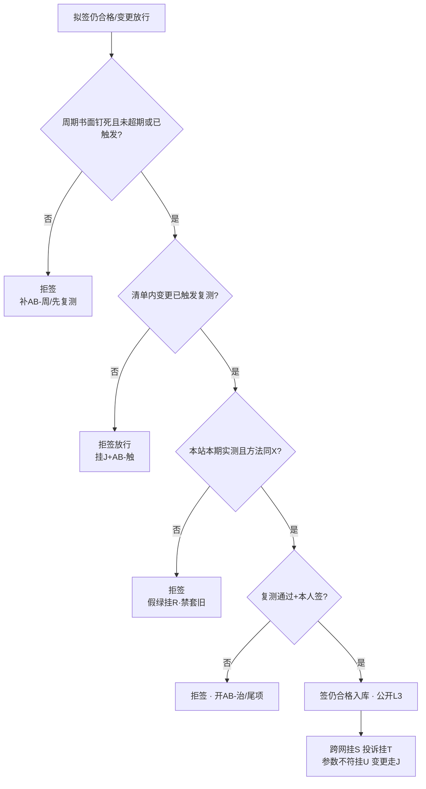

# 手册 29 · 运维制度：室分电磁环境复测周期与变更触发

> **手册模式 · 岗位深挖（复测周期书面钉死 / 变更触发清单 / 本期本站实测最小集 / 复测通过才签仍合格 / 跳复测套旧报告与功率战治理）第 29 篇**（接第 40 课收官 · 手册 01–28 之后 · **不是第 41 课**）  
> 适合：已有贴纸 I / X / Z / AA / J / S / T / R / U / O，可一到「交维那年测过就永远合格」「改了馈线合路还套旧报告」「首年巡检走过等于室分电磁环境复测了」「楼层装修完功率抬一点就行」「屏绿就当噪底没漂」「季测跳过下半年补」「公开仓贴报告全文号与楼层坐标」就慌——想学会**先证复测周期书面钉死且与 X 报告方法一致再签「室分电磁环境仍合格」、变更触发必复测、本站本期实测（上下行·口部·噪底）、禁套旧报告、主贴 AB、假绿≠复测、跨网挂 S、脱敏 L3**的人  
> 阅读量：约 **30–40 分钟** · **不重写手册10 / 11 / 16 / 19 / 20 / 21 / 22 / 25 / 27 / 28 全文**（只给指针）、**不 dump 空口字段**、**不发明条款号**、**不写真实频点 / 站名 / 单位名 / 报告全文号 / 楼层坐标 / 联系人**（教学虚构、L3）· **不教伪造复测记录、不教功率战掩盖噪底漂、不教规避监测、不教套旧报告顶替**——只讲室分 / 隧道电磁环境**复测周期、变更触发、实测最小集、签字边界与治理** · 要把「**周期书面钉死；变更必触发；本期本站实测；复测通过才签仍合格；禁套旧报告；主贴 AB；假绿≠复测；跨网挂 S；脱敏 L3**」钉成肌肉记忆  
> **频谱 / 调制提醒（弱项短补）**：一条 DMR 信道「车道宽」**12.5 kHz**，信号主体「车身」占用带宽通常更窄（国无办〔2025〕1号附件1：12.5 kHz 间隔时 ≤ 8.5 kHz），调制是 **4FSK**，时隙是 **2-slot TDMA**（30 ms / 格）。中继站**收发异频**：基站「说」用发射频率（**下行**，基站→手台），基站「听」用接收频率（**上行**，手台→基站）——手台功率小、天线短，**上行往往比下行先不够用**。室分 / 隧道里更明显：口部、拐弯、合路器之后、楼层装修改管之后，**噪底一抬、上行先塌**。交维那天的 X 报告只证明「交那天」环境与方法；**复测**要回答的是：过了几个月、改了馈线 / 合路 / 增益 / 楼层 / 共址邻居之后，**上下行、口部、噪底是否仍在判据里、方法是否仍与 X 一致**。概念生疏先回 `学习推送/加餐_频率带宽与调制解调.md`；室分交付回手册10（贴纸 I）；电磁环境验收报告台账回手册25（贴纸 X）；开站交维回手册27（贴纸 Z）；首年巡检回手册28（贴纸 AA）。

---

## 1. 为什么要写这篇手册（动机 + 现场对话）

前二十八篇手册从 A–E 协议一路写到 AA 首年巡检：其中 **I 回答「室分管子交没交清楚」**，**X 回答「开站 / 交维那天电磁环境报告齐不齐」**，**Z 回答「交没交清楚」**，**AA 回答「首年怎么巡、保什么、尾项怎么关」**。可交维与首年巡检都还没有单独钉死一件事——**室分 / 隧道的电磁环境，多久必须再测一次？改了什么东西必须立刻复测？和 AA 季巡怎么分工，才不会「巡检走过就算复测了」或「三年前 X 报告永远顶着」？** 这就是本篇的 **AB**——**室分电磁环境复测周期与变更触发**。

- 项目经理：「交维那年测过了，报告还在文件夹，室分电磁环境永远合格。」——**无书面复测周期仍签「仍合格」** = 本篇拒签（规则1）。  
- 施工队：「改了两根馈线、合路增益拧半圈，旧报告方法一样，套用就行。」——**变更后套旧报告** = 规则2 / 规则4。  
- 巡检员：「AA 季巡我走过口部了，等于 AB 复测做完了。」——**用首年巡检抽测顶替电磁环境复测** = 规则3 / 与 AA 分工不清。  
- 班长：「这个季度忙保障，室分复测跳过，年终并一次。」——**跳复测 / 超期未补** = 规则1。  
- 网管：「屏全绿、噪底曲线去年的还能看，打勾。」——**假绿 / 旧曲线顶替本期实测** = 规则6。  
- 施工队：「楼层装修完边缘差一点，功率抬一点就回来了。」——**功率战掩盖** = 规则7。  
- 协调岗：「邻居共址加装后口部变差，我们先顶着，别惹事。」——**跨网不挂 S、私了** = 规则7。  
- 宣传岗：「把复测报告全文号、楼层坐标发群里表扬闭环率。」——**L3 违规** = 规则8。  

这几句背后是同一件事：

> **「室分电磁环境复测周期与变更触发」在现场至少有五个坑**：**① AB-周** 复测周期书面钉死（季 / 半年 / 年；与 AA 首年巡检分工——巡检抽测 ≠ 电磁环境复测）；**② AB-触** 变更触发清单（改馈线 / 合路 / 增益 / 楼层拓扑 / 共址邻居 / 功率角色 / 载频角色等）；**③ AB-测** 本期本站实测方法最小集（上下行、口部、噪底、与 X 报告方法一致）；**④ AB-签** 复测通过才签「室分电磁环境仍合格」；禁套旧报告；**⑤ AB-治** 治理（跳复测、套旧报告、功率战掩盖、假绿顶替、公开泄密）。  
> 把 ①–⑤ 当成「交维那年测过就永远合格」「改管子还套旧报告」「巡检走过等于复测」，这座楼每一次装修、每一次合路拧半圈，都会先吵「到底还合不合格、旧报告还能不能用、谁该掏复测钱」。

本篇目标：能背出**室分电磁环境复测工作流**；会用新贴纸 **AB（周 / 触 / 测 / 签 / 治）**；会填**插页 AB（AB1–AB8）**和《本网室分电磁环境复测周期与变更触发台账卡》；能用「**大楼消防 / 防排烟系统定期检测 + 装修改管必复检**」故事讲清周期钉死、改管触发、方法一致、复测才签、禁套旧证；能拒绝无周期、套旧报告、跳复测、假绿顶替、功率战掩盖；自测过关后，回库把本网最近一座带室分 / 隧道的站（L3）重对一遍：周期、触发清单、最近一次复测与 X 方法对照。

**本篇硬禁令（写进脑子）**：凡引法规与标准只指向已公开发布的文书标题与官方链接（无线电管理条例、频率使用许可管理办法、地面无线电台（站）管理规定、国无办〔2025〕1号、GB 8702 电磁环境控制限值；**只作故事类比**的建筑消防设施检测 / 维护保养公开标准与消防安全责任制相关公开文件），**程序、期限、责任以原文与属地最新要求及本网制度 / 合同为准，本篇只作教学转述，不发明条款号与内部口径**；消防设施定期检测文件**不是台站法定依据**；**现象与台账一律用相对道号、角色标签、脱敏编号，禁真实频点 / 站名 / 单位名 / 报告全文号 / 楼层坐标 / 联系人**；**不教伪造复测记录、不教功率战掩盖、不教规避监测、不教套旧报告**；I / X / Z / AA / J / S / T / R / U / O 各管各的——**室分电磁环境复测周期与变更触发主贴 AB**；ITU 室内传播、DAS 公开科普、TSB-88 覆盖抽样只借**方法级**表述，**复测周期、触发清单与签字以本网制度与 X 报告方法为准**。

---

## 2. 总图 / 故事：室分复测像「大楼消防 / 防排烟定期检测 + 装修改管必复检」

### 2.1 一句话：交维那天的 X 报告像消防验收合格证——发证那天算数，不等于永远不用再检；平时要按周期做消防设施检测（复测），装修改了烟管 / 防火门必须复检（变更触发）；去年的检测报告在改管之后不能直接套用

```text
   ┌──────────────────────────────────────────────────────────────┐
   │  消防/防排烟定期检测+改管复检  =  本网室分电磁环境复测+变更触发 │
   │                                                              │
   │  检测周期书面钉死（年检/季检） ≈ AB-周  季/半年/年·与AA分工    │
   │  装修改烟管/合路/阀门必复检   ≈ AB-触  馈线·合路·增益·楼层·邻居 │
   │  按规程实测·仪器在检·记录完整 ≈ AB-测  上下行·口部·噪底·方法同X │
   │  检测合格才签「设施仍完好」   ≈ AB-签  复测通过才签「仍合格」  │
   │  跳检·套旧证·私改顶着·假绿   ≈ AB-治  跳复测·套旧报告·功率战  │
   └──────────────────────────────────────────────────────────────┘
```

口诀：

> **交维报告管「那天」，复测管「还在不在」；改了管子必触发，套旧报告直接拒。**  
> 交维测过就不复测 = 消防验收后从不年检——**拒签「室分电磁环境仍合格」**。  
> 改完馈线还拿三年前报告交差 = 改完防排烟管道还拿去年检测证——**拒签**。

### 2.2 「消防定期检测 + 装修改管复检」五段直觉（钉死）

| 段 | 像什么 | 运维直觉 | 本篇贴纸 |
|----|--------|----------|----------|
| **复测周期** | 消防设施维护保养 / 检测规程写明周期、项目、记录存档 | 季 / 半年 / 年复测书面钉死；与 AA 首年巡检走点分工，不互相顶替 | AB-周 |
| **变更触发** | 装修改管、改防火门、改风机阀门 → 必须复检，不能「先用着」 | 改馈线 / 合路 / 增益 / 楼层拓扑 / 共址邻居 / 功率 / 载频角色 → 触发复测 | AB-触 |
| **实测方法** | 按检测技术规范：内容、仪器、方法、原始记录 | 本站本期：上下行、口部、噪底；方法与仪器有效期与 X 报告一致可追溯 | AB-测 |
| **签字边界** | 检测合格 / 问题整改复检通过才签「设施完好」；禁套旧证 | 复测通过才签「室分电磁环境仍合格」；禁套他期他站旧报告 | AB-签 |
| **治理** | 跳检、套旧证、私改后不报、用临时措施顶着 | 跳复测、套旧报告、功率战、假绿顶替、公开泄密 → 拒签 / 治理 | AB-治 |

> 公开文书告诉我们（**教学转述，以原文为准**）：建筑消防设施检测 / 维护保养领域有**周期、检测内容、仪器、记录与结论、问题整改**等直觉；消防安全责任制强调设施完好有效、不能长期失管（出处见 §10）。本篇只借这串顺序直觉——**台站室分复测周期与触发以本网制度、合同与 X 报告方法为准，消防检测标准不是台站法定依据**。

### 2.3 和手册10 / 16 / 25 / 27 / 28 等的咬合（指针，不重写）

- **I（手册10）**：室分交付、口部、合路、层级是 AB 复测的**对象与分项指针**；AB 不重写 R1–R8，但复测走点必须能挂回 I 的口部 / 层级角色。  
- **X（手册25）**：交维 / 开站电磁环境报告与台账是 AB 的**方法锚**——复测方法须与 X 报告方法一致（或书面说明差异并获批）；X 管「首次正式验收证据」，AB 管「之后还合不合格」。  
- **Z（手册27）**：交维完成是 AB 周期起算的常见锚点之一（以本网为准）；未交维清楚先回 Z，不急着开「仍合格」。  
- **AA（手册28）**：首年巡检抽测（含室分口部抽测指针）**不等于** AB 电磁环境复测；AA-巡 可发现「口部变差」并开尾项 / 触发 AB，但**不能用季巡记录改日期顶 AB 复测报告**。  
- **O（手册16）**：覆盖与抽样方法可借；复测抽样密度以本网与 X 方案为准。  
- **J（手册11）**：改馈线 / 合路 / 增益 / 功率 / 载频走变更；变更单上应勾选「是否触发 AB 复测」。  
- **S（手册20）/ T（手册21）**：复测发现跨网噪底抬升 / 干扰挂 S；用户投诉挂 T；禁功率战。  
- **R（手册19）**：屏绿 ≠ 已复测合格；挂 R 提醒，主贴 AB。  
- **U（手册22）**：复测若发现与执照参数不符，回挂 U，不是 AB 单独能「调回去」的。

### 2.4 新贴纸 AB：周 / 触 / 测 / 签 / 治（五个子类）

> 小彩蛋：双字母贴纸续写——**AA** 管「交维后首年还在保的巡检与尾项」；**AB** 管「室分 / 隧道电磁环境还合不合格、改了什么必须再测」。A–Z 既有含义不改；新专题用 AA、AB、AC… 续写。

```text
                ┌──────────── 贴纸 AB · 周/触/测/签/治 ────────────┐
                │  AB-周  复测周期：季/半年/年书面钉死·与AA分工     │
                │  AB-触  变更触发：馈线·合路·增益·楼层·邻居·功率  │
                │  AB-测  本期实测：上下行·口部·噪底·方法同X       │
                │  AB-签  复测通过才签「仍合格」·禁套旧报告         │
                │  AB-治  治理：跳复测·套旧·功率战·假绿·泄密       │
                └──────────────────────────────────────────────────────┘
```

| 子类 | 一句话 | 典型拒签 / 拒闭触发 |
|------|--------|----------------------|
| **AB-周** | 无书面周期、跳复测、超期未补仍签「仍合格」→ 拒签 | 「年终合并一次就算了」 |
| **AB-触** | 清单内变更未触发复测、先用着再说 → 拒签放行 / 拒签仍合格 | 「改两根馈线没事」 |
| **AB-测** | 无本站本期实测、方法与 X 不一致且无书面说明、仪器过期 → 拒签 | 「把去年曲线改个日期」 |
| **AB-签** | 套旧报告、只有结论没有指针、未过闸门 → 拒签「仍合格」 | 「文件夹里有 PDF」 |
| **AB-治** | 跳复测、套旧、功率战、假绿顶替、公开泄密 → 治理 | 「功率抬一点顶着」 |

### 2.5 交维报告 → 周期钉死 → 变更触发 → 复测签字 阶段梯（背下来）

```text
  ① 交维/开站 X 报告入库（方法·仪器·测点角色·结论）  ← X 前置；AB 方法锚
        │  Z 交维完成常见为周期起算锚（以本网为准）
        ▼
  ② 复测周期书面钉死（AB-周）                          ← 拒「测过就永远合格」
        │  例如教学：半年口部+噪底 / 年全面复测；与 AA 季巡分工表书面列明
        ▼
  ③ 变更触发清单书面钉死（AB-触）                      ← 改何物必须复测
        │  馈线/合路/增益/楼层拓扑/共址邻居/功率/载频…
        ▼
  ④ 到期或触发 → 本期本站实测（AB-测）                 ← 上下行·口部·噪底·方法同X
        │  发现跨网噪底/干扰 → 挂 S；投诉 → 挂 T；参数不符 → 挂 U
        ▼
  ⑤ 复测通过 + 授权签字（AB-签）→ 签「室分电磁环境仍合格」
        │  禁套旧报告、禁假绿、禁只有结论
        ▼
  ⑥ 未通过 → 开尾项/冻结放行/挂 AA 或 I 分项整改 → 整改后再次复测
        └─▶ 任何清单内变更未勾选触发 → 拒签放行（规则2）
```

> **一句话分辨**：**X** 回答「交维 / 开站那天报告齐不齐」；**AA** 回答「首年整站巡检走点有没有做到」；**I** 回答「室分管子分项交没交清」；**AB** 回答「室分 / 隧道电磁环境按周期或变更后**还合不合格**」。**四个问题，四张贴纸，不能一笔带过。**

### 2.6 室分复测最小工作流（背下来）

每次准备签「室分电磁环境仍合格 / 变更后放行」前，按下图从上往下走；任何一个「否」都停在那一格。



现场口诀：

> **周期钉死看日历，改管触发先复测；本期实测方法同，套旧报告直接拒。**  
> 跳过实测的「仍合格」= 物业拿着去年消防检测证，说「今年也一样」。

---

## 3. 核心交付：插页 AB + 拒签卡 + 与总三联单怎么写

### 3.1 什么时候贴 AB（而不是先贴 I / X / Z / AA / J）

| 现场信号 | 主贴 | 可次挂 |
|----------|------|--------|
| 室分/隧道要定复测周期、到期复测、变更后复测、签「仍合格」 | **AB** | I / X / AA / J |
| 整站还没交维清楚、还在争 X 报告齐不齐 | **Z / X** | 齐了再开 AB 周期 |
| 室分管子分项交付、口部清单本身不清 | **I** | 交付清后再跑 AB |
| 首年整站季巡 / 保修尾项 | **AA** | 发现口部劣化可触发 AB |
| 改馈线/合路/增益/功率/载频 | **J** + 勾选是否触发 **AB** | U / X |
| 屏绿 / 假绿想顶替复测实测 | **AB-治** + 挂 **R** | — |
| 复测发现跨网噪底抬升 / 干扰 | **AB** + 挂 **S** | T（投诉） |
| 复测与执照参数不符 | **AB** + 挂 **U** | J |

> **口诀**：室分管子 → **I**；交维/开站环境报告 → **X**；整站交维签字 → **Z**；首年巡检保修 → **AA**；变更单 → **J**；假绿 → **R**；邻居 → **S**；投诉 → **T**；执照参数 → **U**；**「室分电磁环境多久再测、改何物必测、还合不合格」→ AB**。可叠挂，**该类台账主贴 AB**。

### 3.2 插页 AB · 周 / 触 / 测 / 签 / 治（挂在总三联单或复测单后）

| 行 | 名称 | 填写示例（教学虚构，L3） |
|----|------|--------------------------|
| **AB1** | 站点/室分角色与周期窗口 | 「站点角色甲·室分层级角色·交维/起算日角色·周期：□季 □半年 □年 ·下次应复测日角色·当前拟签：□周期复测合格 □变更后复测合格 □仍合格」 |
| **AB2** | 与 AA / X / I 分工 | 「□AA 季巡抽测指针（不顶替 AB）□X 报告方法锚（脱敏编号）□I 口部/合路清单指针」——三者缺说明拒签「分工清晰」类就绪 |
| **AB3** | 变更触发清单（勾选） | 「□改馈线/接头 □改合路/分路 □改增益/衰减 □改楼层/隧道拓扑 □共址邻居变更 □改功率角色 □改载频角色 □有源器件更换 □其他____」——清单内变更未勾选触发→拒签放行 |
| **AB4** | 本期实测包（最小集） | 「□下行抽测 □上行边缘/口部抽测 □两时隙抽测 □口部/关键点角色 □噪底/底噪抽样 □对照 X 方法一致□或书面差异说明 □仪器有效期 □测人/复核人角色」——缺项拒签 |
| **AB5** | 与 X 报告对照 | 「X 报告脱敏指针·方法要点一致□·测点角色可追溯□·有效期内作方法锚□（过期作历史，不作「仍合格」依据）」 |
| **AB6** | 触发后状态 | 「□未触发 □待复测（冻结放行）□复测中 □已复测入库 □未通过待整改」 |
| **AB7** | 签字边界 | 「复测人角色 · 结果 · 签字人角色 · 本人签□ · 未套旧报告□ · 未假绿顶替□ · 未功率战□」 |
| **AB8** | 拒签门槛 + 互挂 | 「缺任一正式项 → 拒签；互挂：I/X/Z/AA/J/S/T/R/U（脱敏）；公开包 L3」 |

> 插页每一行都对应一条硬规则：AB1/AB2→规则1与分工，AB3→规则2，AB4/AB5→规则3，AB7→规则4，公开包→规则8。**任何一行缺项，就停在那一行。**

### 3.3 和总三联单怎么写（接手册06）

- **现象**：「拟签类型 + AB 子类」；未过闸门前**不写**「室分电磁环境仍合格」「变更后已放行」「周期复测正常」。  
- **证据**：AB2–AB7 勾选与指针；互挂 I/X/AA/J 编号（脱敏）。  
- **结论**：AB 子类 + 待复测 / 待整改 / 已合格 / 拒签；次挂时写明主贴仍 AB。  
- **动作**：补周期书面、触发复测、补测、挂 S、拒签——**禁写**「套旧报告」「跳过本期」「抬功率先顶着」「屏绿打勾」。

### 3.4 《本网室分电磁环境复测周期与变更触发台账卡》预告

§7 给出可复印模板：封面拒签门槛（兼作拒签卡，贴值班台 / 运维会议室）、周期与分工页、触发清单页、实测与签字页。本插页 AB1–AB8 是「贴在三联单后的短页」；台账卡是「本网每座带室分/隧道站维护的厚页」——**站在，卡在；周期到或触发到，卡上必须能看到最近一次复测指针**。若某站「仅有交维 X、从未做过周期复测」，台账卡封面须**红字提示**「周期未起跑或已超期」——避免新人只看文件夹有 PDF 就签仍合格。

---

## 4. 深潜：八条硬规则 + 分诊题 + 最小集 + 台账路径 + 15分钟清单

### 4.1 八条硬规则（本篇钉子）

1. **先证：复测周期书面钉死（AB-周：季/半年/年与起算锚、与 AA 巡检分工表）再签「室分电磁环境仍合格」；无书面周期或已超期未补复测 → 拒签仍合格**。  
2. **变更必触发：清单内变更（馈线/合路/增益/楼层拓扑/共址邻居/功率角色/载频角色/有源器件等）须触发复测；未复测禁签放行与「仍合格」；变更走 J 并勾选 AB-触**。  
3. **本站本期：复测须本站本期实测（上下行、口部/关键点、噪底；两时隙）；方法与仪器有效期与 X 报告方法一致（或书面差异说明并获批）；禁套他站/他期旧报告；只有结论没有指针按缺项**。  
4. **复测通过才签：口头「差不多」、文件夹有旧 PDF、屏绿、假绿演练都不等于「仍合格」；复测通过 + 授权角色本人签字才签；禁代签逼签**。  
5. **与 AA / I / X 分工：AA 季巡抽测可发现劣化并触发 AB，但不得用巡检记录顶替 AB 复测报告；I 管分项交付与口部清单；X 管首次正式验收证据与方法锚；该类台账主贴 AB**。  
6. **可挂 I/X/Z/AA/J/R/S/T/U 支撑，但室分电磁环境复测主贴 AB；屏绿、假绿、远程看一眼、旧噪底曲线都不等于已复测合格（挂 R 提醒）**。  
7. **劣化/干扰跨网挂 S，用户投诉挂 T；禁功率战掩盖噪底漂或覆盖回退；复测与执照不符挂 U；变更走 J**。  
8. **对外/公开仓一律脱敏 L3；禁贴真实频点/站名/单位名/坐标/报告全文号/联系人**。

> 法规锚点（已核公开原文，教学转述，**以原文为准**）：无线电管理与台站、执照规定决定「参数能不能擅自改」——**复测发现漂移要回挂 U/J，不是私自抬功率**。GB 8702 等环境限值公开标准是环境合规指针（与 X 咬合），**不等于**「有过一份报告就永远不用复测」。消防设施定期检测公开标准只作故事类比（§2.2）：**周期、改管复检、仪器与记录、合格才签完好**——翻译成本网语言就是 AB-周 / AB-触 / AB-测 / AB-签。**这些是复测秩序，不是「套旧报告」「功率顶着」的借口。**

**签字前冻结清单**（未过 §2.6 流程图任何一格时）：签「室分电磁环境仍合格」「变更后放行」「周期复测正常」、对外宣传「室分零复测问题」、把超期站点仍写成「环境持续合格」。允许做的：补周期书面、触发复测、补测、挂 S/T/U、内部挂待复测 / 冻结放行。

### 4.2 分诊题：这件事贴 AB 还是贴别的？

| 现场问题 | 先问 | 主贴 |
|----------|------|------|
| 交维/开站环境报告齐不齐 | 是否首次正式验收证据 | **X**（齐了作 AB 方法锚） |
| 室分口部清单、合路层级交没交清 | 分项交付 | **I** |
| 首年整站该多久巡、保什么 | 巡检与保修 | **AA** |
| 室分电磁环境多久必须再测 | 有无书面周期 | **AB-周** |
| 改了馈线/合路要不要再测 | 是否在触发清单 | **AB-触** + **J** |
| 本期复测测什么、方法跟谁对齐 | 最小集与 X 方法 | **AB-测** |
| 能不能签「仍合格」 | 是否复测通过 | **AB-签** |
| 屏全绿想打勾复测 | 有无本期实测 | **AB-治** + **R** |
| 邻居共址后口部噪底抬 | 是否跨网 | **S** + 挂 AB |
| 用户投诉「楼里听不见」 | 分诊证据链 | **T**（本网劣化仍回 AB/I） |

### 4.3 本期复测实测最小集（AB-测）——缺页不能签「仍合格」

| 序号 | 最小集项（教学） | 为什么必须有 | 缺了会怎样 |
|------|------------------|--------------|------------|
| 1 | **本站本期标识**（站点/室分角色 + 复测时段角色） | 防套他站他期 | 对不上 → 拒签 |
| 2 | **下行抽测**（承诺区/层级抽样点角色） | 「基站还说得出去」 | 缺 → 拒签 |
| 3 | **上行边缘/口部抽测** | 室分上行常先塌；对讲双向 | 缺 → 拒签（头号坑） |
| 4 | **两时隙抽测** | 2-slot TDMA 两格都要能用 | 只测一格 → 拒签 |
| 5 | **口部/关键点角色清单勾选（挂 I）** | 分项各管各的；改管后口部最易漂 | 分项缺 → 不签仍合格 |
| 6 | **噪底/底噪抽样** | 装修、共址、合路劣化常先抬噪底 | 「感觉没杂音」不够 |
| 7 | **与 X 方法一致（或书面差异说明）** | 否则不可比、不可追溯 | 方法漂移无说明 → 拒签 |
| 8 | **仪器有效期 + 测人/复核人角色** | 可复核 | 「测过了」三个字不够 |
| 9 | **结论对照判据角色**（以本网/合同/X方案为准） | 有测量无对照等于没结论 | 缺 → 拒签 |

> **口诀**：站、下、上、隙、口、噪、法、仪、判——**九字复测钉**（教学记忆；现场以本网书面复测规程为准，但 **本站本期 + 上下行 + 口部 + 噪底 + 方法同 X** 几乎不可砍）。  
> **弱项短补（为什么室分复测特别要盯上行与噪底）**：交维那天上行够，不代表楼层装修改管、合路增益漂移、邻居共址加装半年后还够。下行场强「看起来还行」、上行误码先坏——用户感受仍是「电梯里听得见调度，调度听不见我」。**只扫下行或只看屏绿就打勾，等于消防年检只看水泵铭牌、不试防排烟风机。**

### 4.4 变更触发清单（AB-触）——改了什么必须再测

| 触发项（教学） | 像消防故事里的 | 未触发就放行？ |
|----------------|----------------|----------------|
| 改馈线 / 接头 / 跳线 | 改烟管、改阀门 | **否** → 拒签放行 |
| 改合路 / 分路 / 耦合度 | 改主管汇合 | **否** |
| 改增益 / 衰减 / 功放档位角色 | 改风机频率 | **否** |
| 改楼层 / 隧道区段拓扑（增删天线点） | 改防火分区管道走向 | **否** |
| 共址邻居新增/变更发射 | 隔壁单位改动共用竖井 | **否**（常挂 S 联测） |
| 改功率角色 / 载频角色 | 改系统额定参数 | **否**（并挂 J/U） |
| 有源器件更换（干放/POI 等角色） | 更换关键设备 | **否** |
| 重大装修遮挡 / 金属幕墙变更 | 装修封堵风口 | **评估后书面；倾向触发** |

与手册11：J 变更单应有「是否触发 AB 复测」勾选；**勾「否」须写理由角色，抽查时能说清**。与手册25：X 台账里「复测触发」字段与 AB-触 应对齐，避免两张皮。

### 4.5 与 AA 首年巡检的分工表（钉死，防互相顶替）

| 问题 | AA（手册28） | AB（本篇） |
|------|--------------|------------|
| 目的 | 整站首年按计划巡检 + 保修尾项闭环 | 室分/隧道电磁环境周期复测 + 变更触发 |
| 典型周期 | 季巡 / 半年覆盖抽测 / 年终（教学） | 半年口部+噪底 / 年全面（教学；以本网为准） |
| 室分相关动作 | 口部**抽测指针**（发现异常开尾项） | 口部+噪底+方法同X的**正式复测** |
| 输出签字 | 巡检合格 / 尾项关闭 | 室分电磁环境仍合格 / 变更后放行 |
| 能否互相顶替 | **不能**用 AB 报告代替整站九字巡钉 | **不能**用 AA 季巡表改日期顶 AB |

> **口诀**：AA 像整车首年保养走点；AB 像消防防排烟专项检测——**保养走过风机房，不等于消防检测报告已经出了**。

### 4.6 台账路径（一座室分站跑完整周期）

| 时点（教学） | 台账动作 | 主贴 |
|--------------|----------|------|
| 交维当日 | X 报告入库作方法锚；写入 AB 周期与触发清单；起算日角色 | X/Z→AB |
| 周期就绪会 | AB-周 / AB-触 书面齐 → 允许按周期跑 | AB |
| 每到期日 | AB-测 九字复测钉；通过→AB-签；不通过→尾项/冻结 | AB |
| 任何清单内变更 | J + 勾选 AB-触；未复测冻结放行 | J+AB |
| AA 季巡发现口部劣化 | 开 AA 尾项 **并** 评估是否触发 AB | AA+AB |
| 共址/干扰可疑 | 挂 S；复测安排联测窗（指针 V 若适用） | S+AB |

### 4.7 签字前 15 分钟清单（可复印）

| 分钟 | 动作 |
|------|------|
| 0–3 | 打开台账卡：站点/室分角色、起算日、周期、下次应复测日、未关闭触发数 |
| 3–6 | AB2 分工：AA 不顶替、X 方法锚在、I 口部清单指针在 |
| 6–9 | AB3：近期有无清单内变更未触发；J 单勾选是否齐全 |
| 9–12 | AB4/AB5：九字复测钉是否本站本期；方法同 X；仪器有效期 |
| 12–15 | AB7 签字自检（通过、本人签、未套旧、未假绿、未功率战）；拒签卡；交班口述 |

夜班压缩版：至少确认「**周期未超期或已触发在测 + 清单内变更未裸放行 + 本期实测指针在 + 未用旧报告顶**」四项——**四项缺一仍禁签仍合格与放行**。

### 4.8 「仍合格」vs「待复测冻结」两张状态表（钉死）

| 状态 | 含义（教学） | 允许对外口径（L3） |
|------|--------------|-------------------|
| 仍合格 | 最近一次 AB 复测通过且未超期、无未关闭触发 | 可说「按周期复测合格」（禁贴报告全文号） |
| 待复测 | 到期或已触发，测量未完成 | 内部挂起；禁宣传「持续合格」 |
| 冻结放行 | 变更已发生、复测未完成，业务侧限制使用 | 禁签「已放行合格」；须书面限制范围 |
| 未通过 | 实测未达判据 | 开整改；禁套旧报告假装通过 |
| 超期未补 | 过了应复测日且未补做 | **拒签仍合格**；补做须注明超期原因 |

> **口诀**：日历和触发清单一起看；**超期与裸变更，都不是「先用着再说」**。

---

## 5. 现场映射：原话速查、对话脚本、夜班、禁写词、交班口述

### 5.1 原话 → 贴纸速查

| 你听到的原话 | 先贴 | 下一句该问 |
|--------------|------|------------|
| 「交维那年测过了，还合格吧」 | AB-周 | 书面周期？下次应复测日？超期了吗？ |
| 「改了两根馈线，旧报告顶一下」 | AB-触/签 | 触发勾选了吗？本期复测做了吗？ |
| 「季巡走过口部了，复测免了」 | AB-周 + AA | 分工表？巡检能否顶复测？（不能） |
| 「屏绿、噪底曲线还行」 | AB-治 + R | 本站本期实测指针？ |
| 「装修完边缘差一点，功率抬一点」 | AB-治 | 禁功率战；先复测+查根因；跨网？ |
| 「邻居加装后口部吵」 | S + AB | 证据最小集；联测还是上报管理机构？ |
| 「报告全文号发群里表扬」 | AB-治 | 规则8，L3；撤回 |

### 5.2 三段对话脚本（可练）

**脚本 A · 拒签套旧报告**  
对方：「文件夹里有交维 PDF，改合路又不大，签仍合格吧。」  
你：「主贴 AB。规则2、4：清单内变更须触发复测；禁套旧报告。请走 J 勾选 AB-触，完成本期 AB-测 九字钉后再申请签字。」

**脚本 B · 拒巡检顶替复测**  
对方：「AA 季巡表口部都打勾了，AB 就别重复了。」  
你：「AA 抽测可发现劣化；正式『室分电磁环境仍合格』要 AB 复测且方法同 X。请打开分工表（AB2）：两张表不能互相改日期顶替。」

**脚本 C · 拒功率战**  
对方：「噪底抬了，先把下行功率角色抬一档顶保障。」  
你：「规则7：禁功率战掩盖。先复测定位（合路？装修？共址？），跨网挂 S，参数变更走 J/U。功率顶着过关 = 本篇治理项。」

### 5.3 夜班压缩卡（四问）

1. 周期是否超期或已有触发未关闭？  
2. 有无清单内变更裸放行？  
3. 若拟签仍合格：本期实测九字钉是否在？  
4. 公开交班材料是否 L3？  

任一「坏」→ 只写「待复测/冻结」，不写「仍合格」。

### 5.4 禁写词（三联单/交班）

禁写：套旧报告、改个日期、巡检代替复测、屏绿即合格、先抬功率、口头说测过了、过期自动算合格、报告全文号、真实频点、楼层坐标。  
宜写：待复测、已触发冻结、本期实测指针（脱敏）、方法同 X、挂 S/J/U、拒签原因 AB 子类。

### 5.5 交班口述 30 秒模板

「站点角色甲，室分 AB：周期____，下次应复测____；未关闭触发____条；今日拟签____（合格/待复测/拒签）；互挂____；公开材料 L3 已过。」

---

## 6. 工作实例（10 则，教学虚构，L3）

**例1 · 无书面周期就想签仍合格**  
现象：交维 X 报告在文件夹，从未写复测周期。  
处置：拒签（规则1）；补 AB-周 与起算锚；红字提示「周期未起跑」。  
互挂：X（方法锚）、Z（交维日）。

**例2 · 改合路增益半圈套旧报告**  
现象：施工改合路，申请用交维报告继续「合格」。  
处置：拒签（规则2、4）；J + AB-触；完成本期复测。  
互挂：I（合路层级）、J。

**例3 · 用 AA 季巡表改日期顶 AB**  
现象：巡检员把季巡口部勾选复印改日期。  
处置：拒签（规则3、5）；开 AB-治；重做 AB-测。  
互挂：AA（说明不顶替）、R（若假绿话术）。

**例4 · 楼层装修后边缘差，建议抬功率**  
现象：金属隔断增加，上行口部变差。  
处置：禁功率战（规则7）；触发 AB 复测；评估拓扑变更；必要时挂 I 整改。  
互挂：J（若改天线点）、AA（若首年尾项）。

**例5 · 共址邻居加装后噪底抬升**  
现象：复测见噪底抬，本网未改管。  
处置：主贴 AB 记录实测；挂 S；禁私了与功率战；证据最小集后走法定/管理机构路径（指针手册20/24）。  
互挂：S、T（若已有投诉）。

**例6 · 仪器检定过期仍出「正式复测」**  
现象：频谱仪证书过期，曲线好看。  
处置：拒签正式依据（规则3）；待补检定或换有效仪器；内部可挂待测。  
互挂：X（仪器有效性同逻辑）。

**例7 · 只测下行不测上行口部**  
现象：保障忙，只扫下行场强。  
处置：缺上行/口部 → 拒签（规则3）；补测两时隙上行。  
弱项提醒：室分上行常先塌。

**例8 · 方法与 X 报告不一致且无说明**  
现象：交维用方案甲测点，复测随便换点位。  
处置：拒签或降级（规则3）；补书面差异说明并获批，或按 X 方法重测。  
互挂：X、O（抽样方法）。

**例9 · 屏全绿打勾「周期复测正常」**  
现象：网管无告警，未上门。  
处置：假绿≠复测（规则6）；挂 R；主贴 AB-治。  

**例10 · 公开表扬贴报告全文号与楼层图坐标**  
现象：宣传稿带全文号、建筑坐标。  
处置：规则8；撤稿脱敏；开 AB-治 提醒。  

---

## 7. 台账卡模板（《本网室分电磁环境复测周期与变更触发台账卡》）

### 7.1 封面 · 拒签门槛（可贴值班台）

```text
  ┌──────── 拒签卡 · 贴纸 AB ────────┐
  │ 无书面周期或已超期未补     → 拒签仍合格 │
  │ 清单内变更未触发复测       → 拒签放行   │
  │ 无本站本期实测/套旧报告    → 拒签       │
  │ 方法与X不一致且无说明      → 拒签       │
  │ 假绿/功率战/只有结论       → 拒签+治理 │
  │ 公开包非 L3                → 拒发       │
  └─────────────────────────────────────┘
```

| 字段 | 填写 |
|------|------|
| 站点/室分角色 |  |
| 交维/起算日角色 |  |
| 周期（季/半年/年） |  |
| 下次应复测日 |  |
| 未关闭触发数 |  |
| 最近复测指针（脱敏） |  |
| 红字提示 | □周期未起跑 □已超期 □有冻结放行 |

### 7.2 周期与分工页（AB-周）

| 字段 | 填写 |
|------|------|
| 周期书面依据指针（脱敏） |  |
| 与 AA 分工说明 | 季巡抽测≠复测 □已书面 |
| X 方法锚指针 |  |
| I 口部/合路清单指针 |  |
| 应复测项目摘要 | 口部·噪底·上下行·两时隙… |

### 7.3 触发清单页（AB-触）

| 触发项 | 本期是否发生 | J 单指针 | 复测状态 |
|--------|--------------|----------|----------|
| 馈线/接头 |  |  | 未/待/已/未通过 |
| 合路/分路 |  |  |  |
| 增益/衰减 |  |  |  |
| 楼层/隧道拓扑 |  |  |  |
| 共址邻居 |  |  |  |
| 功率/载频角色 |  |  |  |
| 有源器件更换 |  |  |  |
| 其他 |  |  |  |

### 7.4 实测与签字页（AB-测 / AB-签）

| 字段 | 填写 |
|------|------|
| 复测时段角色 |  |
| 九字复测钉勾选 | 站□下□上□隙□口□噪□法□仪□判□ |
| 仪器有效期 |  |
| 与 X 方法一致 / 差异说明 |  |
| 结论对照判据 | 通过 / 未通过 |
| 签字人角色 · 本人签 |  |
| 未套旧□ 未假绿□ 未功率战□ |  |
| 互挂 I/X/AA/J/S/T/R/U |  |

### 7.5 夜班速填五行

1. 超期未复测站点数：____（拟签仍合格应为 0）  
2. 清单内变更裸放行：____（应为 0）  
3. 今日拒签仍合格/放行：____　原因 AB 子类：____  
4. 挂 S / 假绿挂 R：____  
5. 公开包抽查 L3：通过 / 不通过  

### 7.6 与总三联单字段对照

| 三联单栏 | 本卡对应 |
|----------|----------|
| 现象 | 拟复测/仍合格/放行 + AB 子类 |
| 证据 | AB2–AB7、九字钉、触发表 |
| 结论 | 待复测/冻结/合格/拒签 + 子类 |
| 动作 | 补周期、触发、补测、挂 S、拒签 |
| 脱敏 | 报告全文号与真实频点不进公开栏 |

---

## 8. 术语表（本篇约 18 词）+ 易错观念

| 术语 | 一句话 |
|------|--------|
| **室分电磁环境复测** | 对室内分布/隧道射频环境按书面周期或变更触发再次测量并对照判据，≠ 交维当天 X 报告本身 |
| **复测周期（AB-周）** | 季/半年/年等书面间隔与起算锚；超期未补禁签仍合格 |
| **变更触发（AB-触）** | 改馈线/合路/增益/拓扑/邻居/功率/载频等必须复测的条件清单 |
| **九字复测钉** | 站、下、上、隙、口、噪、法、仪、判（教学记忆） |
| **方法同 X** | 复测方法与交维/开站 X 报告方法一致，或书面差异说明并获批 |
| **仍合格** | 最近一次复测通过且未超期、无未关闭触发后的签字结论 |
| **套旧报告** | 把他期/他站/变更前报告当作本期仍合格依据，本篇红线 |
| **冻结放行** | 已变更未复测时限制使用的内部状态，≠ 已合格 |
| **噪底 / 底噪** | 接收机处的背景噪声水平；抬升常先打上行 |
| **口部** | 室分/隧道关键取样点角色（挂 I 清单） |
| **与 AA 分工** | 整站巡检抽测 ≠ 电磁环境正式复测，禁止互相顶替 |
| **假绿顶替** | 用监控全绿或假绿演练代替复测实测 |
| **功率战掩盖** | 用抬功率等方式制造「测好看」或顶覆盖，本篇红线 |
| **主贴 AB** | 室分复测周期与变更触发以 AB 为主键，可挂 I/X/Z/AA/J/S/T/R/U |
| **L3** | 公开包最高脱敏等级（本系列约定） |
| **消防定期检测隐喻** | 用大楼消防/防排烟年检+改管复检讲清周期、触发、禁套旧证 |
| **起算锚** | 周期从哪一日起算（常见交维日；以本网为准） |
| **裸变更** | 清单内变更未勾选触发、未复测就放行 |

**易错观念**

1. ✗ 交维 X 报告 = 永远合格 → ✓ 报告管「那天」；之后靠 AB 周期与触发。  
2. ✗ 改管子不大 = 可套旧报告 → ✓ 清单内变更必触发（规则2）。  
3. ✗ AA 季巡走过 = AB 复测完成 → ✓ 分工不同，禁止顶替（规则5）。  
4. ✗ 跳一季复测年终合并 = 没事 → ✓ 超期未补禁签仍合格（规则1）。  
5. ✗ 屏全绿 = 噪底没漂 → ✓ 假绿≠复测（规则6）。  
6. ✗ 边缘差就抬功率 → ✓ 禁功率战；查根因；跨网挂 S（规则7）。  
7. ✗ 只测下行场强即可 → ✓ 上行/口部/噪底几乎不可砍（规则3）。  
8. ✗ 方法换了没关系 → ✓ 须同 X 或书面说明（规则3）。  
9. ✗ 仪器过期但曲线好看 = 正式依据 → ✓ 过期拒签正式依据。  
10. ✗ 公开表扬可贴报告全文号与楼层坐标 → ✓ 规则8，L3。

---

## 9. 自测（12 题）+ 参考答案

1. 贴纸 AB 五个子类是什么？各用四个字以内说明。  
2. 「大楼消防/防排烟定期检测 + 装修改管复检」分别对应周、触、测、签中的哪段直觉？  
3. 八条硬规则里，哪一条要求复测周期书面钉死再签「仍合格」？  
4. 九字复测钉是哪九个字？为什么上行口部与噪底几乎不可砍？  
5. 无书面周期，只有交维 PDF，能否签「室分电磁环境仍合格」？  
6. 改合路增益后直接套用交维报告，能否放行？  
7. AA 季巡口部打勾后，能否把巡检表改日期当作 AB 复测？  
8. 屏全绿、旧噪底曲线还在，能否代替本期实测？主贴谁、次挂谁？  
9. 楼层装修后边缘变差，施工建议抬功率，应如何处置？跨网可疑挂什么？  
10. 复测方法与 X 不一致且无书面说明，能否签字？  
11. 仪器检定过期但曲线好看，能否作正式复测依据？  
12. 公开表扬稿能否出现报告全文号、楼层坐标、真实频点？

### 参考答案

1. 周/触/测/签/治：周期钉死、变更触发、本期实测、复测才签、跳测套旧治理。  
2. 检测周期书面→周；装修改管必复检→触；按规程实测仪器记录→测；合格才签设施完好→签（跳检套旧证功率顶着→治）。  
3. 规则1。  
4. 站、下、上、隙、口、噪、法、仪、判；室分上行常先塌，噪底抬升常先打上行。  
5. 不能；规则1，先补书面周期。  
6. 不能；规则2、4。  
7. 不能；规则3、5。  
8. 不能；主贴 AB，挂 R（规则6）。  
9. 禁止抬功率掩盖；触发复测查根因；跨网挂 S，投诉挂 T（规则7）。  
10. 不能（或须先补差异说明并获批后重走）；规则3。  
11. 不能；规则3。  
12. 不能；规则8。

---

## 10. 加深阅读与视频（均已用 curl / oEmbed 核对；以核验当时为准）

**本篇专项方法级阅读（室内覆盖 / DAS / 复测与变更；借方法，不替代本网周期与签字）**  
1. **[CommScope · In-building cellular: the Fact File](https://webresources.commscope.com/download/assets/In-building+cellular:+the+Fact+File/70289bae3bd611f0a7293e67199c332c)**——室内分布为何要多节点、头端/拉远直觉（通用蜂窝 DAS；借「改拓扑要再验证」）。  
2. **[Huawei · Indoor coverage 公开文章](https://www.huawei.com/en/technology-insights/industry-insights/outlook/mobile-broadband/wireless-for-sustainability/articles/indoor-coverage)**——室内覆盖挑战入门（通用）。  
3. **[TechTarget · 9 Steps for Wireless Network Planning and Design](https://www.techtarget.com/it-infrastructure/feature/9-steps-for-wireless-network-planning-and-design)**——覆盖规划与环境因素（通用 Wi-Fi/无线；借「环境变了要再评」）。  
4. **[TIA TSB-88 标准条目](https://tiaonline.org/standard/tia-tsb-88/)** · **[Softwright · TSB-88 FAQ](https://www.softwright.com/faq/engineering/tsb88faq.html)**——覆盖验证与可重复抽样思路（复测抽样可借方法，门限以合同/X方案为准）。  
5. **[Tait · The 6 Steps of Testing to get to "Final Acceptance"](https://www.taitcommunications.com/en/about-us/news/2012/10/25/the-6-steps-of-testing-to-get-to-final-acceptance)**——验收后仍要跟踪（与「交维报告≠永远合格」咬合）。  
6. **[P25 Best Practice · Field Acceptance Tests](https://www.p25bestpractice.com/implementing/field-acceptance-tests/)**——现场验收与 burn-in 方法级（回指 Z/X，服务复测意识）。  
7. **[Flowdit · Site Acceptance Test (SAT)](https://flowdit.com/site-acceptance-test/)** · **[Engineversity · FAT, SAT and commissioning](https://engineversity.com/courses/process-control-systems-for-beginners/fat-sat-and-commissioning/)**——到站合格≠永远合格。

**故事类比：建筑消防设施检测 / 维护保养（只借直觉，不是台站法定依据）**  
8. **[国务院公报相关消防安全责任制公开文本入口例](https://www.gov.cn/gongbao/content/2021/content_5623051.htm)**——设施完好有效、责任可追溯等直觉（以原文为准）。  
9. **[国家标准信息公共服务平台 · 建筑消防设施检测技术规范项目页](https://std.samr.gov.cn/gb/search/gbDetailed?id=58453A0FBFA6F897E06397BE0A0AAC1B)**——检测内容/技术要求/方法分章直觉（教学指针）。  
10. **[江苏省消防救援相关公开站点入口](https://js.119.gov.cn/)**——地方维护保养规程公开获取入口（以站点现行文件为准；只借「周期+记录+改管须管」）。  
11. Wikipedia：[Preventive maintenance](https://en.wikipedia.org/wiki/Preventive_maintenance)（定期维护 ≠ 一次性验收）。

**国内无线电法规与电磁环境（参数秩序；复测发现漂移要回挂，不私改）**  
12. **[《中华人民共和国无线电管理条例》（中国政府网）](https://www.gov.cn/zhengce/zhengceku/2016-11/25/content_5137687.htm)** · **[国务院公报版](https://www.gov.cn/gongbao/content/2016/content_5148745.htm)**。  
13. **[《无线电频率使用许可管理办法》（中国政府网）](https://www.gov.cn/zhengce/2022-08/23/content_5722706.htm)**。  
14. **[《地面无线电台（站）管理规定》（中国政府网）](https://www.gov.cn/zhengce/202310/content_6908889.htm)** · **[国务院公报 · 工信部令第60号](https://www.gov.cn/gongbao/content/2023/content_5745291.htm)**。  
15. **[国无办〔2025〕1号（工信部公开页，以现行为准）](https://www.miit.gov.cn/jgsj/wgj/wjfb/art/2025/art_31a0765b521e4dc493262188aea65618.html)** · **[无线电管理局首页](https://www.miit.gov.cn/jgsj/wgj/index.html)** · **[无线电管理局政策法规入口](https://www.miit.gov.cn/jgsj/wgj/zcfg/index.html)**（部分出口偶发 403，以官方可访问为准）。  
16. **[工信部无线电管理局 · 法律法规栏目例](https://www.miit.gov.cn/jgsj/wgj/flfg/art/2020/art_9e0f1197e2084ec19425ea2e0cd9586f.html)** · **[部门规章例一](https://www.miit.gov.cn/jgsj/wgj/bmgz/art/2020/art_a23d32952faa494095758a24b7326710.html)** · **[部门规章例二](https://www.miit.gov.cn/jgsj/wgj/bmgz/art/2024/art_ac48d45b89ef4706a0f7fd8fd7f70a13.html)**。  
17. **[生态环境部 · 《电磁环境控制限值》GB 8702—2014 公开页](https://www.mee.gov.cn/ywgz/fgbz/bz/bzwb/hxxhj/dcfsbz/201410/t20141022_290449.htm)** · **[GB 8702 PDF](https://www.mee.gov.cn/ywgz/fgbz/bz/bzwb/hxxhj/dcfsbz/201410/W020141022352826534956.pdf)** · **[全国标准信息平台条目](https://std.samr.gov.cn/gb/search/gbDetailed?id=71F772D7ECC9D3A7E05397BE0A0AB82A)**（限值以原文为准；与 X/复测咬合）。  
18. **[《电磁辐射环境保护管理办法》相关公开文本例](https://www.gov.cn/zhengce/2010-09/06/content_2602563.htm)** · **[国务院公报相关例](https://www.gov.cn/gongbao/content/2010/content_1702206.htm)**（程序以属地现行要求为准）。  
19. **[国家无线电监测中心 / SRRC 门户](https://www.srrc.org.cn/)** · **[工信部首页](https://www.miit.gov.cn/)**。

**ITU / ETSI / DMR（传播与参数指针；不替代复测签字）**  
20. **[ITU-R P.1238（室内传播模型推荐）](https://www.itu.int/rec/R-REC-P.1238/en)** · **[ITU-R P.1411（室外短距离/室外到室内相关）](https://www.itu.int/rec/R-REC-P.1411/en)**——室内/近场传播方法级指针。  
21. **[ITU-R SM.1753](https://www.itu.int/rec/R-REC-SM.1753/en)** · **[ITU-R SM.1880](https://www.itu.int/rec/R-REC-SM.1880/en)** · **[ITU-R SM.329](https://www.itu.int/rec/R-REC-SM.329/en)** · **[ITU-R SM.1879](https://www.itu.int/rec/R-REC-SM.1879/en)**——监测/测量相关推荐（方法级）。  
22. **[ITU-R Terrestrial 入口](https://www.itu.int/en/ITU-R/terrestrial/Pages/default.aspx)** · **[Monitoring 入口](https://www.itu.int/en/ITU-R/terrestrial/monitoring/Pages/default.aspx)** · **[National Spectrum Management 手册出版物页](https://www.itu.int/pub/R-HDB-21-2015)** · **[Spectrum Monitoring 手册出版物页](https://www.itu.int/pub/R-HDB-23)**。  
23. **[ETSI TS 102 361-1 V2.7.1（PDF）](https://www.etsi.org/deliver/etsi_TS/102300_102399/10236101/02.07.01_60/ts_10236101v020701p.pdf)** · **[ETSI TR 102 398](https://www.etsi.org/deliver/etsi_TR/102300_102399/102398/01.05.01_60/tr_102398v010501p.pdf)** · **[ETSI Standards 检索](https://www.etsi.org/standards)**。  
24. **[DMR Association · Standards](https://www.dmrassociation.org/dmr-standards.html)** · **[DMR Association 首页](https://www.dmrassociation.org/)** · **[Tait Communications 官网](https://www.taitcommunications.com/)**。

**测量仪器与 EMF 公开资料（看懂「测」，不是造假教程）**  
25. **[Rohde & Schwarz · EMF testing 方案页](https://www.rohde-schwarz.com/us/solutions/electronics-testing/emc-testing/emf-testing/emf-testing_253445.html)** · **[TS-EMF 便携系统产品页](https://www.rohde-schwarz.com/us/products/test-and-measurement/radiated-testing/rs-ts-emf-portable-emf-measurement-system_63493-8174.html)**。  
26. **[R&S EMF Measurement Application 选项说明 PDF](https://scdn.rohde-schwarz.com/ur/pws/dl_downloads/pdm/cl_brochures_and_datasheets/option_sheet/3683_7319_32/EMF-measurement-application-K105-for-FPH-and-ZPH-v0110.pdf)**。  
27. **[Keysight · EMF Triaxial Isotropic Antenna 资料](https://www.keysight.com/us/en/assets/3121-1035/data-sheets/Electromagnetic-Field-EMF-Triaxial-Isotropic-Antenna.pdf)**。

**名词垫脚石（定义级）**  
28. Wikipedia：[Distributed antenna system](https://en.wikipedia.org/wiki/Distributed_antenna_system) · [Noise floor](https://en.wikipedia.org/wiki/Noise_floor) · [Passive intermodulation](https://en.wikipedia.org/wiki/Passive_intermodulation) · [Received signal strength indication](https://en.wikipedia.org/wiki/Received_signal_strength_indication) · [Spectrum analyzer](https://en.wikipedia.org/wiki/Spectrum_analyzer) · [Digital mobile radio](https://en.wikipedia.org/wiki/Digital_mobile_radio) · [Land mobile radio system](https://en.wikipedia.org/wiki/Land_mobile_radio_system) · [Drive testing](https://en.wikipedia.org/wiki/Drive_testing) · [Spectrum management](https://en.wikipedia.org/wiki/Spectrum_management)。

**视频（YouTube，已用 oEmbed 核验标题与频道）**  
29. **[Rohde & Schwarz · Understanding Spectrum Analyzers – ACLR](https://www.youtube.com/watch?v=mco_BJ1mjNo)**——「看见」频谱；**不是**造假教程。  
30. **[Shure · What is Intermodulation?](https://www.youtube.com/watch?v=IrlyAei02_o)**——共址与抬功率的互调直觉；对照禁功率战。  
31. **[MPSCS · Site Maintenance Inspection and Preventative Maintenance on our Tower Sites](https://www.youtube.com/watch?v=4IRdxeXN1do)**——塔站预防性维护与巡检记录（借「定期还要做」，非室分专项）。  
32. **[Sunil Kashyap · How to perform site audit or RF audit in Telecom field](https://www.youtube.com/watch?v=7Awj0-rDfeA)**——电信机房/射频站点巡检直觉（通用）。  
33. **[NATEsafety · How to Conduct Tower Inspections](https://www.youtube.com/watch?v=dFs4At6-hhU)**——巡检安全与检查项入门。  
34. **[Engineered Vision · FAT and SAT Explained](https://www.youtube.com/watch?v=x7qNC6Rtp9I)** · **[Careers360 · FAT & SAT](https://www.youtube.com/watch?v=3aafLF9o0NA)**——出厂/到站合格直觉（回指交维≠永远）。  
35. **[Scanner School · What is DMR?](https://www.youtube.com/watch?v=aQX_JbTbXuY)**（弱项：时隙与数字话音）。

> **诚实说明**：没有找到「DMR 专网室分/隧道电磁环境复测周期与变更触发制度（含贴纸 AB + 插页 AB1–AB8 + 消防定期检测/改管复检隐喻 + 拒签卡 + 与 AA/X/I 分工表）」的专项中文公开视频或制度文章；上文最贴题的是 **室内 DAS/覆盖公开科普（CommScope Fact File 等）**、**TSB-88 覆盖抽样方法**、**消防设施检测/维保公开标准指针（仅类比）**，以及频谱仪/互调/塔站预防性维护等通用视频。其余为国内无线电法规、GB 8702、ITU 室内传播与监测推荐、ETSI/DMR 参数指针。需按贴纸 AB 与 AB1–AB8 拼进本网流程。`video_found=true`（通用频谱/互调/塔站巡检/FAT-SAT/DMR 基础），**非**室分复测专项。任何「教你如何把复测记录改好看」「如何抬功率应付抽测」「如何套旧报告过关」的页面即使 200，本篇也**不引用**。

**库内必回：** 手册10（I）、16（O）、25（X）、27（Z）、28（AA）、11（J）、19（R）、20（S）、21（T）、22（U）、06（脱敏）、`加餐_频率带宽与调制解调.md`。

---

## 11. 收束：你今天带走什么；下一篇候选

### 11.1 带走的钉子
- 贴纸 **AB** 五子类：周 / 触 / 测 / 签 / 治——双字母续写的第二张，负责室分/隧道「还合不合格、改了什么必须再测」。  
- 故事：大楼消防/防排烟定期检测 + 装修改管必复检——验收证管那天；周期要检；改管必复检；禁套旧证。  
- 阶段梯：X 方法锚 → 周期钉死 → 触发清单 → 本期实测 → 复测签字 → 未通过整改再测。  
- 八条硬规则：**周期书面钉死**；**变更必触发**；**本站本期实测且方法同 X**；**复测通过才签**；**与 AA/I/X 分工禁顶替**；**主贴 AB，假绿≠复测**；**跨网挂 S、禁功率战、变更走 J**；**脱敏 L3**。

### 11.2 下一篇手册候选（本篇不写正文）
- **应急通信车 / 机动站快速开站与撤收边界**（与 V/Y/Z 咬合，仍 L3）  
- **备件周转与金机轮换台账**（与 Q/AA/K/AB 咬合：金机、备件、复测漂移后基线更新）  
- **隧道/地铁区间电磁环境联测与换乘节点责任界面**（与 AB/I/S 咬合）

### 11.3 给带新人的三句话
1. 交维 X 报告不是终身免测凭证：室分电磁环境要有书面复测周期，改了管子必须触发复测。  
2. 季巡抽测发现口部变差可以报警，但不能用巡检表改日期顶替正式复测；方法要跟 X 对齐，上行和噪底几乎不可砍。  
3. 假绿不是复测合格；禁套旧报告；禁功率战；跨网挂 S；公开材料脱敏；主贴 AB。

### 11.4 一张图记住本篇（收工贴纸）
```text
  ┌────────── 贴纸 AB ──────────┐
  │ 周 周期钉死·与AA分工         │
  │ 触 改管必测·清单触发         │
  │ 测 本期实测·方法同X          │
  │ 签 复测通过·禁套旧报告       │
  │ 治 跳测套旧·功率战假绿泄密   │
  └────────────────────────────┘
    消防年检 · 改管复检 · 室分仍合格
```

---

## 12. 本篇检查清单（自学打勾）
- [ ] 能背贴纸 AB 五子类与消防/防排烟定期检测 + 装修改管复检故事  
- [ ] 能画 X 方法锚→周期→触发→实测→签字阶段梯  
- [ ] 能背八条硬规则（周期、触发、本期实测方法同X、复测才签、与AA分工、假绿≠复测、挂S禁功率战、L3）  
- [ ] 能背九字复测钉，并能讲清室分仍要测上行口部与噪底  
- [ ] 会填插页 AB1–AB8、触发清单与拒签卡  
- [ ] 12 题自测过关  
- [ ] 知道 §10 诚实说明：无专项室分复测视频，仅 DAS/覆盖科普 + 消防类比 + 通用频谱/巡检视频  
- [ ] 回库用 L3 重对一次本网最近一座带室分/隧道站点的：复测周期书面、触发清单、最近一次复测与 X 方法对照、未关闭触发

---

*手册29 · 室分电磁环境复测周期与变更触发 · 学习推送 · 2026-10-23 09:52 +08:00*
